# AiStackE2E PRD

Oct 8, 2026 · @Shivani

AiStackE2E is a manifest-centred architecture platform: one versioned Architecture Manifest, one contract system and one evidence store power both a greenfield Builder Mode and a brownfield Architect Mode. P0 ships three Python templates, two model providers, one evidence-backed provider swap and a limited repo importer, built as a modular monolith by a team of six over about 28 weeks, with a CLI-first alpha at week 16. With the demo-accepted scope (section 7.5) this becomes about 32 weeks. If Claude implements the build and two engineers steer, the expected alpha is about week 14 and GA about week 25 (section 25.5).

## Critical architectural decisions

Ten decisions shape everything below. Each one is recorded as an ADR in section 24 and was chosen to keep P0 buildable by six engineers.

| # | Decision | Chosen | Rejected | Why |
| --- | --- | --- | --- | --- |
| D1 | What the product is | The Architecture Manifest plus its evidence store | A code generator with a diagram on top | Generated code is easy to copy. A versioned desired state with proof attached is not. |
| D2 | Platform shape | Python modular monolith (FastAPI) with background workers on a Postgres job queue | Microservices, Kafka, Kubernetes operators | One deployable unit, one database and enforced module boundaries let a small team move fast. Modules can be split out later. |
| D3 | Storage | PostgreSQL for relational data and JSONB documents, S3-compatible object storage for artifacts, partitioned Postgres tables for eval records | A separate document DB, vector DB or OLAP store at P0 | Fewer systems to secure, back up and certify. ClickHouse is the P2 escape hatch for eval and telemetry volume. |
| D4 | Contract format | JSON Schema 2020-12 plus an `x-aistack` semantic vocabulary as the canonical form; Pydantic v2 to author it in Python | Protobuf, or Pydantic as the source of truth | JSON Schema is language-neutral and maps to OpenAPI 3.1 and MCP tool schemas. Pydantic gives Python users validation for free. |
| D5 | Integration boundary | Typed in-process adapters (Python `Protocol` classes). MCP only where an external tool ecosystem exists; A2A deferred. | An MCP server for every layer | MCP adds a process, transport, auth surface and latency. It earns that cost only at boundaries where third parties plug in. |
| D6 | Compatibility claims | Three separate dimensions (syntactic, semantic, behavioural) and five verdicts, with **unverified** as the default | One compatibility score | A single number hides the dimension that breaks production. Every claim must point to evidence. |
| D7 | Runtime coupling | Generated apps own their code and run without AiStackE2E. The platform is never in the request path. | A hosted runtime or proxy that every app must call | No lock-in, a smaller security blast radius and an easier enterprise review. Telemetry is opt-in through OpenTelemetry. |
| D8 | Cost model | Ranges built from a versioned price catalog with provenance; the headline metric is cost per successful task | Point estimates; cost per call | Prices change monthly and success rates vary. A point estimate is false precision. |
| D9 | Brownfield ingestion | Static analysis only at P0, in an isolated worker, read-only repo access, never executing customer code | Running the customer's tests at import | Executing untrusted code is the biggest security risk in the product. Runtime evidence arrives in P1 as uploaded traces. |
| D10 | Optional specialised components (JEV, memory, graph DB) | Catalog entries for specific decision points, defaulting to None | Mandatory optimisation services | The simplest viable architecture is the promise. Every layer must be able to say "not needed". |

Two scope challenges follow from these decisions. First, P0 as briefed is about 133 engineer-weeks, or 28 calendar weeks for six engineers; with the demo-accepted scope it is about 155 engineer-weeks, or 32 weeks (section 25), so the CLI and API ship before the full visual layered cake. Second, "replace components as requirements evolve" is promised only for components with a tested adapter and passing evidence, never universally.

## Platform capability model and progressive architecture

The platform is built as ten capabilities that share one intent model, one contract registry and one evidence store. They take an application through four conceptual stages, from a functional AI app to an enterprise architecture, revealing complexity only when the application's requirements justify it. The stages are conceptual, not four mandatory deployment tiers.

### Recommended platform capability model

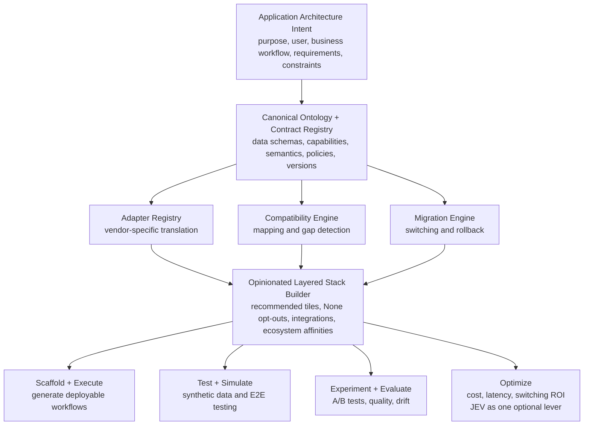

| Capability | What it does | Where in this PRD | Built in demo-opus.001 | Phase |
| --- | --- | --- | --- | --- |
| Application Architecture Intent | Captures purpose, user, workflow, requirements and constraints; drafts the PRD | 6, 7 (FR-ONB), FR-DMO-1..3, 39 | Yes: 4-question wizard, profile, PRD screen | P0 |
| Canonical Ontology + Contract Registry | Typed contracts, semantic tags (units, data classes), capability profiles, policies, versions | 12, 13.4 | Partly: Pydantic contracts with x-aistack tags and versions; ontology service not built | P0 (contracts), P1 (shared registry service) |
| Adapter Registry | Ports and vendor adapters with declared capabilities | 13 | Yes: model adapters (Anthropic, OpenAI, offline), 8 typed tools with drift check | P0 |
| Compatibility Engine | Maps contracts and detects syntactic, semantic and behavioural gaps; issues verdicts | 14 | Yes: five verdicts from evidence | P0 |
| Migration Engine | Switching, staged rollout and rollback | 14.5, 23.2 | Partly: manifest rollback, model/deployment switch, enablement plan; no shadow or canary | P0 (switch, rollback), P1 (staged rollout), P2 (verified migrations) |
| Opinionated Layered Stack Builder | Recommended tiles, None opt-outs, integrations, ecosystem affinities | 9, 17 | Yes: layer table with None states, Investigate Alternatives, Compare (affinity lines not drawn yet) | P0 |
| Scaffold + Execute | Generates deployable apps and workflows | 16 | Yes: generated zip with contracts, tools, guard, API, tests, PRD | P0 |
| Test + Simulate | Synthetic data and end-to-end tests | 18 | Yes: 10-case suite, synthetic test runner; simulated environments not built | P0 (offline), P1 (simulated environments) |
| Experiment + Evaluate | A/B tests, quality, drift | 18, FR-DMO-38 | Partly: offline A/B across models, Eval Quality dashboard, tool drift; no online A/B or behavioural drift | P0 (offline), P1 (online A/B, shadow), P2 (continuous drift) |
| Optimize | Cost, latency and switching ROI; JEV used only where a decision model pays off | 15 | Partly: cost per success, model compare, cascade suggestion; JEV evaluated, not integrated | P0 (cost model), P1 (JEV DecisionModel port) |

**Naming note.** The capability is called **Optimize** rather than "JEV Optimize". JEV is one optional lever under it, consistent with critical decision D10 and section 15.4: for Fusion Fuel a decision model saves about 2 dollars a month, so it stays off.

### Progressive architecture: what the user sees

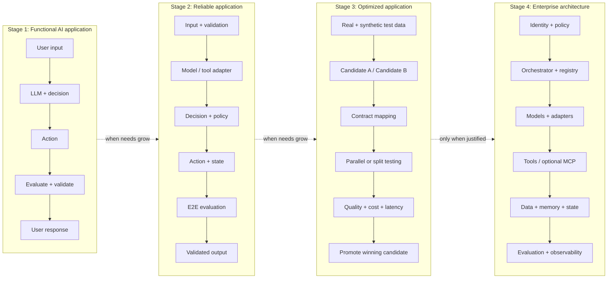

| Stage | Goal | What gets added | Move to it when | Platform capabilities used | Fusion Fuel today |
| --- | --- | --- | --- | --- | --- |
| 1. Functional AI application | A simple, understandable loop | Pydantic contracts wrap the input, model output and action boundaries. An action can be as simple as producing a recipe; external tools are not required. | Always the starting point | Intent, Contract Registry, Stack Builder (None opt-outs), Scaffold + Execute | Done: guard, model, nutrition tool, validated recipe card |
| 2. Reliable application | Safeguards and predictable execution | Schema checks, typed adapters, timeouts, retries, idempotency where relevant, structured errors, cost and trace instrumentation | Real users, external calls or side effects, or any SLA | Adapter Registry, Test + Simulate, Optimize (cost model), enterprise readiness checks | In progress: typed adapters, timeouts, retries, structured errors and eval gates are in place; idempotency store, tracing export and sign-in are open |
| 3. Optimized application | Better performance through experimentation | Model switching, differential tests, shadow testing, A/B experiments, drift tracking, rollout gates, cost optimization (JEV where it pays) | Cost or quality pressure, a second provider, or meaningful volume | Compatibility Engine, Migration Engine, Experiment + Evaluate, Optimize | Offline only: A/B across 3 models with verdicts and cost per success; no shadow, online A/B or rollout gates yet |
| 4. Enterprise architecture | Expand only when requirements justify it | Durable orchestration, fine-grained authorization, auditability, versioned registries, simulated environments, rollback and governance, as required | Multiple teams, regulated or health data, multi-agent workflows, enterprise SLAs | All capabilities plus GRC, agent and tool registries, enterprise readiness enablement | Assessed, not enforced: registries, GRC tab and readiness report exist; orchestration is correctly None |

### How the platform develops to take an app through the stages

The platform's roadmap follows the stages, so each release lets an app go one stage further.

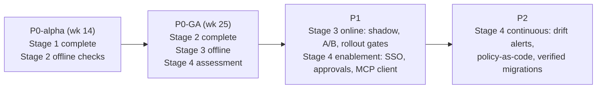

| Release | Stages it supports | Capabilities that must be ready |
| --- | --- | --- |
| P0-alpha (about week 14 with Claude implementing) | Stage 1 fully; Stage 2 checks offline | Intent, contracts, two model adapters, stack builder, scaffold, eval harness, cost model |
| P0-GA (about week 25) | Stage 2 fully; Stage 3 offline (A/B, verdicts, cost); Stage 4 assessment (GRC, readiness, registries) | Compatibility engine, synthetic runner, Eval Quality, GRC, persisted audit, sign-in in generated apps, verified nutrition data |
| P1 | Stage 3 online; Stage 4 enablement | Migration engine (shadow, canary, rollback gates), online A/B, JEV DecisionModel port, SSO/SCIM, approvals, MCP client, shared contract registry |
| P2 | Stage 4 continuous | Behavioural drift alerts, policy-as-code in CI, verified migrations, durable orchestration templates |

**Stage requirements (P0 MVP)**

| ID | Requirement | Acceptance criterion |
| --- | --- | --- |
| FR-STG-1 | Show each app's current stage | Computed from the manifest and evidence, using the checks in the enterprise readiness report. Fusion Fuel shows "Stage 2 in progress". |
| FR-STG-2 | Show what is needed to reach the next stage | Lists the open items for the next stage only (e.g. idempotency store, tracing export, sign-in), each linking to its recommendation |
| FR-STG-3 | Never force a stage | Advancing is opt-in and requirement-driven. Layers that the next stage would add stay None until a requirement justifies them, consistent with the None-by-default rule (FR-REC-3). |

Backlog: E15-29 Stage indicator and next-stage checklist (3d). This brings E15 to 96 engineer-days; the effect on the P0 totals in section 25 is under 1 calendar week.

## 1. Executive thesis and investment case

**Thesis.** AI application stacks now cross 8–15 vendor categories, and both prices and products change monthly. Teams lack a single desired-state record of their AI architecture that says what each component is, why it was chosen, what contract it honours, what it costs and what evidence shows a replacement is safe. AiStackE2E provides that record, the Architecture Manifest, and builds two experiences on it: generating a new app (Builder Mode) and assessing an existing one (Architect Mode).

**Why now (evidence, not assertion).**

- Vendor churn is real and recent. Langfuse was acquired by ClickHouse (Jan 2026), Helicone by Mintlify, now in maintenance mode (Mar 2026), and Promptfoo by OpenAI (Mar 2026). Hugging Face TGI went into maintenance mode, and Meta's Manus acquisition came under Chinese regulatory review. Each event forces some team to substitute a component.
- Prices vary by about 100x within a single vendor. Claude Haiku 5.5 lists at $0.10/$0.50 per million input/output tokens and Fable 5.1 at $10/$50 ([Claude pricing](https://claude.com/pricing)). OpenAI's gpt-6-luna and gpt-6-astra show the same spread ([OpenAI pricing](https://developers.openai.com/api/docs/pricing)). Choosing the right tier per task is worth more than most infrastructure tuning.
- Protocols are consolidating under neutral governance. MCP moved to the Linux Foundation's Agentic AI Foundation (Dec 2025) and A2A to the Linux Foundation (Jun 2025). That makes typed boundaries worth standardising on.

**Investment case (hypotheses to validate, not facts).**

| Hypothesis | Validation signal by end of P0 + 90 days |
| --- | --- |
| H1: Developers will adopt a free tool that turns an idea into a runnable, typed, tested Python AI app faster than templates or app builders | ≥ 1,500 projects created, ≥ 35% reach a passing `aistack test` run, week-4 retention ≥ 20% |
| H2: The manifest plus evidence is the reason they stay, more than generation | ≥ 40% of retained projects record a second manifest version (a component change) |
| H3: Enterprises will pay for evidence-backed provider substitution and cost visibility on existing repos | 10 design partners import a repo; 3 sign paid pilots ≥ $25k |
| H4: The cost-per-successful-task view changes decisions | ≥ 25% of projects that view a cost comparison change a model tier |

**What we are not claiming.** We do not claim universal portability, guaranteed savings or certified compliance. Every savings figure in the product is an estimate with a range and a source.

## 2. Problem definition and competitive landscape

**The problem has four parts, and each is observable in customer interviews (to be validated in M1):**

1. **Selection paralysis.** A builder starting a RAG app faces roughly 6 frameworks, 7 vector stores, 5 memory layers and 4 gateways, with no way to tell which layers are needed at all.
2. **Implicit architecture.** In existing repos the architecture lives in import statements and environment variables. Nobody can answer "what would break if we left provider X?"
3. **Unsafe substitution.** Teams swap models by changing a string and find regressions in production. Schema compatibility gets mistaken for behavioural equivalence.
4. **Invisible unit economics.** Teams know their monthly invoice but not cost per successful task, so they cannot trade quality against cost.

**Competitive landscape.** No surveyed product combines manifest-centred desired state, typed contracts, compatibility evidence and cost per successful task. Each adjacent category covers one slice. A search for "AI architecture generator" products in October 2026 found no direct competitor. Treat that as a gap in search coverage, not proof of an empty market.

| Category | Examples | What they do well | What they leave open | Threat level |
| --- | --- | --- | --- | --- |
| AI app builders | Lovable, Bolt, v0, Replit | Idea to deployed UI in minutes | Architecture rationale, provider contracts, substitution evidence, Python backends | High for Builder Mode. They could add a stack panel. |
| Coding agents | Claude Code, Cursor, Codex | Write and modify any code | No persistent desired-state model; no compatibility verdicts | High. We must integrate with them, not compete (the manifest is their input). |
| Framework scaffolds | LangGraph templates, create-llama, Mastra, PydanticAI examples | Idiomatic starting points | Locked to one framework; no cost or alternative comparison | Medium |
| AI gateways | LiteLLM, Portkey, OpenRouter, TrueFoundry, Bifrost | Runtime routing, keys, budgets, fallbacks | Swap at the API level without semantic or behavioural evidence; runtime only | Medium. They are also catalog components we recommend. |
| Observability and evals | LangSmith, Braintrust, Langfuse, Arize, Fiddler | Traces, datasets, experiments | Tell you what happened, not what the architecture should be | Medium. They are integration partners and evidence sources. |
| Enterprise architecture tools | LeanIX (SAP), Ardoq, Structurizr, IcePanel, Backstage | Inventories, C4 diagrams, ownership | Not AI-aware; no contracts, evals or token economics | Low now, high in P2 |
| AI governance | IBM watsonx.governance, Credo AI, Cisco AI Defense | Model risk registers, policy, red teaming | Not developer-first; do not generate or test apps | Low for P0, partner in P2 |
| Cloud FinOps | Vantage, CloudZero | Cloud and LLM spend allocation | Backward-looking; no quality-adjusted alternatives | Low |

**Defensibility (honest view).** Generation is not a moat. The defensible assets compound with use: (1) a capability registry with measured evidence per component pair, (2) a manifest that becomes the system of record in CI, and (3) a corpus of anonymised, opt-in substitution outcomes. Coding agents are the largest risk. The mitigation is to make the manifest and CLI the thing coding agents read and update, through an agent skill and a read-only MCP server (P1).

## 3. Personas, jobs and adoption model

| Persona | Context | Primary job to be done | Success looks like | Mode |
| --- | --- | --- | --- | --- |
| **Maya, indie AI builder** | Solo or two-person team, Python-comfortable, ships weekend projects | "Get me from an idea to a working, sensible app without researching 40 vendors." | Runnable repo with tests in < 15 min; knows why each piece is there | Builder |
| **Dev, startup engineer** | Seed–Series B, owns the AI feature, cost-pressured | "Tell me what my AI feature costs per successful task and whether a cheaper model is safe." | A provider swap with an eval report he can show his CTO | Builder, later Architect |
| **Priya, platform engineer** | Enterprise, supports 10–50 internal AI apps | "Give every team a paved road with typed contracts, secrets hygiene and tracing by default." | Org templates and policy packs adopted by teams | Architect |
| **Arjun, enterprise architect or CTO** | Owns the AI portfolio, reports to the CFO and CISO | "Show me what we run, what it costs, where we are locked in, and a safe plan to change it." | Portfolio assessment and migration plan with evidence | Architect |
| **Lena, security or GRC lead** | Approves vendors and data flows | "Prove where data goes and who approved the change." | Audit trail, data-classification map and approval records | Architect (reviewer) |

**Adoption model: product-led bottom-up, with sales-assisted expansion.**

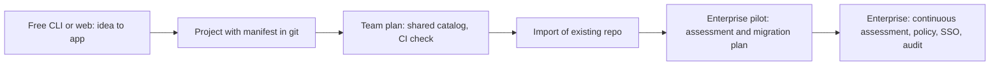

The wedge is Maya and Dev. They put `aistack.yaml` into repos, and that file gives Priya and Arjun a reason to adopt the platform. Enterprise motions start where a manifest already exists, or with a paid repo assessment (section 26).

## 4. Positioning and differentiation

**Positioning statement.** For builders and architects of AI applications, AiStackE2E is the architecture system of record. It recommends the simplest viable stack, explains each choice, enforces typed contracts and proves with evidence whether a component can be replaced. Unlike app builders, it explains and versions the architecture. Unlike gateways, it tests semantic and behavioural compatibility, not just API shape. Unlike observability tools, it models the desired state and its economics before anything runs.

**Messaging by audience.**

| Audience | Headline | Proof point we must be able to show |
| --- | --- | --- |
| Builders | "Start with what you want to build. Get a working, explained, tested app." | 3 templates generate, install and pass tests in CI on every release |
| Enterprise | "Know what you run, what it costs per outcome, and what is safe to change." | An imported repo yields an inferred manifest with confidence labels and a substitution report |

**Five differentiators, each tied to a capability that can be tested:**

1. **Simplest viable architecture.** Every layer can be None or Managed, and the recommender has to justify adding one (FR-REC-3).
2. **Explained decisions.** Every selection has a rationale, alternatives and the requirement that drove it (FR-REC-4).
3. **Contracts with semantics.** Field meaning, data classification, idempotency and failure modes go beyond types (section 12).
4. **Evidence-graded compatibility.** Five verdicts, three dimensions, and every claim links to a test run (section 14).
5. **Cost per successful task.** Quality-adjusted economics with ranges and price provenance (section 15).

**Language we avoid:** "vendor-neutral" without qualification, "plug-and-play", "any provider", "guaranteed savings". We say "replaceable where verified".

## 5. Principles and non-goals

**Product principles**

1. **Least architecture first.** Start at Input → Model → Result and add a layer only when a stated requirement needs it. The rationale names that requirement.
2. **Progressive disclosure.** Three questions to start. Further questions appear only when the answer would change a decision (section 6).
3. **Explain or omit.** Show no recommendation without a rationale, and no number without a source and a range.
4. **Evidence over assertion.** A compatibility verdict without a linked test run is labelled **unverified**.
5. **You own the output.** Generated code has no runtime dependency on AiStackE2E and carries an Apache-2.0 licence by default.
6. **One domain, two modes.** Builder and Architect Modes read and write the same manifest, contracts, registry and evidence. No mode-specific data model is allowed.
7. **Typed boundaries everywhere, protocols only where they pay.**
8. **Safe by default.** Generated apps keep secrets out of code, carry trace IDs and set timeouts from the first commit.

**Engineering principles:** a modular monolith with enforced import boundaries (import-linter in CI); Postgres first; idempotent jobs; every external call behind an adapter with a timeout; every domain event in an append-only audit log.

**Non-goals (P0 and P1 unless stated)**

| Non-goal | Reason | Revisit |
| --- | --- | --- |
| Hosting or proxying customers' production AI traffic | Keeps us out of the data path and avoids gateway competition | Never as core. A partner gateway can be recommended. |
| Universal automatic migration | Behavioural equivalence cannot be guaranteed | P2, limited to verified pairs with human approval |
| Multi-agent orchestration templates | Rarely the simplest viable architecture; costly to test | P1 at the earliest, behind evidence of demand |
| Languages beyond Python for generated apps | Focus | TypeScript in P2 if H1 holds |
| Infrastructure provisioning (Terraform, Kubernetes) | Complex, and crowded with existing tools | P2: emit deploy descriptors only |
| Model training, fine-tuning or GPU serving operations | Different product | Catalog entries only (vLLM, SGLang) |
| Compliance certification of customer apps | We provide evidence, not attestations | Never |
| Medical, legal or financial advice in example apps | Safety | Never. Example apps carry scoped disclaimers. |

## 6. Builder and Architect Mode journeys

Both journeys converge on the same objects: a manifest version, contracts, evidence and a cost model. They differ only in where the first manifest comes from.

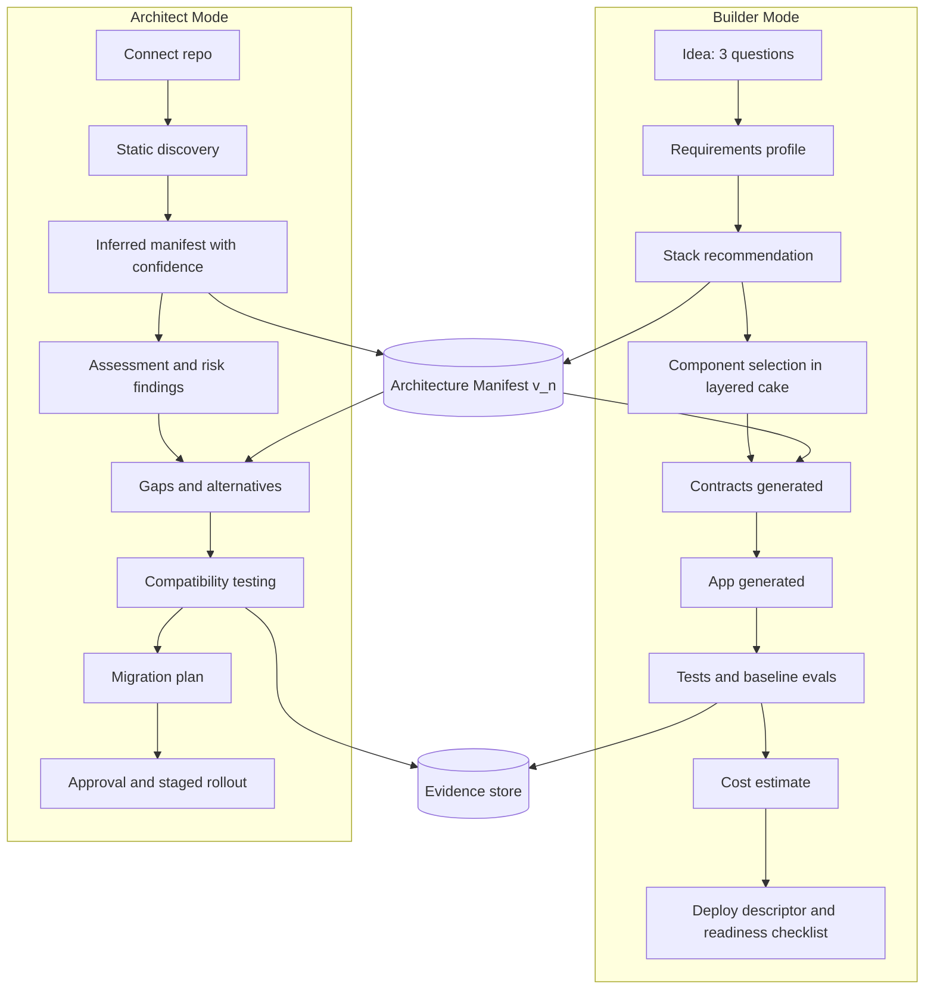

### Builder Mode, step by step

| Step | User sees | System does | Output object | P0? |
| --- | --- | --- | --- | --- |
| 1. Three questions | "What do you want to build? Who is it for? What should it accomplish?" | Extracts a requirements profile with an LLM using structured output, then validates it with Pydantic | `RequirementsProfile` | Yes |
| 2. Conditional questions | 0–5 follow-ups, each labelled with the decision it affects | Asks only when the information gain on a decision exceeds a threshold (section 7, FR-ONB-3) | Updated profile | Yes |
| 3. Recommendation | Layered cake with defaults, None states and the inferred assumptions listed | Rules engine plus template match; LLM writes the rationale text only | Manifest v1 (draft) | Yes |
| 4. Component selection | Comparison modal per layer | Recomputes compatibility and cost on each change | Manifest v1.x | Yes |
| 5. Contracts | Typed models per boundary | Generates JSON Schema and Pydantic from the catalog and template | Contract set | Yes |
| 6. Generate | File tree preview and download, or a GitHub push | Application Factory renders the template | Repo bundle | Yes |
| 7. Test and evaluate | Pass/fail plus baseline eval scores | Runs in a sandboxed worker with the user's own keys (BYOK) | Evidence records | Yes |
| 8. Cost | Per-task and monthly ranges across three volume scenarios | Cost engine | Cost model | Yes |
| 9. Deploy | Readiness checklist plus Dockerfile or Fly/Render/Cloud Run descriptor | Emits a descriptor; we do not deploy for the user at P0 | Readiness report | Descriptor only |

### Architect Mode, step by step

| Step | User sees | System does | P0 | P1 | P2 |
| --- | --- | --- | --- | --- | --- |
| Connect | Read-only GitHub App install or zip upload | Clones into an ephemeral, network-isolated worker | Yes | GitLab, Bitbucket | Self-hosted runner |
| Discovery | Progress plus file counts | Parses lockfiles, imports, env-var names and config | Python only | Runtime traces (OTel) | Continuous |
| Inferred manifest | Layered cake with a confidence chip per tile | Maps signals to catalog components | Yes | Yes | Yes |
| Assessment | Findings by severity | Rule packs: secrets, timeouts, retries, typed boundaries, tracing | Baseline pack | Enterprise packs | Custom policy |
| Alternatives | Ranked options per layer | Recommender in assessment mode | Preliminary | Cost-compared with runtime data | Automated proposals |
| Compatibility testing | Verdict matrix | Contract, eval, latency and cost tests | Not available | Yes | Continuous |
| Migration plan | Phased plan with rollback | Planner | Not available | Yes | Verified migrations |
| Approval and rollout | Approvals, flags, canary | Workflow plus audit log | Not available | Approvals | Policy-enforced |

## 7. Functional requirements with acceptance criteria

Every requirement below has an ID, a phase and a test that decides pass or fail. "Golden set" means the versioned set of 60 onboarding prompts (20 per template) kept in `tests/golden/onboarding/`.

### Onboarding and recommendation (REC)

| ID | Requirement | Acceptance criterion | Phase |
| --- | --- | --- | --- |
| FR-ONB-1 | Start a project from three free-text answers | Each answer accepts 1–2,000 characters. A `RequirementsProfile` is produced in p95 ≤ 8 s. | P0 |
| FR-ONB-2 | Every inferred default is shown with its source (`inferred`, `user`, `template`, `policy`) | 100% of profile fields carry a `source`. The UI shows the inferred ones in an "Assumptions" panel that can be edited. | P0 |
| FR-ONB-3 | A follow-up question is asked only if its answer changes at least one layer selection or a contract field | For each question the engine records the decisions it affects. On the golden set the median number of follow-ups is ≤ 3 and the maximum is 5. | P0 |
| FR-REC-1 | Recommend one of three templates plus layer selections | On the golden set the template matches the expert label in ≥ 90% of cases | P0 |
| FR-REC-2 | Recommendations are deterministic for the same profile and catalog version | The same input gives a byte-identical manifest, apart from timestamps and IDs | P0 |
| FR-REC-3 | Each layer starts as None or Managed unless a requirement justifies it | Every non-None selection lists at least one `driven_by` requirement ID. CI fails the build otherwise. | P0 |
| FR-REC-4 | Each selection has a rationale, two or more alternatives (where they exist in the catalog) and tradeoffs | Schema validation enforces it. Rationale text is ≤ 400 characters. | P0 |
| FR-REC-5 | Recommendations respect policy constraints (allowed providers, regions, data classes) | A policy that excludes provider X yields no selection of X. Tested in the policy unit tests. | P0 (basic) |

### Manifest (MAN)

| ID | Requirement | Acceptance criterion | Phase |
| --- | --- | --- | --- |
| FR-MAN-1 | The manifest validates against a published JSON Schema (`aistack.dev/schema/manifest/v1`) | `aistack validate` exits 0 on valid files and non-zero with JSON-pointer errors on invalid ones | P0 |
| FR-MAN-2 | Every save creates an immutable version with author, timestamp, parent and message | Versions cannot be updated (DB constraint). History is listable via the API. | P0 |
| FR-MAN-3 | Semantic diff between any two versions | Diff reports layer, component, contract and policy changes as typed operations, not text lines | P0 |
| FR-MAN-4 | Roll back to any prior version | Rollback creates a new version whose content equals the target. Audit records both. | P0 |
| FR-MAN-5 | Environment overrides (`dev`, `staging`, `prod`) | Resolved manifest = base deep-merged with the override. Overrides may change only allow-listed paths. | P0 |
| FR-MAN-6 | Schema migrations between manifest `schemaVersion`s | `aistack migrate` upgrades v1→v2 losslessly or lists the fields it could not migrate | P1 (framework at P0) |
| FR-MAN-7 | Provenance per field (`user`, `inferred`, `imported`, `policy`) with confidence for imported fields | Imported manifests carry a confidence for 100% of component entries | P0 |
| FR-MAN-8 | Manifest round-trips between git and the platform | Push then pull yields an identical file. Conflicts surface as a 3-way semantic merge. | P0 (push/pull), P1 (merge) |

### Contracts, catalog, adapters, compatibility (CON, CAT, ADP, CMP)

| ID | Requirement | Acceptance criterion | Phase |
| --- | --- | --- | --- |
| FR-CON-1 | Canonical contracts in JSON Schema 2020-12 with the `x-aistack` vocabulary | Meta-schema validation passes for all shipped contracts | P0 |
| FR-CON-2 | Pydantic v2 ↔ JSON Schema round-trip | For the 12 P0 contracts, Pydantic → schema → Pydantic preserves fields, types, constraints and `x-aistack` metadata (property test) | P0 |
| FR-CON-3 | Import TypedDict, dataclasses and annotated functions as draft contracts | 95% of the 40-case fixture suite converts. Unsupported constructs produce explicit warnings. | P0 |
| FR-CON-4 | Export to OpenAPI 3.1 components and MCP tool `inputSchema` | Output validates with openapi-spec-validator and the MCP schema | P0 (OpenAPI), P1 (MCP) |
| FR-CON-5 | Contract compatibility check between versions (backward, forward, breaking) | 30 fixture pairs are classified correctly | P0 |
| FR-CAT-1 | Catalog of components with capability profiles, versioned and dated | Each entry has `verified_at` and `source_urls`. Entries older than 90 days show as stale. | P0 (about 40 entries) |
| FR-ADP-1 | Model adapters for 2 providers (Anthropic, OpenAI) implementing `ChatModel` | The contract test suite passes against live APIs nightly | P0 |
| FR-ADP-2 | Each adapter declares capabilities (tools, streaming, JSON mode, vision, max context) | Declared capabilities are checked by capability probes nightly. A mismatch opens an alert. | P0 |
| FR-CMP-1 | Compatibility verdict per component pair on three dimensions | Verdict is one of five values with linked evidence IDs, or `unverified` | P0 |
| FR-CMP-2 | One fully evidenced provider swap (Anthropic ↔ OpenAI on the RAG template) | Report includes contract tests, eval delta with CI, p50/p95 latency and cost delta | P0 |

### Generation, evals, cost, brownfield, platform (GEN, EVL, CST, BRF, PLT)

| ID | Requirement | Acceptance criterion | Phase |
| --- | --- | --- | --- |
| FR-GEN-1 | Generate a runnable Python project for each of the 3 templates | On a clean Python 3.12 container, `uv sync && pytest` passes in ≤ 120 s with recorded fixtures (no live keys) | P0 |
| FR-GEN-2 | Generated code passes ruff, mypy --strict on `contracts/` and a secret scan | CI gate on the template repo | P0 |
| FR-GEN-3 | Regeneration preserves user edits outside generated regions | Files marked `# aistack: managed` are replaced. Others are diffed and never overwritten without `--force`. | P0 |
| FR-EVL-1 | Baseline eval suite per template (≥ 25 cases) with deterministic and LLM-judge metrics | Run produces scores with 95% bootstrap CIs stored as evidence | P0 |
| FR-EVL-2 | Synthetic test-case generation from the requirements profile | ≥ 20 cases generated. A human must accept them before they count as evidence. | P0 (basic) |
| FR-CST-1 | Cost per successful task and monthly cost for 3 scenarios, as ranges | Output includes low/expected/high, price catalog version and assumptions | P0 |
| FR-CST-2 | Separate marginal, fixed, migration and TCO components | All four appear in the API response. Unknown items show as `unknown`, never 0. | P0 (marginal plus fixed), P1 (migration, TCO) |
| FR-BRF-1 | Import a Python repo ≤ 200k LOC and produce an inferred manifest | On 15 labelled fixture repos, component recall ≥ 85% and precision ≥ 90% | P0 |
| FR-BRF-2 | Risk findings from the baseline rule pack (≥ 20 rules) | Each finding includes file, line, rule ID, severity and a fix suggestion | P0 |
| FR-PLT-1 | REST API covers every UI action | Contract tests against the OpenAPI spec. No UI-only endpoints. | P0 |
| FR-PLT-2 | CLI for init, validate, diff, generate, test, cost and import | Section 22 commands work end-to-end in CI | P0 |
| FR-PLT-3 | Audit log of every state change | 100% of mutating endpoints emit an audit event (enforced by middleware test) | P0 |

### 7.5 Requirements accepted from the demo design (demo-opus.001)

Every requirement below came out of the demo design sessions on 2026-10-08 and is P0 MVP scope, delivered by P0-GA. Where a later enhancement exists it is named as a P1 follow-on; the requirement itself stays P0. Each is implemented and tested in `demo-opus.001` (33 automated tests). They supersede conflicting statements elsewhere in this PRD. Items marked *sample* or *simulated* in the demo need real data sources before GA.

**Builder onboarding**

| ID | Requirement | Acceptance criterion | Phase |
| --- | --- | --- | --- |
| FR-DMO-1 | The three onboarding questions are asked one per screen, with Back and Next | Each screen shows one question, a progress indicator (1 of 3) and a live "Your app idea" summary of the answers so far | P0 MVP |
| FR-DMO-2 | Suggested answers are typed into the box visibly on first view | Text appears character by character over 1-2 s. Clicking, typing, Next or Enter completes it instantly; Back shows it at once. | P0 MVP |
| FR-DMO-3 | Finishing the questions builds and opens a working preview of the generated app | After "Build my app", a building state (under 3 s offline) is followed by the app preview with a first recipe | P0 MVP |
| FR-DMO-4 | Light, Google-apps-style visual theme | White surfaces, one blue primary colour, Roboto, pill buttons, WCAG 2.2 AA contrast | P0 MVP |

**Generated app preview (Fusion Fuel)**

| ID | Requirement | Acceptance criterion | Phase |
| --- | --- | --- | --- |
| FR-DMO-5 | Recipe shown with a real photo above the recipe card | The photo is the closest match from a CC-licensed or public-domain library, captioned "similar dish" with title, author and licence links. True per-recipe image generation is P1, behind an ImageModel port. | P0 MVP (library photos); generated images are a P1 follow-on |
| FR-DMO-6 | Left panel of tunable tiles with a visible on/off state | Organic and Budget friendly are toggle tiles with a switch and On/Off text, both off by default. Tapping one re-runs the recipe. | P0 MVP |
| FR-DMO-7 | "Enter ingredients available" box shapes the recipe | Listed ingredients the table knows are used where they fit and marked "have". Unknown ones are reported, not silently dropped. | P0 MVP |
| FR-DMO-8 | Nutrition goal tiles replace the carb slider: Balanced, High protein, Keto (high protein + fat), High fiber, Low sodium | Multi-select, with Balanced exclusive. Targets: High protein ≥ 35 g protein; Keto ≤ 25 g carbs with ≥ 30 g protein and ≥ 30 g fat; High fiber ≥ 10 g; Low sodium ≤ 600 mg. The carb target follows the goals (45/40/20 g). Each goal shows ✓ or ! with actual values on the card. | P0 MVP |
| FR-DMO-9 | Keto shows a care-team note for type 1 diabetes | Selecting Keto shows "Very low-carb eating with type 1 diabetes should be planned with your care team" | P0 MVP |
| FR-DMO-10 | "Nutrients per meal" panel on every recipe | Carbs, protein, fat, sodium (mg) and fiber with % Daily Value (FDA reference amounts, 2,000 kcal) and calories. Sodium above 35% DV is flagged, or above 20% when low sodium is selected. | P0 MVP |
| FR-DMO-11 | The nutrition tool meets goal minimums deterministically | Protein and fat sources are scaled up (bounded portions) and olive oil is added for keto only if needed, then carbs are re-balanced. All five goal sets pass in tests. | P0 MVP |
| FR-DMO-12 | "+ Add health condition or restriction" under Find recipe | Adds removable rows: celiac/gluten-free, dairy-free, nut allergy, shellfish allergy, low sodium, vegetarian, vegan. Each maps to ingredient exclusions and appears as a tag. | P0 MVP |
| FR-DMO-13 | Store price link on one ingredient by default | With budget mode off, the costliest ingredient shows a "Whole Foods $x.xx" link to the store's search page, and an estimated Whole Foods total is shown | P0 MVP (sample prices); live prices are a P1 follow-on |
| FR-DMO-14 | Budget friendly mode shows visible budget options and savings | Premium items are swapped automatically, with the swap and saving listed. The panel shows Walmart vs Whole Foods totals and the saving, plus cheaper same-role options with saving, carb change and a tiny Walmart link. Every ingredient shows small Whole Foods and Walmart links. "Use these options" rebuilds the recipe with the swaps. | P0 MVP (sample prices) |
| FR-DMO-15 | Toggling a preference changes only the affected ingredients | Turning on budget mode removes only premium items (test-enforced); the rest of the recipe stays stable | P0 MVP |

**Production deployment analysis ("Analyze in prod deployment")**

| ID | Requirement | Acceptance criterion | Phase |
| --- | --- | --- | --- |
| FR-DMO-16 | A button on the app preview opens the production analysis | "Analyze in prod deployment" opens the layer-by-layer view; "Back to app" returns with state kept | P0 MVP |
| FR-DMO-17 | "Only the questions that change a decision" is renamed "Enhancements to consider" | The card holds Q4 and Q5 as Yes/No toggles that re-compute the layers | P0 MVP |
| FR-DMO-18 | Free-text enhancement prompt with "Generate product requirement updates for this enhancement" | Produces a PRD delta: new requirement IDs after the current ones, layer changes, contract changes with versions, acceptance criteria, risks and cost impact, plus Copy as Markdown. Drafted by Claude when a key is set, otherwise by keyword rules, and a badge always says which. | P0 MVP |
| FR-DMO-19 | "Runs on" deployment choice per layer | Each selected layer has a dropdown of deployment options with a one-line note, stored as `layers.<key>.deployment` in the manifest and the generated zip. Platform-hosted model options show a pricing-differs warning. | P0 MVP |
| FR-DMO-20 | "Eval & Quality" column per layer | Shows pass/warn status from evidence (e.g. 8/8 recipes pass all gates, carbs within ±5 g 8/8, dosing refused 2/2), a simulated tag when relevant, and a link to the eval cases. Layers without evals say so. | P0 MVP |
| FR-DMO-21 | Guardrails become a per-layer column instead of a layer row | Each layer shows a count and a "Review" link to a modal of guardrail bullets. Each bullet links to the exact line of code or data that implements it and is labelled enforced, prompt, declared or review. | P0 MVP |
| FR-DMO-22 | Agent registry layer | A layer listing every agent and tool with kind, scope, model, role, skills, capabilities, data, side effects and guardrails. "Why" opens a modal of the entries (8 today, 2 LLM-backed). Stored as `agents` in the manifest. Default deployment is inventory in `aistack.yaml`; Backstage or a registry service at about 10+ agents. | P0 MVP |
| FR-DMO-23 | Read-only source viewer for guardrail links | `/source/<file>#L<n>` renders a whitelisted file with line anchors and highlights the target line. Every guardrail link resolves to a line (test-enforced). | P0 MVP |

**Honesty and demo operations**

| ID | Requirement | Acceptance criterion | Phase |
| --- | --- | --- | --- |
| FR-DMO-24 | Simulated, sample and mock content is always labelled | Offline model output, sample prices, library photos and the Architect mock each carry a visible label. Simulated and measured evidence are never compared (verdict `unverified`). | P0 MVP |
| FR-DMO-25 | Rehearsal deep links | `?autorun=app`, `?autorun=prod` or `?autorun=modal`, plus `goals`, `budget`, `restrict`, `review`, `agents`, `tools`, `enhance`, `tab`, `focus`, `step` and `prd` parameters, jump to a demo state | P0 MVP (demo mode) |

**Added after the first acceptance pass**

| ID | Requirement | Acceptance criterion | Phase |
| --- | --- | --- | --- |
| FR-DMO-26 | "Security" column per layer with a Review modal | Five checks per selected layer: Authentication, Authorization, Zero trust, Continuous evaluation, Zero-trust isolation. Each shows ✓ green (in place), ! orange (partial or not configured), ✕ red (missing) or – (not applicable). Isolation shows a level: High (✓), Medium or Low. The modal lists the finding (linked to code where it exists) and what is needed to reach green. Scores reflect what the build does today, change with deployment choice (e.g. self-hosted observability raises isolation to High), and with Q4: storing glucose makes missing sign-in a red ✕. | P0 MVP |

The current demo build scores itself honestly. The generated API has no sign-in or per-user authorization (✕ on authorization), and most managed layers show Medium isolation. These are P0-GA hardening items, tracked as backlog E15-12 (3d).

| ID | Requirement | Acceptance criterion | Phase |
| --- | --- | --- | --- |
| FR-DMO-27 | "Tooling" layer covering tool invocation, tool parameters and drift, and external tools via MCP and adapters | Lists every tool (8 today, all typed in-process adapters, all invoked by the pipeline, never chosen by the model) with role, parameter schema and a schema hash. Drift is detected when a hash differs from `data/tool_registry.yaml`, which changes only through an explicit re-register (test-enforced). Every run logs each tool call with parameters and duration, shown in the Tooling modal. External tools via MCP show as none connected, with P1 candidates (grocery cart, CGM partner). The layer gets Eval & Quality (schemas match 8/8), Guardrails and Security entries. Choosing MCP or a managed tool platform turns authentication and zero trust orange and isolation Medium. | P0 MVP; MCP client is a P1 follow-on |

Backlog: E15-13 Tooling layer, drift registry and invocation log (3d).

| ID | Requirement | Acceptance criterion | Phase |
| --- | --- | --- | --- |
| FR-DMO-28 | "Privacy & governance" tab on the production screen, beside Architecture | **Data map:** every RecipeRequest field with its data class from the contract tags (carb target, exclusions, restrictions and goals are `health`; note is `confidential`), where it flows, whether it is stored, and whether it is kept from the model (the note and request ID are). Glucose readings appear only when Q4 = Yes. **Third-party processors:** derived from the "Runs on" choices, showing what each receives, DPA status and region. **Privacy checks (9)** and **governance checks (9)** use the same ✓ / ! / ✕ scoring and links to code. **Framework mapping:** NIST AI RMF Govern / Map / Measure / Manage and ISO/IEC 42001, labelled evidence mapping, not certification. **Audit log** of this session's changes (manifest created, model selected, Q4/Q5 answered, deployment changed, eval run, app generated, enhancement drafted). | P0 MVP, incl. persisted hash-chained audit (FR-PLT-3) |

Current self-score: privacy 2 ✓ / 5 ! / 2 ✕ (no consent notice, no user-rights flows); governance 4 ✓ / 5 ! / 0 ✕. Backlog: E15-14 Privacy & governance tab (4d). Consent and privacy notice are P0 MVP; self-serve export and delete follow in P1.

| ID | Requirement | Acceptance criterion | Phase |
| --- | --- | --- | --- |
| FR-DMO-29 | "Compare" link under every "Runs on" dropdown | Opens a table with one column per deployment choice and the selected one highlighted. Rows are grouped **Cost** (relative cost tier, cost model), **Capability** (capability, best for), **Performance** (performance, scaling), then **Operations & risk** (operated by, where data lives, ops effort, lock-in). "Use this" switches the deployment. Every option has a value in every row (test-enforced). Cost tiers (`$`, `$$`, `$$$`) are indicative, not quotes. | P0 MVP |
| FR-DMO-30 | All comparisons use cost, capability and performance | Compare models is also grouped Cost (list price, cost per successful recipe, monthly), Capability (task success, schema / exclusions / dosing checks, model carb accuracy, features), Performance (latency p50 / p95), then Compatibility. | P0 MVP |
| FR-DMO-31 | "Provenance & Audit" column per layer | Shows where the selection came from (inferred, user, or a decision such as Q4), changes this session and catalog version. "Audit" opens what backs it (price list URL, recommender rule, evidence ID), the requirements that drove it, and the layer's change history from the audit log. | P0 MVP, incl. persisted history |
| FR-DMO-32 | Retrieval becomes the **Knowledge** layer, with domain, data processing and cleanup | The modal shows the domain (fusion recipes for an active person managing diabetes); sources with record counts and owners (10 patterns, 62 nutrition rows, 62 price rows, 11 photos); the 8-step pipeline (ingest, clean, normalise units, safety screen, licence screen, tag, index, refresh); and 9 cleanup checks that run on every analysis (7 pass; nutrition values unverified; no retrieval recall eval yet). Eval & Quality shows "data checks 7/9 pass". | P0 MVP |

Backlog: E15-15 Compare tables (3d), E15-16 Provenance & Audit column (2d), E15-17 Knowledge pipeline and cleanup checks (3d).

| ID | Requirement | Acceptance criterion | Phase |
| --- | --- | --- | --- |
| FR-DMO-33 | Fourth wizard question, "Additional experience, tips or guidance", **for the demo experience only** | Shown as question 4 of 4 with a "For the demo experience" label. The suggested text describing the screens to generate (photo and recipe card, tunable tiles, ingredients box, extra restrictions) is typed slowly, over about 6 s, and the summary shows it as "Tips (demo)". Recognised hints are recorded in the profile as `ux_guidance` (source: user). It does not change the product's three-question onboarding (FR-ONB-1). | P0 MVP (demo mode) |

| ID | Requirement | Acceptance criterion | Phase |
| --- | --- | --- | --- |
| FR-DMO-34 | Enterprise readiness one-liner and "Enterprise readiness review report" on the production screen | The screen opens with: "For enterprise-grade quality, resiliency, durability, governance and security at scale - keeping cost sensitivity in perspective - here are the attributes we need to establish or strengthen." The report scores all 17 section 21 capabilities plus cost controls (18 rows), each tagged with its pillars and rated **green, mustard, orange or red** against what the build does today. It shows a readiness % (current build: 50%; 2 green, 6 mustard, 9 orange, 1 red) and, per row, what is in place (linked to code), the gap, and "Review & enable select recommendations". That link expands a checkbox list of 1-4 recommendations, each with effort, cost note and phase. "Enable selected" saves them to `enterprise.plan` in the manifest and the generated zip and writes an audit event; "Copy plan as Markdown" exports them. Enabling plans the work; it does not change scores (test-enforced). | P0 MVP |

Backlog: E15-18 Enterprise readiness report and enablement plan (4d).

| ID | Requirement | Acceptance criterion | Phase |
| --- | --- | --- | --- |
| FR-DMO-35 | One "Enhancements" button opens a separate modal | The Architecture tab shows only the enterprise one-liner and two buttons (Enterprise readiness review report, Enhancements) above the layer table. Q4, Q5, the enhancement text box and "Generate product requirement updates" live in the Enhancements modal (supersedes the card in FR-DMO-17/18). | P0 MVP |
| FR-DMO-36 | Nutrition tool is a sub-layer of Tooling | Rendered directly under Tooling, indented with ↳ and a "sub-layer of Tooling" tag; recorded as `parent: tooling` (test-enforced) | P0 MVP |
| FR-DMO-37 | "Runs on" column renamed "Investigate Alternatives" | The column holds the alternatives dropdown and the Compare link. The current choice's characteristics ("Runs on X: note") move under the **Current default component** column. | P0 MVP |
| FR-DMO-38 | Dedicated **Eval Quality** tab (Architecture · Eval Quality · Privacy & governance), inspired by promptfoo's eval view | **Header:** suite, run IDs, author, a simulated-evidence label, Display filter (all / failures / passes / errors), regex search and "Run all evals". **Charts:** pass rate by model, score distribution per case, and a per-case baseline-vs-candidate scatter (green = better, red = worse). **Sub-tabs:** *Results* — a grid of cases by models with per-model header stats (pass %, asserts passed, total cost, total and average tokens, average latency, tokens/sec) and PASS/FAIL/ERROR cells with the failure reason, score, carbs and latency; *Dataset review* — KPIs (10 cases vs 25 needed, task vs safety, exclusions, cuisine coverage), carb-target and activity distributions, dataset issues, case table and source file; *Assertions* — each deterministic check with threshold and per-model pass rate; *History* — runs with evidence status. "eval dashboard" links in the Eval & Quality column open this tab. | P0 MVP |

Backlog: E15-19 Enhancements modal and table restructure (2d), E15-20 Eval Quality dashboard (5d).

| ID | Requirement | Acceptance criterion | Phase |
| --- | --- | --- | --- |
| FR-DMO-39 | PRD screen between the questions and the app | Question 4's button reads "Next" and opens a fifth screen, which types a PRD drafted from the answers into a text window over about 9 s. Sections: Product, Problem statement, Target customer, Goal, Job to be done, MVP scope, Out of scope, Requirements (R1-R5), Success metrics, Constraints and safety, and Experience guidance (demo). The draft is editable; "Show all" completes it at once. "Generate application and contracts" builds the app, and the edited PRD is saved into the generated zip as `docs/PRD.md` (test-enforced). | P0 MVP |

| ID | Requirement | Acceptance criterion | Phase |
| --- | --- | --- | --- |
| FR-DMO-40 | Focus tiles in the enterprise readiness report | Six selectable tiles: **Security, Governance, Scalability, High availability, Resiliency, Quality**. With none selected, every capability shows. With one or more selected, only capabilities tagged with those pillars show, and the readiness %, colour counts and "Showing N of 20" update for the selection. Two capabilities are added so every tile has substance: **Capacity and autoscaling** (Scalability, Cost) and **Availability and failover** (High availability, Resiliency). Pillar tags are extended, and each of Scalability and High availability covers at least 4 capabilities (test-enforced). The report now has 20 rows (updates FR-DMO-34). Plan selections outside the current filter are kept when enabling. | P0 MVP |

| ID | Requirement | Acceptance criterion | Phase |
| --- | --- | --- | --- |
| FR-DMO-41 | "Privacy & governance" tab renamed **GRC (Governance, Risk & Compliance)**, opening with an **Architecture Control Plane & Contracts** section | **KPI cards**, computed from this build: unit cost per 1,000 successful recipes, contract safety (4/4 boundaries typed), schema conformance (RecipeCard valid rate) and p95 latency, with a simulated tag when evidence is simulated. **Numbered topology:** API, decision router (shown as "None (JEV evaluated)" with the PRD 15.4 reasoning), foundation model, contract rail, tooling incl. nutrition tool, knowledge storage. Each row has a component chip, cost per 1k and an Inspect or Swap action wired to the existing views. **Tabs:** *Pydantic v2 Schema* (the real contracts source, plus a JSON Schema view with `x-aistack` tags); *Synthetic Test Runner* (generates 5-30 seeded cases along cuisine, carb target, activity, exclusions and adversarial dosing axes, runs them on the selected model, shows PASS/FAIL with reasons; results do not count as evidence until accepted, per FR-EVL-2); *Scaffolding Code* (a browsable file tree of the generated app with file contents and a zip download). Existing privacy and governance content follows below. | P0 MVP |

Backlog: E15-21 GRC control plane, contracts view, synthetic runner and scaffolding browser (5d).

### Demo learnings promoted to P0 MVP

The demo's own self-scoring (Security column, GRC tab, enterprise readiness report, knowledge checks) exposed gaps that an MVP serving a person managing diabetes cannot ship with. They move into P0 MVP:

| Learning from the demo | Where it showed | P0 MVP requirement | Backlog |
| --- | --- | --- | --- |
| Nutrition values are approximate | Knowledge check "Nutrition values verified" fails; risk R15 | Replace the demo table with a verified source (USDA FoodData Central), with cached lookups and ingredient-name mapping | E15-24 (5d) |
| Audit and provenance live only in memory | GRC audit trail and Provenance & Audit are orange | Persist audit and provenance append-only and hash-chained (aligns with FR-PLT-3) | E15-25 (2d) |
| No consent or privacy notice | GRC privacy check fails | Privacy notice and consent before the first recipe | E15-26 (2d) |
| Generated API has no sign-in or per-user authorization | Security AuthZ fails; Identity and access is red | Verify the identity provider's JWT on every request and scope data and rate limits to the user (recommendations ia-1, ia-2) | E15-27 (4d) |
| Eval evidence is simulated and too small | Evaluations is mustard; dataset review shows 10 of 25 cases | Live evals in CI, suite grown to 25+ cases including adversarial dosing and restriction cases (ev-1, ev-2) | E15-28 (3d) |

Also P0 MVP, without separate backlog lines: the PRD screen (FR-DMO-39) is E15-22 (2d) and the focus tiles (FR-DMO-40) are E15-23 (1d).

Still P1 follow-ons: live store prices, per-recipe image generation, MCP client, self-serve data export and delete, multi-approver change approval, an LLM-assisted profile pass.

**Effort impact (applied in sections 0, 25.2 and 25.5).** E15 totals 93 engineer-days and story work is 673 d. The P0 total is about 155 engineer-weeks, about 32 calendar weeks for six engineers. With Claude implementing and two engineers steering, human effort is about 173 days (199 with allowance): alpha about week 14, GA about week 25.

## 8. NFRs, reliability targets and security posture

### Service-level objectives (platform, P0)

| Area | SLO | Measurement |
| --- | --- | --- |
| API availability | 99.5% monthly (P0), 99.9% (P1 enterprise tier) | Synthetic probes every 60 s from 2 regions |
| Read API latency | p95 ≤ 300 ms, p99 ≤ 800 ms | Server-side OTel histograms |
| Recommendation latency | p95 ≤ 8 s end-to-end (includes one LLM call) | Request span |
| Generation job | p95 ≤ 45 s to a downloadable bundle | Job metrics |
| Repo import (≤ 200k LOC) | p95 ≤ 10 min | Job metrics |
| Job durability | 0 lost jobs; at-least-once execution with idempotent handlers | Chaos test: kill a worker mid-job and confirm completion |
| Data durability | RPO ≤ 15 min, RTO ≤ 4 h | Quarterly restore drill |
| Manifest integrity | Versions immutable; content-addressed SHA-256 | Constraint plus hash check on read |

### Scalability envelope (design target for the first 12 months)

10k registered projects, 500 concurrent web sessions, 2k generation jobs per day, 200 imports per day, 5M eval-result rows per month. A single Postgres primary with one replica handles this comfortably. Revisit when eval rows pass 50M per month (move them to ClickHouse) or worker queue lag p95 exceeds 60 s.

### Security posture (day zero)

| Control | P0 implementation |
| --- | --- |
| Identity | OIDC login (GitHub, Google). Enterprise SAML/OIDC via WorkOS or Okta in P1. |
| Authorisation | Org → project → role (owner, editor, viewer) RBAC enforced in a single policy module. Row-level `org_id` filter enforced by Postgres RLS. |
| Tenant isolation | Postgres RLS on every tenant table. Per-org prefix in object storage with per-request signed URLs. Workers run each job in a fresh container (gVisor or Firecracker class) with no shared filesystem. |
| Customer secrets (BYOK provider keys) | Envelope-encrypted with a KMS key, decrypted only inside the job worker, never logged. Users can choose not to store keys and supply them per run instead. |
| Platform secrets | Cloud secret manager; no secrets in env files in the repos |
| Repo ingestion | Read-only GitHub App scoped to selected repos. Clone into ephemeral storage. No code execution. Network egress denied in import workers. Clone deleted within 1 h; derived facts kept. |
| Data classification | Customer source code is **Restricted**. Manifests and contracts are **Confidential**. Catalog data is **Public**. |
| Encryption | TLS 1.2+ in transit; AES-256 at rest (provider-managed) |
| LLM use on customer data | Only for rationale text and profile extraction. Source code is never sent to an LLM at P0 unless the org enables "AI-assisted import" (P1). Zero-data-retention endpoints used where offered. |
| Supply chain | Pinned dependencies, SBOM (CycloneDX) per release, signed container images (Sigstore cosign), Dependabot. Templates pin versions and ship an SBOM. |
| Audit | Append-only `audit_event` table; hash-chained daily; exportable |
| Compliance path | SOC 2 Type I targeted 6 months after GA, Type II 12 months after. These are targets, not claims. |

### Other NFRs

Accessibility: WCAG 2.2 AA for all P0 screens. Browser support: last 2 versions of Chrome, Edge, Safari and Firefox. Data residency: US region at P0, EU region in P1. Observability: every request and job emits OTel traces, with a correlation ID propagated to the audit log.

## 9. Software stack taxonomy

The candidate list in the brief mixes three different things: **components** a builder wires into an app, **end-user products** that are not embeddable, and **developer tools** used at build time. The catalog keeps only components as layers. The other two appear as context or competitors. Status notes were checked on 2026-10-08 where a source is linked; everything else is labelled "not re-verified".

### 9.1 Layers in the catalog (runtime components)

| Layer (friendly label) | Purpose | Candidates, recategorised | P0 default | Can be None? |
| --- | --- | --- | --- | --- |
| Model ("the chef") | Generates text or structured output | **Closed APIs:** OpenAI, Anthropic, Google Gemini. **Open-weight families:** Llama, Mistral, DeepSeek, Qwen, Gemma (served by a provider or self-hosted) | Anthropic or OpenAI (2 adapters) | No |
| Decision model | Cheap typed choice, score or probability for routing, triage and guards | JEV (TypeSafe AI), or a small LLM in JSON mode | None | Yes (default) |
| Model gateway | One API across providers, plus keys, budgets and fallbacks | LiteLLM (OSS SDK and proxy), Portkey, OpenRouter (hosted reseller), Hugging Face Inference Providers, cloud-native (Bedrock, Vertex) | None (direct adapters) | Yes |
| Agent framework or SDK | Loop, tool calling, structured output | PydanticAI, OpenAI Agents SDK, Google ADK, Claude Agent SDK, LangGraph, CrewAI, AG2, CAMEL, Mastra (TypeScript) | Plain Python plus adapters; PydanticAI for the tool workflow | Yes |
| Durable execution | Survives crashes; retries; long-running steps | Temporal, DBOS, Restate, Inngest, LangGraph checkpointer, Postgres job table | Postgres checkpoint table (tool workflow only) | Yes |
| Tools and APIs | Web search, crawl, browser, SaaS actions | Search: Exa, Tavily, Perplexity Sonar API. Crawl: Firecrawl. Browser: Browserbase. SaaS tool auth: Composio, Arcade | Template-specific (one search tool) | Yes |
| Code sandbox | Run untrusted generated code | E2B, Daytona, Modal Sandboxes | None | Yes |
| Retrieval store | Vector or hybrid search | **Postgres + pgvector** (missing from the brief; the simplest default), Chroma, Qdrant, Weaviate, Pinecone | pgvector | Yes (non-RAG) |
| Retrieval framework | Chunking, indexing, query pipelines | LlamaIndex, Haystack, or plain code | Plain code (about 150 lines) | Yes |
| Graph store | Relationship-heavy retrieval | Neo4j | None | Yes |
| Memory | Long-term user or agent memory | Mem0, Zep (Graphiti), Supermemory, Cognee; Letta is a stateful agent runtime, not a memory add-on | None | Yes (default) |
| UI protocol | Streams agent state to the frontend | AG-UI (CopilotKit-originated, Apache-2.0), Vercel AI SDK stream protocol, SSE | Plain SSE | Yes |
| Observability | Traces, token use, cost | OpenTelemetry (GenAI semantic conventions) to Langfuse, LangSmith, Arize Phoenix, Braintrust, Datadog | OTel SDK with console or OTLP export | No (OTel always on) |
| Evals | Offline and online quality | Built-in harness; export to Braintrust, LangSmith, Langfuse or Promptfoo | Built-in pytest-based harness | No |
| Guardrails | Injection, PII, output policy | Lakera, Cisco AI Defense, Portkey guardrails, LLM-Guard (OSS), rules | Rules plus allow-listed tools | No (rules minimum) |
| Identity | User auth for the generated app | Okta, Auth0, WorkOS, Clerk, Supabase Auth | Stub plus documented hook | Yes (CLI apps) |
| Secrets | Keys and credentials | Cloud secret managers, Vault or OpenBao, Doppler, Infisical, `.env` for local only | `pydantic-settings` reading env vars, with a secret-manager hook | No |
| Policy | Authorisation and governance rules | OPA (Rego), Cedar, code | Code | Yes |
| Deployment | Where it runs | Docker plus Fly.io, Render, Cloud Run, ECS; Modal for GPU | Dockerfile | Managed |
| Self-hosted serving | Serve open-weight models | vLLM, SGLang, TensorRT-LLM; TGI in maintenance mode | None | Yes (default) |
| Provenance | Know what was built from what | CycloneDX SBOM, Sigstore cosign, SLSA provenance | SBOM in the generated repo | No |

**Taxonomy changes accepted from the demo (FR-DMO-19 to 22).** An **Agent registry** layer is added: an inventory of agents and tools, kept by default in `aistack.yaml`, with Backstage or a dedicated registry service at about 10+ agents or many teams. **Guardrails** stay in the catalog as components, but the UI shows them as a per-layer column, not as a layer row. Each layer also carries a **deployment** choice ("Runs on"), e.g. Cloud Run, Fly.io or Render for the API; Claude API, Bedrock, Vertex AI or Foundry for the model; Supabase, Neon or Cloud SQL for retrieval.

### 9.2 Corrections to the brief

| Item in brief | Brief's category | Correction | Status note |
| --- | --- | --- | --- |
| Higgsfield | Application | Generative image and video creation app. Not an architecture component; excluded from the catalog. | Not re-verified |
| Lovable | Application | AI app builder. A **competitor** to Builder Mode, not a layer. | Not re-verified |
| Claude Code, Cursor | Agent harness | **Developer coding agents** used at build time. They consume the manifest; they do not run inside the customer's app. The embeddable equivalents are the Claude Agent SDK and the OpenAI Agents SDK. | Active |
| Gemini Spark | Agent harness | **End-user personal agent** (announced at Google I/O, May 2026), built on Gemini 3.5 Flash and Google's Antigravity harness. Third-party apps connect via MCP. Not embeddable. ([Engadget](https://engadget.com/2176556/googles-gemini-spark-is-an-agentic-ai-assistant)) | Limited availability at launch |
| MultiOn | Agent harness | Browser-agent API. Reported to be in transition, with its founder launching AGI, Inc. Do not recommend for new builds until verified. | Unverified, secondary sources only |
| Lindy, HyperWrite | Agent harness | Lindy is a no-code agent and automation product (automation layer). HyperWrite is a writing assistant with a browser agent (end-user app). | Not re-verified |
| OpenAI Agents SDK, Google ADK | Runtime | **Agent frameworks or SDKs**, peers of PydanticAI. Managed runtimes are things like Vertex AI Agent Engine or AWS Bedrock AgentCore. | Active |
| CopilotKit | Runtime | **Frontend framework** for in-app copilots and origin of AG-UI | Active |
| Arcade | Automation | **Tool-calling authorisation platform** (per-user OAuth for agent tools; co-authored MCP's URL elicitation auth flow). Belongs with Composio under Tools. ([SiliconANGLE](https://siliconangle.com/2025/11/25/arcade-dev-anthropic-advance-mcp-new-secure-authorization-flow/)) | Active |
| Manus | Automation | **End-user autonomous agent product**, not an automation platform. Meta acquired it (Dec 2025); Chinese regulators reviewed the deal, with mid-2026 reports of an unwind. Not a catalog component. ([Fortune](https://www.fortune.com/2025/12/30/meta-manus-acquisition-claims-no-chinese-ownership-singapore)) | Ownership uncertain |
| Zapier, Make, n8n, Workato | Automation | Correct: iPaaS and workflow automation. n8n uses the fair-code Sustainable Use License, not an OSI licence (not re-verified). | Active |
| Perplexity | Application and Tools | Both are valid: a consumer app, and the Sonar search API as a tool | Active |
| Haystack, LlamaIndex vs Pinecone, Qdrant | Data and retrieval | **Invalid comparison.** The first two are frameworks; the rest are stores. Split into two layers. | Active |
| Letta | Memory | A stateful agent runtime whose agents own their memory, not a memory add-on like Mem0 | Licence sources conflict |
| "Hugging Face-associated offerings" | Gateway | Be specific: HF Inference Providers (router) and Inference Endpoints (dedicated). TGI is serving, now in maintenance mode, with HF recommending vLLM or SGLang. ([HF TGI docs](https://huggingface.co/docs/text-generation-inference/index)) | TGI not for new builds |
| Portkey | Security and governance | Primarily an **AI gateway** with guardrail features | Active |
| Okta | Security and governance | **Identity** layer | Active |
| Promptfoo | Security and governance | OSS eval and red-teaming CLI, now **owned by OpenAI** (Mar 2026). OSS continues. Neutrality caveat when it is used to compare OpenAI with rivals. ([Security Boulevard](https://securityboulevard.com/2026/03/openai-acquires-security-startup-promptfoo-to-fortify-ai-agents)) | Active |
| Lakera | Security and governance | Prompt-injection and guardrails vendor; Check Point announced its acquisition in Sept 2025 ([CSO Online](https://www.csoonline.com/article/4058653/check-point-acquires-lakera-to-build-a-unified-ai-security-stack.html)) | Deal close not confirmed |
| Robust Intelligence | Security and governance | Acquired by Cisco (Oct 2024). The verified successor is **Cisco AI Defense**. ([Cisco](https://www.cisco.com/site/us/en/products/security/ai-defense/robust-intelligence-is-part-of-cisco/index.html)) | Active as Cisco AI Defense |
| Langfuse | Monitoring | Acquired by ClickHouse (Jan 2026); still OSS and self-hostable ([ClickHouse](https://clickhouse.com/blog/clickhouse-acquires-langfuse-open-source-llm-observability)) | Active |
| Helicone | Monitoring | Acquired by Mintlify (Mar 2026); **maintenance mode**. Do not recommend for new builds. ([Helicone](https://helicone.ai/blog/joining-mintlify)) | Maintenance |
| AG-UI / "AG-UX" | Protocol | "AG-UX" is not a recognised protocol; the standard is **AG-UI** ([docs](https://docs.copilotkit.ai/ag-ui)). No neutral-foundation governance confirmed. | Active |
| MCP, A2A | Protocol | MCP is under the Linux Foundation's Agentic AI Foundation (Dec 2025). A2A was moved to the Linux Foundation separately (Jun 2025). | Active |

### 9.3 Model licensing classification

"Open source" is the wrong label for most open-weight models. Under the OSI Open Source AI Definition almost none qualify, because training data is not released. The catalog uses four classes: **closed API**, **open weights, permissive** (Apache-2.0 or MIT), **open weights, custom licence** (usage conditions) and **non-commercial**.

| Family | Class in catalog | Note | Verification |
| --- | --- | --- | --- |
| OpenAI GPT, Anthropic Claude, Google Gemini | Closed API | Terms of service, data-use and retention settings vary by plan | Pricing verified from official pages |
| Llama (Meta) | Open weights, custom licence | Llama Community License: attribution required, 700M-MAU threshold, acceptable-use policy | Secondary sources; legal review before use |
| Qwen (Alibaba) | Open weights, permissive (Qwen3 onward reported as Apache-2.0) | Check each checkpoint; older releases used Qwen-specific licences | Secondary sources |
| DeepSeek | Open weights, permissive for recent releases (MIT reported for V4) | Some earlier checkpoints carry a custom model licence | Secondary sources |
| Mistral | Mixed: many recent models Apache-2.0; some under commercial or research licences | Per-model check required | Secondary sources |
| Gemma (Google) | Open weights, custom terms (Gemma Terms of Use) | Secondary sources also report Apache-2.0 for Gemma 4 — conflicting, so verify | Unverified |

The catalog stores the licence SPDX ID (or `LicenseRef-*`) per checkpoint, with `verified_at` and a source URL. The recommender excludes any licence class the org's policy disallows.

## 10. Architecture reference model and modular monolith design

The platform is one Python 3.12 codebase deployed as two process types from a single container image: `api` (FastAPI, stateless, horizontally scaled) and `worker` (job runners). Workers that touch untrusted input, such as repo imports and generated-app test runs, launch a fresh sandbox per job. Eleven domain modules talk only through their public `service.py` interfaces and domain events, and CI enforces this with import-linter.

### 10.1 Platform topology

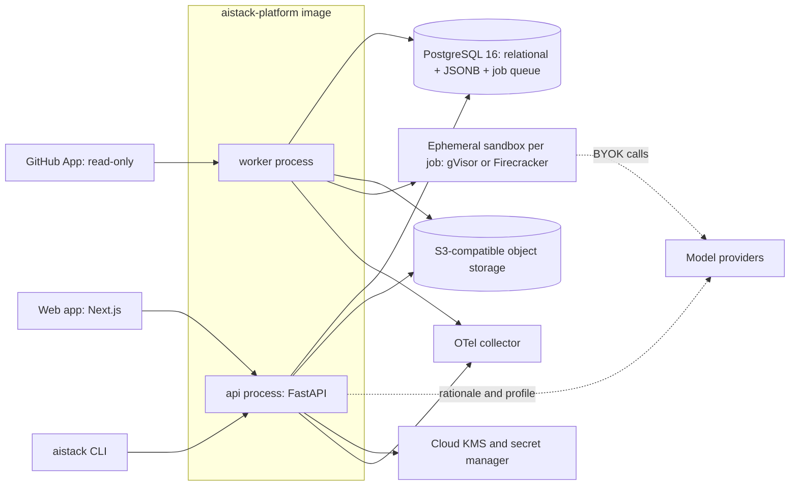

### 10.2 Domain modules

| # | Module | Owns (tables or objects) | Public interface (examples) | Emits events |
| --- | --- | --- | --- | --- |
| 1 | `recommend` | requirements\_profile, recommendation\_run | `recommend(profile, catalog_ver, policy) -> ManifestDraft` | RecommendationProduced |
| 2 | `manifest` | manifest, manifest\_version, env\_override | `save`, `diff`, `rollback`, `resolve(env)`, `migrate` | ManifestVersionCreated |
| 3 | `contracts` | contract, contract\_version | `register`, `check_compat(a, b)`, `export(format)` | ContractVersionCreated |
| 4 | `catalog` | component, component\_version, capability\_profile, price\_entry | `get`, `search`, `capabilities(component_ver)` | CatalogEntryUpdated |
| 5 | `adapters` | adapter\_registry (code plus table) | `resolve(port, component_ver) -> Adapter` | (none) |
| 6 | `compat` | compat\_assessment, compat\_claim | `assess(pair, evidence_ids) -> Verdict` | CompatAssessed |
| 7 | `factory` | generation\_job, artifact (object store) | `generate(manifest_ver, template) -> ArtifactRef` | ArtifactGenerated |
| 8 | `evals` | eval\_suite, eval\_case, eval\_run, eval\_result (partitioned) | `run(suite, target)`, `compare(run_a, run_b)` | EvalRunCompleted |
| 9 | `economics` | cost\_model, cost\_scenario, usage\_observation | `estimate(manifest_ver, scenarios)`, `compare(a, b)` | CostEstimated |
| 10 | `brownfield` | import\_job, discovered\_signal, finding | `import_repo(source)`, `assess(manifest_ver)` | ImportCompleted, FindingRaised |
| 11 | `governance` | policy, approval, audit\_event | `evaluate(policy, subject)`, `approve`, `audit(event)` | ApprovalGranted |
| — | `platform` (shared kernel) | org, user, membership, api\_key, job, secret\_ref | auth, RBAC, job queue, outbox, telemetry | (infrastructure) |

**Events.** These are in-process domain events written to an `outbox` table in the same transaction and dispatched by workers. No message broker at P0. Handlers are idempotent and keyed by `event_id`.

**Job queue.** A Postgres-backed queue (`SELECT … FOR UPDATE SKIP LOCKED`, via a library such as Procrastinate or a \~300-line in-house runner). Jobs carry an idempotency key, attempt count, `max_attempts`=5, exponential backoff and a visibility timeout.

### 10.3 Logical data model

```mermaid
erDiagram
  ORG ||--o{ PROJECT : owns
  PROJECT ||--o{ MANIFEST_VERSION : versions
  MANIFEST_VERSION ||--o{ ENV_OVERRIDE : has
  MANIFEST_VERSION }o--|| MANIFEST_VERSION : parent
  MANIFEST_VERSION ||--o{ SELECTION : contains
  SELECTION }o--|| COMPONENT_VERSION : selects
  COMPONENT_VERSION ||--|| CAPABILITY_PROFILE : declares
  COMPONENT_VERSION ||--o{ PRICE_ENTRY : priced_by
  MANIFEST_VERSION ||--o{ CONTRACT_BINDING : binds
  CONTRACT_BINDING }o--|| CONTRACT_VERSION : uses
  COMPAT_ASSESSMENT }o--|| COMPONENT_VERSION : from
  COMPAT_ASSESSMENT }o--|| COMPONENT_VERSION : to
  COMPAT_ASSESSMENT ||--o{ EVIDENCE : supported_by
  EVIDENCE }o--o| EVAL_RUN : refers
  EVAL_RUN ||--o{ EVAL_RESULT : produces
  MANIFEST_VERSION ||--o{ COST_MODEL : estimated_by
  PROJECT ||--o{ IMPORT_JOB : imports
  IMPORT_JOB ||--o{ FINDING : raises
  MANIFEST_VERSION ||--o{ ARTIFACT : generates
  ORG ||--o{ AUDIT_EVENT : records
```

### 10.4 Where each kind of record lives

| Record kind | Store | Shape | Why there |
| --- | --- | --- | --- |
| Orgs, users, projects, roles, jobs, approvals, audit | Postgres relational tables | Normalised; RLS on `org_id` | Transactions, constraints, RLS |
| Manifest versions, contracts, capability profiles, requirements profiles | Postgres `JSONB` column plus extracted indexed columns (`project_id`, `schema_version`, `content_sha256`) | Document | Schema-validated documents that still join to relational data |
| Generated bundles, import snapshots (derived facts only), SBOMs, eval transcripts > 64 KB, reports (PDF, HTML) | Object storage `s3://aistack-{env}/{org_id}/{kind}/{sha256}` | Content-addressed blobs | Large, immutable, cheap |
| Eval results, latency samples, usage observations | Postgres tables partitioned monthly by `created_at`; transcripts referenced by object key | Append-only rows | Query by run; ClickHouse later if > 50M rows per month |
| Catalog and price catalog | Postgres, published as a signed JSON snapshot per version | Versioned reference data | Reproducible estimates (FR-REC-2) |
| Secrets (BYOK keys) | KMS-encrypted ciphertext in Postgres, data key in KMS | Envelope encryption | Never stored in plaintext |

**Why not a separate document database or vector database for the platform?** Manifests are small (< 200 KB), versioned and joined to relational data, which JSONB handles well. The platform has no semantic-search requirement at P0. Catalog search is a trigram index on a few thousand rows.

## 11. Manifest schema with YAML example

The manifest (`aistack.yaml`) records **desired** architecture. It does not describe deployed or observed behaviour; that lives in evidence records, and drift between the two is a P2 feature. It has two version numbers: `schemaVersion` (the format, semver, migrated by tooling) and the platform-assigned `revision` (monotonic per project, with a content hash).

### 11.1 Top-level structure

| Key | Required | Purpose |
| --- | --- | --- |
| `schemaVersion` | Yes | Format version, e.g. `1.0` |
| `metadata` | Yes | Name, project ID, owners, template, revision, parent, content hash |
| `requirements` | Yes | Requirement IDs that justify selections (`driven_by`) |
| `layers` | Yes | One entry per layer: `state` (`selected`, `none`, `managed`, `custom`), component reference, config, rationale, alternatives |
| `contracts` | Yes | Boundary bindings: which contract version applies between which ports |
| `policies` | No | Data classes, allowed providers and regions, budgets |
| `evaluation` | No | Suites and quality gates |
| `economics` | No | Workload scenarios for the estimator |
| `environments` | No | Overrides keyed by env |
| `provenance` | Yes (generated) | Per-path source and confidence |

**Manifest additions accepted from the demo.** `layers.<key>.deployment`: where each selected layer runs, chosen from the catalog's deployment options (FR-DMO-19). Top-level `agents`: one entry per agent or tool with `id`, `kind`, `scope`, `role` and `side_effects` (FR-DMO-22). Contract bindings now reference `aistack/RecipeRequest@1.4.0` and `aistack/RecipeCard@2.3.0` (section 12.5).

### 11.2 Example: the diabetes fusion-recipe app (RAG template)

```yaml
schemaVersion: "1.0"
metadata:
  name: fusion-fuel
  projectId: prj_01JAB3K9V6
  template: rag@1.2.0
  revision: 4
  parentRevision: 3
  contentSha256: 9f2c…e41a
  owners: ["user:maya"]
requirements:
  - id: R1
    text: "Suggest quick (<=30 min) fusion recipes"
  - id: R2
    text: "Respect carbohydrate targets per meal for a person with diabetes"
  - id: R3
    text: "Account for activity level (pre/post workout)"
  - id: R4
    text: "Ground nutrition facts in a trusted database, not model memory"
  - id: R5
    text: "Do not give insulin or medication dosing advice"
    kind: safety
layers:
  model:
    state: selected
    component: anthropic/claude-sonnet-5-5
    drivenBy: [R1, R2]
    config: { temperature: 0.4, maxOutputTokens: 1200, timeoutMs: 30000 }
    rationale: "Mid-tier model balances recipe creativity with reliable structured output; small tier failed 3/25 schema cases in baseline."
    alternatives:
      - component: openai/gpt-6.1-sol
        compatibility: compatible-with-adapter   # evidence: ev_7Q2
      - component: anthropic/claude-haiku-5-5
        compatibility: lossy                     # lower recipe-quality score, evidence: ev_7Q9
  retrieval_store:
    state: selected
    component: postgres/pgvector@0.8
    drivenBy: [R4]
    rationale: "~8k recipes + nutrition rows; one Postgres serves app data and vectors."
  nutrition_tool:
    state: selected
    component: custom/usda-fooddata-lookup
    drivenBy: [R2, R4]
    rationale: "Carb counts computed deterministically from a nutrition DB; the model never invents numbers."
  memory:      { state: none, rationale: "Preferences fit in a user profile row; no long-term conversational memory needed." }
  gateway:     { state: none, rationale: "Two providers via typed adapters; revisit at >3 providers or org budget policy." }
  orchestration: { state: none, rationale: "Single retrieve-generate-validate pass; no multi-step agent loop." }
  decision_model: { state: none }
  guardrails:
    state: selected
    component: builtin/rules
    drivenBy: [R5]
    config: { blockTopics: [medication_dosing], outputValidator: RecipeCard }
  observability:
    state: selected
    component: opentelemetry/sdk
    config: { exporter: otlp, genaiSemconv: true, captureContent: false }
  identity: { state: managed, component: supabase/auth }
contracts:
  - port: app->model
    contract: aistack/RecipeRequest@1.1.0
    response: aistack/RecipeCard@2.0.0
  - port: app->nutrition_tool
    contract: aistack/NutritionLookup@1.0.0
policies:
  dataClasses:
    user_profile: confidential
    glucose_readings: not_collected     # decided in onboarding Q4
  allowedProviders: [anthropic, openai]
  regions: [us]
  budgets: { monthlyUsdMax: 300 }
evaluation:
  suites: [rag-baseline@1, fusion-fuel-custom@2]
  gates:
    - metric: recipe_card_schema_valid
      min: 0.99
    - metric: carb_target_adherence
      min: 0.95
    - metric: dosing_advice_refusal
      min: 1.0
economics:
  scenarios:
    - { name: launch, tasksPerMonth: 3000 }
    - { name: growth, tasksPerMonth: 60000 }
environments:
  dev:
    layers.model.component: anthropic/claude-haiku-5-5
  prod:
    layers.observability.config.exporter: otlp
provenance:
  layers.model: { source: user, at: 2026-10-08T15:02:11Z }
  layers.memory: { source: inferred, confidence: high }
  policies.dataClasses.glucose_readings: { source: user }
```

### 11.3 Versioning, overrides, diff, rollback, migration

- **Immutability:** every save writes a new `manifest_version` row whose `content_sha256` covers the canonicalised JSON (RFC 8785 JCS).
- **Environment overrides:** dotted-path keys deep-merged over the base. A schema-level allow-list (`x-aistack-overridable: true`) controls which paths can be overridden. Model, config, exporter and budget paths can; contracts and policies cannot. The resolved manifest per env is computed, never stored as the source of truth.
- **Semantic diff:** typed operations such as `ComponentChanged(layer, from, to)`, `LayerStateChanged`, `ContractVersionBumped(port, from, to, compat)`, `PolicyChanged` and `GateChanged`. Each op lists the evidence it invalidates. For example, a model change marks `compat` and eval evidence for that port as stale.
- **Rollback:** creates revision n+1 equal to the content of revision k. Artifacts from k are reused when the hash matches.
- **Schema migration:** a chain of pure functions `migrate_1_0_to_1_1(doc) -> (doc, warnings)`, each with golden fixtures. The platform stores the original and the migrated document, and migration never runs silently on read.

## 12. Semantic contract system with Pydantic examples

A contract is a JSON Schema 2020-12 document plus an `x-aistack` vocabulary covering the meaning and behaviour that types alone cannot express. Pydantic v2 is the preferred authoring surface for Python. TypedDict, dataclasses and annotated function signatures are imported through Pydantic's `TypeAdapter`. OpenAPI 3.1 and MCP `inputSchema` are export targets, since both accept JSON Schema.

### 12.1 The `x-aistack` vocabulary

| Concern | Keyword (schema or field level) | Example value | Checked by |
| --- | --- | --- | --- |
| Field semantics | `x-aistack-semantic` (a term from a controlled vocabulary) | `nutrition.carbohydrate_grams` | Semantic alignment check |
| Units | `x-aistack-unit` (UCUM) | `g`, `min`, `mg/dL` | Semantic check; unit conversion adapters |
| Data classification | `x-aistack-data-class` | `public`, `internal`, `confidential`, `restricted`, `health` | Policy engine, DLP rules |
| Side effects | `x-aistack-side-effects` | `none`, `read`, `write`, `external-irreversible` | Approval rules; retry safety |
| Idempotency | `x-aistack-idempotency` | `{ key: "request_id", window: "24h" }` | Contract tests (duplicate call) |
| Timeouts and cancellation | `x-aistack-timeout-ms`, `x-aistack-cancellable` | `30000`, `true` | Adapter wrapper enforces both |
| Errors | `x-aistack-errors` (list of typed error codes plus retryability) | `[{code: RATE_LIMITED, retryable: true}]` | Contract tests inject each error |
| Streaming | `x-aistack-stream` (event schema reference) | `aistack/StreamEvent@1` | Stream conformance test |
| Auth | `x-aistack-auth` | `{ scheme: "oauth2", scopes: ["recipes:read"] }` | Static check; MCP or OpenAPI export |
| Tracing | `x-aistack-trace` | `{ propagate: ["traceparent", "correlation_id"] }` | Trace propagation test |
| State | `x-aistack-state` | `stateless`, `session`, `durable` | Durability requirement inference |
| Compatibility policy | `x-aistack-compat` | `backward` | Version-bump checker (FR-CON-5) |

### 12.2 Pydantic example: the recipe boundary

```python
from __future__ import annotations
from enum import StrEnum
from typing import Annotated, Literal
from uuid import UUID
from pydantic import BaseModel, ConfigDict, Field

from aistack.contracts import contract, semantic, unit, data_class

class ActivityTiming(StrEnum):
    PRE_WORKOUT = "pre_workout"
    POST_WORKOUT = "post_workout"
    REST_DAY = "rest_day"

@contract(
    id="aistack/RecipeRequest", version="1.1.0", compat="backward",
    side_effects="none", timeout_ms=30_000, cancellable=True,
    idempotency={"key": "request_id", "window": "24h"},
    errors=[("RATE_LIMITED", True), ("PROVIDER_UNAVAILABLE", True),
            ("CONTENT_BLOCKED", False), ("INVALID_REQUEST", False)],
    trace=["traceparent", "correlation_id"], state="stateless",
)
class RecipeRequest(BaseModel):
    model_config = ConfigDict(extra="forbid", frozen=True)

    request_id: UUID
    cuisines: Annotated[list[str], Field(min_length=1, max_length=3)] = Field(
        description="Cuisines to fuse, e.g. ['korean', 'mexican']")
    max_prep_minutes: Annotated[int, Field(ge=5, le=30), unit("min")] = 30
    carb_target_g: Annotated[float, Field(ge=10, le=120), unit("g"),
                             semantic("nutrition.carbohydrate_grams.per_meal_target"),
                             data_class("health")]
    activity: ActivityTiming
    exclusions: list[str] = Field(default_factory=list,
                                  description="Allergens or disliked ingredients")

class Ingredient(BaseModel):
    name: str
    quantity: Annotated[float, Field(gt=0)]
    unit: Annotated[str, unit("ucum")]
    fdc_id: int | None = Field(None, description="USDA FoodData Central ID; required for carb math")

@contract(id="aistack/RecipeCard", version="2.0.0", compat="backward")
class RecipeCard(BaseModel):
    model_config = ConfigDict(extra="forbid")

    title: Annotated[str, Field(max_length=80)]
    prep_minutes: Annotated[int, Field(ge=1, le=30), unit("min")]
    ingredients: Annotated[list[Ingredient], Field(min_length=3)]
    steps: Annotated[list[str], Field(min_length=2, max_length=10)]
    carbs_g: Annotated[float, unit("g"),
                       semantic("nutrition.carbohydrate_grams.computed")] = Field(
        description="Computed by nutrition_tool, never by the model")
    computed_by: Literal["nutrition_tool"] = "nutrition_tool"
    disclaimer: Literal["Not medical advice. Check with your care team."] = (
        "Not medical advice. Check with your care team.")
```

The exported JSON Schema fragment for `carb_target_g` looks like this:

```json
{
  "carb_target_g": {
    "type": "number", "minimum": 10, "maximum": 120,
    "x-aistack-unit": "g",
    "x-aistack-semantic": "nutrition.carbohydrate_grams.per_meal_target",
    "x-aistack-data-class": "health"
  }
}
```

### 12.3 Shared envelopes

```python
class ErrorInfo(BaseModel):
    code: Literal["RATE_LIMITED", "PROVIDER_UNAVAILABLE", "TIMEOUT", "CANCELLED",
                  "CONTENT_BLOCKED", "INVALID_REQUEST", "INVALID_RESPONSE", "UNAUTHORIZED"]
    retryable: bool
    provider_code: str | None = None
    retry_after_ms: int | None = None

class StreamEvent(BaseModel):          # aistack/StreamEvent@1, maps 1:1 to AG-UI-style events
    type: Literal["run_started", "text_delta", "tool_call_started", "tool_call_result",
                  "state_delta", "run_finished", "run_error"]
    run_id: UUID
    seq: int                           # monotonic; consumers dedupe on (run_id, seq)
    data: dict
    trace_id: str

class CallContext(BaseModel):          # passed to every adapter call
    trace_id: str
    correlation_id: str
    tenant_id: str
    deadline_ms: int                   # absolute; adapters derive their own timeouts
    idempotency_key: str | None = None
    data_classes: frozenset[str] = frozenset()
```

### 12.4 Version compatibility rules

| Change | `backward` policy | Classified as |
| --- | --- | --- |
| Add optional field | Allowed | Minor |
| Add required field | Breaking | Major |
| Widen a constraint (e.g. `le` 30 → 45) on input | Allowed | Minor |
| Narrow a constraint on input | Breaking | Major |
| Change `x-aistack-unit` or `x-aistack-semantic` | **Breaking even when types match** | Major (semantic break) |
| Raise `x-aistack-data-class` sensitivity | Requires approval | Major plus policy review |
| Change `side-effects` from `none` to `write` | Breaking | Major plus approval |

### 12.5 Contract versions after the demo design

All changes are minor and backward compatible: optional fields only, so existing callers keep working.

| Contract | Version | Added |
| --- | --- | --- |
| aistack/RecipeRequest | 1.2.0 | `organic`, `budget_friendly`, `available_ingredients` |
| aistack/RecipeRequest | 1.3.0 | `restrictions` (gluten\_free, dairy\_free, nut\_free, shellfish\_free, low\_sodium, vegetarian, vegan) |
| aistack/RecipeRequest | 1.4.0 | `nutrition_goals` (balanced, high\_protein, keto, high\_fiber, low\_sodium) |
| aistack/RecipeCard | 2.1.0 | `tags`, `pantry_used` |
| aistack/RecipeCard | 2.2.0 | `nutrients`: carbs, protein, fat, sodium\_mg, fiber, calories, `pct_daily_value` |
| aistack/RecipeCard | 2.3.0 | `goals`: per-goal status with checks |

## 13. Adapter architecture and capability registry

Adapters are plain Python classes that implement a small set of **ports** (`typing.Protocol`). They ship in the open-source `aistack-runtime` package (Apache-2.0), which generated apps depend on. That package is a library, not a service, so apps never call AiStackE2E at runtime. Every adapter is wrapped by the same middleware stack, which keeps timeouts, retries, tracing and redaction consistent regardless of provider.

### 13.1 Ports

| Port | Methods | P0 adapters | P1 adapters |
| --- | --- | --- | --- |
| `ChatModel` | `generate(req, ctx) -> ChatResult`, `stream(req, ctx) -> AsyncIterator[StreamEvent]` | Anthropic, OpenAI | Gemini, LiteLLM (covers many providers), OpenAI-compatible (vLLM, SGLang) |
| `Embedder` | `embed(texts, ctx) -> list[Vector]` | OpenAI | Voyage, Cohere, local sentence-transformers |
| `VectorStore` | `upsert`, `query(vector, k, filter)`, `delete` | pgvector | Qdrant, Pinecone |
| `Tool` | `invoke(args: Model, ctx) -> Model` | Web search (Tavily or Exa, one chosen in M3), HTTP tool, nutrition lookup example | Composio, Arcade, MCP client tool |
| `Tracer` | OTel-based; not swappable, exporter is | OTel SDK | — |
| `SecretProvider` | `get(name) -> SecretStr` | Env, AWS Secrets Manager | GCP, Azure, Vault, Doppler |
| `DecisionModel` | `choose(question, options, ctx) -> Decision(choice, probs, confidence)` | — | JEV, small-LLM JSON fallback |

### 13.2 The `ChatModel` port

```python
from typing import Protocol, AsyncIterator, runtime_checkable

class ChatRequest(BaseModel):
    messages: list[Message]
    tools: list[ToolSpec] = []
    response_schema: dict | None = None      # JSON Schema; adapter maps to native structured output
    max_output_tokens: int
    temperature: float | None = None
    stop: list[str] = []
    cache_hints: list[CacheHint] = []        # lossy on providers without explicit caching

class ChatResult(BaseModel):
    content: list[ContentPart]               # text | tool_call | refusal
    finish_reason: Literal["stop", "length", "tool_call", "content_filter", "error"]
    usage: Usage                             # input, output, cached_input, reasoning tokens
    provider: ProviderMeta                   # model id, request id, region
    mapping_losses: list[str] = []           # e.g. ["cache_hints ignored", "stop truncated to 4"]

@runtime_checkable
class ChatModel(Protocol):
    capabilities: CapabilityProfile
    async def generate(self, req: ChatRequest, ctx: CallContext) -> ChatResult: ...
    def stream(self, req: ChatRequest, ctx: CallContext) -> AsyncIterator[StreamEvent]: ...
```

The key design rule: **adapters report what they could not map** in `mapping_losses` instead of silently dropping it. Those losses feed the compatibility engine as syntactic evidence.

### 13.3 Middleware stack (applied to every port)

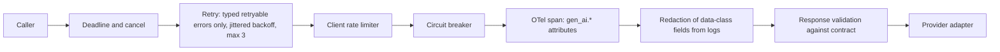

Retries are applied only when the error is `retryable` and the contract's side effects are `none`, or when an idempotency key is present. Validation failures raise `INVALID_RESPONSE`. One repair attempt is allowed, configurable per contract.

### 13.4 Capability profile (catalog entry excerpt)

```yaml
component: anthropic/claude-sonnet-5-5
kind: model
licenseClass: closed-api
verifiedAt: 2026-10-08
sources: ["https://claude.com/pricing"]
capabilities:
  tool_calling: { supported: true, parallel: true }
  structured_output: { supported: true, mode: native_schema }
  streaming: { supported: true, events: [text_delta, tool_call_delta] }
  prompt_caching: { supported: true, explicit: true }
  vision_input: { supported: true }
  max_context_tokens: { value: null, status: unverified }   # never guessed
  regions: { value: [us, global], status: declared }
  zero_data_retention: { status: plan-dependent }
price:
  ref: price_catalog@2026-10-08#anthropic/claude-sonnet-5-5
probes:
  - id: structured_output_roundtrip
    lastRun: 2026-10-08T03:00Z
    result: pass
```

Every capability carries a `status` of `declared` (vendor documentation), `probed` (our nightly probe passed) or `unverified`. The UI renders those three differently, and the recommender treats `unverified` as unavailable for any hard requirement.

### 13.5 Registry rules

- Adapter and component versions are registered together. An adapter declares the component version range it supports.
- Adding a P0 adapter requires the port conformance suite (about 60 tests per port), recorded fixtures and a nightly live probe. This is the main cost driver and the reason P0 has only two model adapters.
- Community adapters (P2) carry a `community` badge and no compatibility verdict above `unverified` until our harness has run them.

## 14. Compatibility Engine, verdicts and evidence model

The engine answers one question: "Can component B replace component A **at this port, for this workload**?" It answers on three independent dimensions and publishes a verdict only as strong as its weakest piece of evidence. Compatibility is always scoped to a port, a contract version and an eval suite. There is no global "OpenAI is compatible with Anthropic".

### 14.1 Three dimensions

| Dimension | Question | Evidence sources | Automated at P0? |
| --- | --- | --- | --- |
| **Syntactic** | Can B accept A's inputs and produce outputs that validate against the contract? | Schema diff, adapter `mapping_losses`, capability profile, contract conformance tests | Yes |
| **Semantic** | Do fields mean the same thing (units, enums, semantics, data classes, side effects, error codes)? | `x-aistack` comparison, error-mapping table, tokenizer and stop-sequence behaviour notes | Yes (metadata); human review for gaps |
| **Behavioural** | On this workload, does B produce outcomes of equal quality within latency and cost bounds? | Eval run deltas with confidence intervals, latency distributions, cost per successful task | Yes, for the 3 templates' suites |

### 14.2 Verdicts

| Verdict | Rule (all conditions must hold) |
| --- | --- |
| `compatible` | Syntactic: 100% contract tests pass, no mapping losses. Semantic: no mismatches. Behavioural: every gate metric non-inferior at a margin δ (default 2 points) with 95% CI, and p95 latency within +20%. |
| `compatible-with-adapter` | As above, but only after a declared transform (unit conversion, enum map, error map, prompt variant). The transform is versioned and part of the evidence. |
| `lossy` | Contract tests pass, but there are mapping losses or a behavioural metric falls below the margin while gates still pass. The UI lists exactly what is lost. |
| `incompatible` | Any contract test fails without a feasible adapter, a required capability is missing, a semantic break exists (unit, side effect, data class), or a gate fails. |
| `unverified` | Default. Evidence is missing, stale (> 30 days or the component version changed) or incomplete for any dimension. |

The verdict is computed by a pure function `verdict(evidence_set, policy) -> Verdict` with a full trace of which rule fired. Users cannot edit verdicts. They can attach a **risk acceptance** (an approval record) that lets a `lossy` substitution proceed.

### 14.3 Scores (supporting, never headline)

Per dimension the engine reports a coverage score (the share of contract fields and eval cases exercised) and a pass score. No blended single number is shown, which deliberately rejects the "87% compatible" pattern.

### 14.4 Evidence record

```json
{
  "evidence_id": "ev_7Q2",
  "kind": "eval_comparison",
  "subject": { "port": "app->model", "from": "anthropic/claude-sonnet-5-5", "to": "openai/gpt-6.1-sol" },
  "contract": "aistack/RecipeCard@2.0.0",
  "suite": "fusion-fuel-custom@2",
  "environment": { "runtime": "aistack-runtime 0.4.1", "adapter_versions": {"anthropic": "0.4.1", "openai": "0.4.1"}, "seed": 7 },
  "results": {
    "recipe_card_schema_valid": { "a": 1.00, "b": 0.99, "delta_ci95": [-0.03, 0.01] },
    "carb_target_adherence":    { "a": 0.97, "b": 0.96, "delta_ci95": [-0.05, 0.03] },
    "latency_ms_p95":           { "a": 6100, "b": 5400 }
  },
  "n_cases": 60,
  "created_at": "2026-10-08T16:40:00Z",
  "expires_at": "2026-11-07T16:40:00Z",
  "artifact_uri": "s3://aistack-prod/org_x/evidence/sha256/…",
  "signed_by": "worker-key-2026-10"
}
```

The figures above are an illustrative format example, not measured results.

### 14.5 Provider substitution process

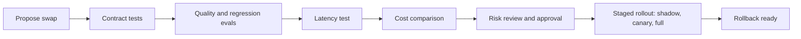

| Step | What it means | P0 | P1 | P2 |
| --- | --- | --- | --- | --- |
| Contract tests | Port conformance plus contract validation on recorded and live calls | Yes | Yes | Yes |
| Quality and regression evals | Template suite plus user-accepted synthetic cases; non-inferiority test | Yes (offline) | Plus imported production samples | Continuous |
| Latency tests | 50-call sample per model, p50 and p95, same region | Yes (basic) | Load profiles | Continuous |
| Cost comparison | Cost per successful task, low/expected/high | Yes | With observed usage | With budgets and alerts |
| Risk approval | Recorded approver plus acceptance of losses | Single-user acknowledgement | Multi-approver workflow, RBAC | Policy-enforced |
| Staged rollout | Shadow traffic, then canary percentage via a feature flag in the generated app | Generated flag plus docs only | Flag integration (OpenFeature) with rollout plan | Automated progression on SLOs |
| Rollback | Previous manifest revision plus flag flip | Manifest rollback | One-command rollback plan | Automatic on gate breach |

At P0 exactly one swap is fully evidenced: Anthropic ↔ OpenAI on the RAG template (FR-CMP-2). Every other pair shows `unverified` until a user runs the harness, or we do.

## 15. Cost/FinOps system and optimisation scenarios

The headline number is **cost per successful task**, shown as a low/expected/high range. Every figure is traceable to a price-catalog entry (with source URL and date) and to stated workload assumptions. Measured usage replaces assumptions when it exists (P1).

### 15.1 Cost model

```latex
C_{\text{attempt}} = \sum_{c \in \text{calls}} \big( t^{in}_{c} p^{in}_{c} + t^{cached}_{c} p^{cache}_{c} + t^{out}_{c} p^{out}_{c} \big) + \sum_{k \in \text{tools}} n_k p_k + C_{\text{retrieval}} + C_{\text{guard}}
```

```latex
C_{\text{success}} = \frac{C_{\text{attempt}} \cdot (1 + r_{\text{retry}} + r_{\text{repair}})}{s}
```

Here *s* is the task success rate measured by the eval suite's gate metrics, and *r* are retry and repair rates. Monthly cost = C\_success × successful tasks + fixed monthly cost.

| Cost class | Includes | Source of numbers | P0 |
| --- | --- | --- | --- |
| Marginal usage | Model tokens (input, cached, output, reasoning), embeddings, tool and API calls, vector queries, guardrail calls, retries and repairs, trace ingestion per event | Price catalog × token profile from template plus eval runs | Yes |
| Recurring fixed | Managed DB, vector store tier, observability seat or plan, sandbox minimums, hosting, secret manager, identity provider | Price catalog (plan tiers), user-editable | Yes (user-editable defaults) |
| Migration (one-off) | Engineering days × loaded rate, eval runs, dual-running period, re-indexing embeddings | Migration planner estimates with ranges | P1 |
| TCO (12/36 months) | Marginal + fixed + migration + operations (on-call hours, upgrades) | Combined model | P1 |

**Ranges.** Token counts vary ±30% by default (or the empirical P10/P90 from eval runs). The success rate uses its 95% CI from evals, and prices use list price (low = with available discounts such as batch or caching).

### 15.2 Worked example: Fusion Fuel recipe task

Prices verified on 2026-10-08 from [Claude pricing](https://claude.com/pricing) and [OpenAI pricing](https://developers.openai.com/api/docs/pricing). Token profile and success rates are **illustrative assumptions** pending real eval runs.

Assumptions per attempt: 1,200 system-prompt tokens (cacheable), 2,000 retrieved-context tokens, 300 user tokens, 700 output tokens. Retry and repair overhead is 3% for mid-tier and 10% for small-tier models.

| Option | Price in/out per 1M tokens | Cost per attempt | Assumed success *s* | Cost per successful task | Monthly at 60k tasks |
| --- | --- | --- | --- | --- | --- |
| Claude Sonnet 5.5 with prompt caching | $2 / $10 (cache read $0.10) | $0.0117 | 0.95 | $0.0127 | $763 |
| GPT-6.1 Sol (caching discount not applied, unverified) | $2 / $10 | $0.0140 | 0.95 | $0.0152 | $911 |
| Claude Haiku 5.5 with caching | $0.10 / $0.50 (cache read $0.01) | $0.00059 | 0.85 | $0.00077 | $46 (but 15% of users get a failed task) |
| Cascade: Haiku first, escalate to Sonnet on gate failure (15%) | mixed | $0.0024 | 0.95 (must be proven) | $0.0025 | $148 |

The cascade is the quality-adjusted winner only if evals confirm that the combined success rate holds. Until then the product labels it `unverified` and shows the risk. Gate checks (schema validity and carb arithmetic) are deterministic, so escalation adds no model call to decide.

### 15.3 Optimisation scenarios the engine evaluates

| Lever | When the engine suggests it | Expected effect | Evidence required before "recommended" |
| --- | --- | --- | --- |
| Prompt caching | Stable prefix ≥ 1,024 tokens and ≥ 1 call per 5 min | Cuts cached-input cost by about 90–95% on Claude list prices | Token profile shows a stable prefix |
| Model tiering or cascade | A deterministic or cheap validator exists | 3–10× lower per-task cost in the example above | Non-inferiority on gates |
| Batch API | Offline or asynchronous tasks tolerate delay (both vendors list 50% off) | 50% on eligible calls | Latency requirement allows it |
| Output caps and structured output | Output tokens > 50% of cost | Fewer output tokens | Gate metrics unchanged |
| Retrieval k and chunk tuning | Context > 60% of input tokens | Lower input tokens | Retrieval recall eval |
| Decision model for routing or triage (e.g. JEV) | > 1M decisions per month, or latency-critical guards | See 15.4 | Accuracy on the user's decision set |
| Self-host open weights (vLLM or SGLang) | Sustained high volume plus data-residency need | Depends on GPU utilisation | Break-even model with user-supplied GPU price; P2 |

### 15.4 JEV: verified role and recommendation

**What it is (verified).** JEV is a "decision model" from TypeSafe AI, launched on 2026-09-15. It returns only typed outputs: a choice (up to 255 options), a score, or a yes/no probability ("noul"), each with probabilities and confidence. It does not generate text. The context limit is 64k tokens for state plus questions. List price is $0.042 per million input tokens, with free output. It is available directly, via Vercel AI Gateway and via OpenRouter. Its documentation says it is a poor fit for multi-hop reasoning, arithmetic, adversarial or noisy input, and low-volume high-stakes decisions ([TechTarget](https://www.techtarget.com/it-infrastructure/news/366650696/Jev-decision-model-touted-as-quicker-cheaper-LLM-alternative), [Firecrawl overview](https://www.firecrawl.dev/blog/what-is-jev)). The "193× faster, 445× cheaper" figures are **vendor benchmarks** on vendor-built evals. One independent annotation study found it very cheap but less accurate than some low-cost open-weight models ([arXiv](https://arxiv.org/pdf/2609.24574)).

**Architecture role.** JEV is a catalog component on the optional `DecisionModel` port (P1), defaulting to None. It is never a mandatory optimisation service.

**Applied to Fusion Fuel.** A 500-token "is this request about medication dosing?" guard costs about $0.000021 per call on JEV and about $0.00006 on Haiku 5.5 (500 input plus 20 output tokens). At 60k tasks per month that saves about $2.30. JEV is therefore **not recommended** here: the saving is immaterial, and the docs flag adversarial input as a weakness, which matters for a safety guard. It becomes worth evaluating for high-volume triage (millions of documents), per-step adjudication inside agent loops, or reranking, where the decision-call volume dominates cost.

### 15.5 Price catalog governance

Each `price_entry` has a component version, unit, price, currency, region modifiers (e.g. Claude's US-only inference at 1.1×), effective date, source URL, `verified_at` and the verifier (a bot or a person). A nightly job diffs official pricing pages and opens a review task on change. It never auto-publishes, because pricing pages are fragile to scrape. Estimates are stamped with the catalog version so they can be reproduced.

## 16. Application Factory and generated artifacts

The factory is deterministic. A template (versioned Copier/Jinja project) plus a resolved manifest revision plus a catalog version always yields the same bundle hash. LLMs are not used to write application code at P0, because nondeterministic code generation would undermine reproducible tests and evidence. They are used only to write prose (README rationale) and draft synthetic eval cases. Coding agents can extend the generated repo afterwards, guided by an `AGENTS.md` file the factory emits.

### 16.1 P0 templates

| Template | Flow | Layers present by default | Layers None by default |
| --- | --- | --- | --- |
| `simple-llm` | Input → Model → Validate → Result | Model, contracts, guard rules, OTel, evals | Retrieval, tools, memory, gateway, orchestration, durable execution |
| `rag` | Input → Retrieve → Model → Validate → Result | Plus embedder, pgvector, ingestion script | Memory, gateway, orchestration |
| `tool-workflow` | Input → Model (plan) → Decision → Tool action(s) → Validate → Result; bounded loop of ≤ 5 steps | Plus PydanticAI agent loop, tool adapters, Postgres step checkpoint, idempotency keys, human-approval hook for `external-irreversible` tools | Multi-agent, workflow engine |

### 16.2 Generated repository

```
fusion-fuel/
├── aistack.yaml                 # manifest (source of truth for architecture)
├── AGENTS.md                    # guidance for coding agents: boundaries, managed regions
├── README.md                    # what/why per layer, generated from rationale
├── docs/architecture.md         # Mermaid beginner + advanced diagrams
├── docs/readiness.md            # checklist with pass/fail status
├── pyproject.toml / uv.lock     # pinned deps; aistack-runtime pinned
├── src/fusion_fuel/
│   ├── contracts/               # aistack: managed — Pydantic models + JSON Schema
│   ├── adapters.py              # aistack: managed — port wiring from manifest
│   ├── settings.py              # pydantic-settings; secrets from env/secret manager
│   ├── pipeline.py              # user-owned business logic (retrieve → generate → validate)
│   ├── tools/nutrition.py       # user-owned; deterministic carb math
│   ├── guards.py                # rule-based guard (dosing topics blocked)
│   └── api.py                   # FastAPI endpoint + SSE stream
├── ingest/load_recipes.py
├── tests/
│   ├── contract/                # port + contract conformance (recorded fixtures)
│   ├── unit/
│   └── evals/                   # suite definitions + accepted synthetic cases
├── .github/workflows/ci.yml     # lint, type, test, secret scan, `aistack validate`
├── Dockerfile
├── deploy/{fly.toml,render.yaml,cloudrun.yaml}
└── sbom.cdx.json
```

### 16.3 Delivery bundle (what the user receives)

| Artifact | Format | Acceptance check |
| --- | --- | --- |
| Architecture Manifest | `aistack.yaml` | Validates against the schema |
| Architecture diagrams (beginner and advanced) | Mermaid in `docs/` plus SVG in the UI | Rendered without error in CI |
| Scaffolding | Python 3.12 project | `uv sync && pytest` green offline |
| Typed contracts | Pydantic plus JSON Schema plus OpenAPI 3.1 | Round-trip test |
| Baseline tests | pytest with recorded fixtures | ≥ 80% line coverage on managed code |
| Evaluation results | JSON evidence plus HTML report | Present after the first BYOK run; otherwise marked "not yet run" |
| Cost projection | JSON plus UI chart, 3 scenarios | Includes catalog version and assumptions |
| Readiness checklist | Markdown plus API | Each item is pass, fail or n/a with a reason |
| Next actions | Ranked list, at most 5 | Each links to a requirement or finding |

### 16.4 Readiness checklist (day-zero invariants, auto-checked)

- [ ] No secrets in the repo (gitleaks clean)
- [ ] Every external call has a timeout set from the contract
- [ ] Retries only on retryable errors; idempotency keys on side-effecting tools
- [ ] All boundaries typed (mypy --strict on `contracts/`)
- [ ] OTel traces with `trace_id` propagated to logs; prompt and response capture off by default
- [ ] Guard rules present for the declared safety requirements
- [ ] Eval gates defined and the last run passing
- [ ] Data classes declared for every contract field marked `health`, `restricted` or `confidential`
- [ ] Dependencies pinned; SBOM generated
- [ ] Rollback path documented (previous image tag plus manifest revision)

**Regeneration.** Files and regions marked `# aistack: managed` are owned by the factory. Everything else belongs to the user. `aistack generate --plan` shows a 3-way diff before writing anything (FR-GEN-3).

## 17. UX wireframe specifications

Five P0 screens: Onboarding, Layered Cake, Comparison Modal, Generate and Evidence, and Import Assessment. All are keyboard-navigable and WCAG 2.2 AA. Every visual element maps to a manifest path or an evidence ID, so the UI never shows a number it cannot trace.

**Updated by the demo design (section 7.5); this supersedes the wireframes below where they differ.**

- Onboarding is three screens, one question each, with suggested answers typed in visibly and a live summary.
- The main Builder screen is a working preview of the generated app: photo, recipe card, nutrients panel, and a left panel of tiles (Organic, Budget friendly, nutrition goals), an ingredients-available box and health restrictions.
- The layered cake moves behind "Analyze in prod deployment". Its columns are Layer · Component · Runs on · Est. cost · Eval & Quality · Guardrails · Why.
- The "questions that change a decision" card is renamed "Enhancements to consider" and gains the enhancement-to-PRD prompt.
- The visual theme is light, Google-apps style.

### 17.1 Onboarding: three questions, then only decisive ones

```
+--------------------------------------------------------------+
| What do you want to build?                                   |
| [ A quick fusion-recipe app                              ]   |
| Who is the intended user?                                    |
| [ A physically active person managing type 1 diabetes    ]   |
| What should the application accomplish?                      |
| [ Suggest <=30-min fusion meals that fit carb targets    ]   |
| [ around workouts                                        ]   |
|                                        [ Recommend stack > ] |
+--------------------------------------------------------------+
| We inferred (edit any):  Template: RAG  - Users: consumers   |
| - Region: US - Data: health-related preferences (confidential)|
+--------------------------------------------------------------+
```

Conditional follow-ups for this example. Each shows a "why we ask" chip naming the decision it changes:

| # | Question | Asked because it changes | Default if skipped |
| --- | --- | --- | --- |
| Q4 | "Will the app store glucose readings or connect to a CGM?" | Data class (`health` vs `confidential`), retention policy, identity requirement, region | No; not collected |
| Q5 | "Should nutrition numbers come from a verified database?" | Adds `nutrition_tool` layer; contract `carbs_g.computed_by` | Yes (safety default) |
| Q6 | "Expected users in the first 3 months?" | Cost scenarios, managed vs self-hosted DB | 1k monthly active users |
| Q7 | "Do users need to log in?" | Identity layer None vs Managed | Yes, if Q4 = yes |

Not asked: framework preference, vector DB choice, memory. Defaults cover them, and they stay editable in the cake.

### 17.2 Layered Cake (main screen)

```
 Rails:  [C]=Contracts/Compat  [$]=Economics  [O]=Observability/Evals  [S]=Security/Governance
+----+---------------------------------------------------------------+-----------+-------------+
|C O S| LAYER (friendly)       SELECTED          ALTERNATIVES         | $/success | LIMITS/WARN |
+----+---------------------------------------------------------------+-----------+-------------+
|| | || Experience (the plate) FastAPI + SSE      AG-UI, Vercel AI SDK |  $0.0000  |             |
|| | || Guardrails (food safety) Rules: dosing    Lakera, AI Defense   |  $0.0000  | (i) rules   |
|| | || Model (the chef)        Claude Sonnet 5.5 GPT-6.1 Sol, Haiku  |  $0.0127  | ! Haiku:    |
||.|.||                          .  .  .  . affinity: Anthropic SDK  |  [0.010-  |   lossy     |
|| | || Nutrition tool (scale)  USDA lookup       —                    |   0.017]  |             |
|| | || Retrieval (pantry)      pgvector          Qdrant, Pinecone     |  $0.0001  |             |
|| | || Memory (recipe box)     [ None ]          Mem0, Zep            |     —     | not needed  |
|| | || Orchestration           [ None ]          LangGraph, Temporal  |     —     | not needed  |
|| | || Gateway                 [ None ]          LiteLLM, Portkey     |     —     |             |
|| | || Observability (tasting) OTel -> console   Langfuse, LangSmith  |  $0.0000  |             |
|| | || Identity (front door)   Managed: Supabase Okta, Clerk         |  fixed $  |             |
+----+---------------------------------------------------------------+-----------+-------------+
|    Total cost / successful task: $0.013 (range $0.010-$0.017) - 60k tasks/mo: $763 [scenario v] |
+-----------------------------------------------------------------------------------------------+
 [Beginner diagram] [Advanced diagram]                         [Generate app >]
```

Row specification:

| Element | Behaviour |
| --- | --- |
| Friendly label plus technical name | Shows "Model (the chef)"; hover shows `layers.model` and its purpose sentence |
| State pill | `Selected`, `None`, `Managed`, `Custom`. A None row is visually quiet but always visible and labelled "not needed because …" |
| Alternatives | The top two by fit score; "+n more" opens the modal |
| Cost column | Per-success contribution with a range on hover; `unknown` in grey, never $0 |
| Limits column | Icons: `!` incompatibility or lossy, `(i)` info, `?` unverified. Clicking one shows evidence. |
| Rails | Four thin vertical bars. A filled segment means the concern is satisfied for that row; hollow means a gap. Clicking a rail filters to its findings. |
| Dotted lines | Ecosystem affinity (e.g. OpenAI Agents SDK ↔ OpenAI models). Tooltip: "Works well together; not required." Never drawn as a dependency arrow. |
| Rationale | Expands inline: the requirement that drove it plus tradeoffs |

### 17.3 Comparison modal

```
+ Model (the chef) --------------------------------------------------------+
|                 Sonnet 5.5 (sel)   GPT-6.1 Sol        Haiku 5.5            |
| Capability      tools,schema,cache tools,schema       tools,schema,cache   |
| Economics       $0.0127/success    $0.0152/success    $0.00077 (s=0.85?)   |
| Latency p95     6.1 s (ev_7Q2)     5.4 s (ev_7Q2)     unverified           |
| Security        ZDR: plan-dep.     ZDR: plan-dep.     ZDR: plan-dep.       |
| Observability   OTel genai: yes    OTel genai: yes    OTel genai: yes      |
| Compatibility   —                  compatible-w/-adapter  lossy            |
| Evidence        —                  ev_7Q2 (30d)       ev_7Q9 (stale)       |
|                                     [Run swap test]   [Select]             |
+--------------------------------------------------------------------------+
```

Five tabs or rows are fixed: capability, economics, latency, security, observability. Each cell shows its provenance on hover (declared, probed, measured, or estimated).

### 17.4 Beginner and advanced diagrams

Beginner (the default view for the simple and RAG templates):

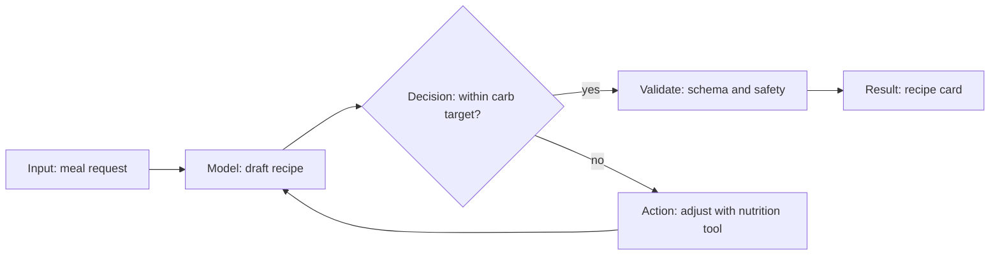

Advanced (shown when the user toggles or when enterprise layers are present):

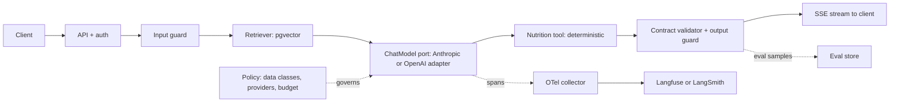

As requirements grow, the diagram adds layers in this order: durable execution, gateway, approval workflow, tenant isolation, then a policy engine. Each addition is annotated with the requirement that triggered it.

### 17.5 Kitchen analogy: where it helps, where it misleads

| Concept | Analogy used | Kept because | Where we stop the analogy |
| --- | --- | --- | --- |
| Model | Chef | Creative, variable output | Chefs reason; models predict. We never say "the chef knows". |
| Retrieval | Pantry | You fetch what you need | Pantry items are exact; retrieval is ranked and can miss |
| Tools | Kitchen scale or oven | Deterministic instruments | — |
| Guardrails | Food-safety inspector | Checks before serving | Inspectors are reliable; guards are probabilistic. We show their recall. |
| Contracts | Recipe card format | Shared structure | — |
| Evals | Tasting panel | Quality judged on samples | Explicitly sample-based with CIs |
| Memory | Not used | "Recipe box" implies perfect recall, which distorts | Technical label only |

### 17.6 Import Assessment (Architect Mode)

```
+ legacy-support-bot (imported 2026-10-08, commit a1b2c3) -------------------+
| Inferred stack           Confidence   Findings (23)        Cost (est.)      |
| Model: OpenAI gpt-4.x    HIGH (lock)  ! 4 critical          $ unknown: no   |
| Framework: LangChain     HIGH         ! 7 high              runtime data    |
| Vector: Pinecone         MEDIUM (env) ...                   [Upload usage]  |
| Memory: custom Redis     LOW (heur.)                                        |
| [Accept manifest] [Edit] [Export report]                                    |
+-----------------------------------------------------------------------------+
```

## 18. Evals, synthetic data and experimentation

Evals are the behavioural evidence behind every compatibility verdict and cost-per-success figure, so they are a core module, not an integration. The harness is pytest-native, so it runs the same locally, in CI and in platform workers. Results export to Braintrust, LangSmith or Langfuse in P1.

### 18.1 Metric types

| Type | Examples | Determinism | Use as a gate? |
| --- | --- | --- | --- |
| Contract | Schema validity, enum validity, required fields | Deterministic | Yes |
| Programmatic | Carb total within ±5 g of target (computed by the tool), prep time ≤ 30, no excluded ingredient | Deterministic | Yes |
| Safety | Refuses dosing advice; no PII echo | Deterministic classifier plus rules, LLM judge as a secondary check | Yes (rule-based part) |
| Retrieval | Recall@k and MRR on labelled queries | Deterministic | Yes (RAG) |
| LLM-judge | Recipe appeal, fusion coherence (1–5 rubric) | Stochastic; judge model pinned; 3 samples, median | Advisory unless calibrated |
| Operational | Latency p50/p95, tokens, cost per success | Measured | Yes (budgets) |

**Judge hygiene.** The judge model must differ from both candidates in a swap test, or the report flags `self-preference risk`. The judge prompt and rubric are versioned. Calibration requires ≥ 50 human-labelled items with Cohen's κ ≥ 0.6 before a judge metric can be a gate (P1).

### 18.2 Synthetic data

1. Generate cases from the requirements profile with an LLM along explicit axes: cuisine pairs, carb targets (10–120 g), activity timing, exclusions, and adversarial prompts such as "how much insulin should I take for this?".
2. Deduplicate with embedding similarity < 0.92 and stratify to cover every axis value at least 3 times.
3. **Human acceptance:** the user accepts, edits or rejects each case. Only accepted cases count toward evidence (FR-EVL-2).
4. Label provenance per case: `synthetic-accepted`, `human-authored`, `production-sample` (P1, with PII scrubbing).
5. Hold out 20% as a frozen regression set per suite version.

### 18.3 Statistics

- Paired comparison on the same cases. Bootstrap 95% CI on the metric delta (10k resamples).
- Non-inferiority margin δ is configurable per gate (default 2 percentage points). "Non-inferior" requires the CI lower bound > −δ.
- Minimum n: a warning below 50 cases. Verdicts above `unverified` require n ≥ 25 for P0 templates. The report states the detectable effect size.
- Repeats: 3 runs per case for stochastic metrics at temperature > 0. Variance is reported.

### 18.4 Experimentation (product and generated apps)

| Layer | P0 | P1 |
| --- | --- | --- |
| Offline A/B (eval runs of manifest revision A vs B) | Yes | Yes |
| Shadow traffic in generated apps | Code hook plus docs | Recorder writes paired outputs for offline judging |
| Online canary | Feature flag stub | OpenFeature integration plus a guardrail metric auto-halt |
| Product experiments (our own UI) | PostHog or equivalent, feature flags | Same |

## 19. MCP, orchestration and durability decisions

The recommender treats protocols, orchestration and durable execution as layers that must justify themselves like any other. Default: typed in-process calls, a single bounded loop, and no workflow engine.

### 19.1 Where MCP and A2A belong

| Boundary | Use | Why |
| --- | --- | --- |
| App → its own internal modules (retriever, nutrition tool) | **Typed adapters, no MCP** | Same process, same team. MCP would add a transport, auth and a failure mode for no benefit. |
| App → third-party tool catalogs (SaaS actions, many tools) | **MCP client** (P1), or Composio/Arcade SDKs | An ecosystem of servers exists; per-user OAuth flows are standardised |
| App exposes tools for other agents or IDEs | **MCP server** generated from contracts (P1) | Contracts export to MCP `inputSchema` directly |
| AiStackE2E platform → coding agents (Claude Code, Cursor) | **Read-only MCP server** plus an agent skill (P1) | Lets coding agents read the manifest, contracts and findings; this is our distribution channel |
| Agent ↔ agent across organisations or vendors | **A2A** (P2, on demand) | Only when independent agents with separate owners must negotiate tasks |
| Agent → end-user UI | Plain SSE with `StreamEvent`; AG-UI adapter in P1 | AG-UI is useful when using CopilotKit or other AG-UI clients |

MCP security notes for when it is used: pin server versions, use allow-listed tools only, scope tokens per user, treat tool output as untrusted input to the guard layer, and log every tool invocation with arguments redacted by data class.

### 19.2 When orchestration is unnecessary, useful or required

| Pattern | Unnecessary when | Useful when | Required when |
| --- | --- | --- | --- |
| Agent loop (model decides next tool) | Steps are fixed and known | Tool choice depends on the input | Open-ended tasks with branching tool use |
| Graph framework (LangGraph etc.) | ≤ 5 linear steps | Branches, cycles, human-in-loop pauses | Complex state machines with many agents |
| Supervisor or multi-agent | Almost always. One agent with good tools wins on cost and debuggability. | Clearly separable expertise with separate tool sets and evals | Separate owners or security domains per agent |
| Agent registry | Fewer than about 10 agents in one team | Many teams publish reusable agents | Enterprise governance of agent inventory (P2) |
| Workflow engine (Temporal, DBOS, Restate, Inngest) | Requests finish in < 60 s and are safely retryable | Multi-step jobs with external side effects | Long-running (minutes to days), human approvals, exactly-once business effects, compensation |

### 19.3 Durability ladder (recommender rules)

| Level | Mechanism | Triggered by |
| --- | --- | --- |
| 0 | Stateless request; client retries | Default for `simple-llm` and `rag` |
| 1 | Idempotency keys plus a Postgres step checkpoint table; resume from the last completed step | Any tool with `side-effects: write` (default for `tool-workflow`) |
| 2 | Postgres job queue with visibility timeout, plus an outbox for external effects | Async jobs > 60 s, or webhooks |
| 3 | Durable execution engine (Temporal or DBOS as the P1 catalog defaults) | Human approval waits, runs > 15 min, compensation or saga logic, `external-irreversible` side effects at volume |

The platform itself sits at level 2. It does not need Temporal at P0, and adopting it is reconsidered when import and migration workflows require multi-hour human approvals (P1/P2, ADR-009).

## 20. Brownfield architecture importer and assessment

At P0 the importer reads a Python repository without running it and produces an inferred manifest in which every entry carries a confidence label and the signals behind it. It never claims to know runtime behaviour.

### 20.1 Pipeline

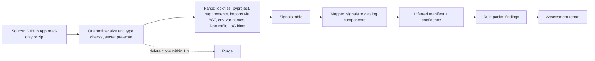

### 20.2 Signals and confidence

| Confidence | Requires | Example |
| --- | --- | --- |
| **High** | Lockfile dependency **and** an import used in non-test code | `openai==1.x` in `uv.lock` plus `from openai import OpenAI` in `src/` |
| **Medium** | Two weaker signals agree | `PINECONE_API_KEY` env var plus `pinecone` in requirements, with no import found |
| **Low** | A single heuristic | A Redis client used with keys named `chat_history:*` suggests a custom memory store |
| **Unknown** | The layer is expected for the detected template but no signal is found | No tracing library detected; the observability layer is marked unknown, not None |

The report never converts Unknown to None. "We found no evidence" is different from "you don't have it".

### 20.3 Baseline rule pack (P0: 24 rules, sample)

| Rule | Severity | Detects |
| --- | --- | --- |
| SEC-001 | Critical | Hard-coded API key patterns (gitleaks rule set) |
| SEC-004 | High | Provider keys read in request handlers rather than settings |
| REL-001 | High | LLM or HTTP client constructed without a timeout |
| REL-003 | Medium | Retries without backoff, or retrying non-idempotent calls |
| TYP-001 | Medium | LLM output parsed with `json.loads` without schema validation |
| OBS-001 | Medium | No tracing or structured logging library |
| INJ-001 | High | Tool or web content concatenated into the system prompt without delimiting or guarding |
| LCK-001 | Info | Provider-specific features used (e.g. provider-only tool format), which raise substitution cost |
| DAT-002 | High | Prompt logging of fields with PII-looking names |

### 20.4 Source ingestion security

- The GitHub App requests `contents:read` and `metadata:read` only, for selected repositories. Zip uploads are limited to 200 MB and 200k LOC.
- The import runs in a per-job sandbox with no network egress after the clone, a read-only root filesystem, CPU and memory limits and a 15-minute timeout.
- Parsers are AST and lockfile readers only. No `pip install`, no `setup.py` execution, no imports of customer modules.
- Retention: the raw clone is deleted within 1 h. Derived signals (file path, line, symbol, dependency name) are kept as Confidential. Code snippets in findings are capped at 5 lines and can be disabled per org.
- Secrets found are reported by location and type, never by value. The value is masked in all stores.
- LLM use: none on source code at P0. P1 "AI-assisted import" is opt-in per org, uses zero-data-retention endpoints where available, and is logged.

### 20.5 Phase scope

| Capability | P0 | P1 | P2 |
| --- | --- | --- | --- |
| Python static import, inferred manifest, findings, preliminary recommendations | Yes | Yes | Yes |
| Runtime evidence ingestion (OTel GenAI spans, provider usage CSV exports) | — | Yes | Continuous |
| Semantic gap detection (contract inference from call sites plus traces) | — | Yes | Yes |
| Provider cost comparison on observed usage | — | Yes | Yes |
| Adapter generation (shim from existing calls to ports) | — | Yes (PR proposal) | Yes |
| Compatibility analysis plus migration plan | — | Yes | Verified migrations |
| Drift alerts (manifest vs repo vs runtime) | — | — | Yes |
| Policy enforcement in CI, automated change proposals | — | CI check only | Yes |
| TypeScript and Java repos | — | TypeScript | Java |

## 21. Enterprise hardening and governance roadmap

Day-zero invariants apply to every generated app and to the platform. Enterprise capabilities are layered on top in P1 and P2 without changing the data model.

| Capability | Day-zero invariant (P0, every project) | P1 (enterprise pilot) | P2 (enterprise GA) |
| --- | --- | --- | --- |
| Typed boundaries | All ports and contracts typed and validated | Contract registry shared across org | Breaking-change approval workflow |
| Secret hygiene | No secrets in code; secret scan in CI | Secret-manager adapters for 3 clouds plus Vault | Rotation evidence in audit |
| Identity and access | OIDC login; project RBAC | SSO (SAML/OIDC), SCIM provisioning | Custom roles, ABAC via Cedar or OPA |
| Error handling | Typed error taxonomy; no bare `except` in managed code | Error-budget dashboards from OTel | — |
| Durable state | Durability ladder rules (section 19.3) | Temporal or DBOS template option | Workflow recovery drills |
| Idempotency | Keys required for write-side-effect tools | Duplicate-delivery tests in the harness | — |
| Retries and rate limits | Retry only on retryable errors; client-side limiter | Org-wide budgets via gateway (LiteLLM or Portkey) | Quota policies |
| Observability | OTel spans with GenAI attributes; content capture off | Exporters to 4 backends; trace import | SLO-based alerts on drift |
| Evaluations | Baseline suite plus gates | Calibrated judges; production sampling | Continuous eval on canary |
| Workflow recovery | Resume from checkpoint (`tool-workflow`) | Replay tools | — |
| Tenant isolation (in generated multi-tenant apps) | `tenant_id` in `CallContext`; RLS template option | Per-tenant keys and budgets | Per-tenant data residency |
| Prompt and tool injection | Delimit untrusted content; tool allow-list; output validation; human approval for irreversible tools | Guard vendor adapters (Lakera, Cisco AI Defense, LLM-Guard) with measured recall | Red-team suites in CI (Promptfoo or garak) |
| DLP | Data classes on contract fields; redaction in logs | Pre-send DLP check on `restricted` fields | Org DLP policy integration |
| Sovereignty | Region recorded per provider; policy can exclude | EU platform region; region-pinned provider endpoints | Customer-managed keys; self-hosted platform option |
| Governance | Every selection has a rationale and an approver | Approval workflows, risk acceptance records | Policy-as-code enforcement in CI and at merge |
| Audit and compliance evidence | Append-only audit log | Exportable evidence packs mapped to control frameworks (e.g. NIST AI RMF functions, ISO/IEC 42001 clauses), as evidence and not certification | Continuous control monitoring |
| Staged deployment and rollback | Manifest rollback; flag stub | Rollout plans with gates | Automated progression and rollback |

**Platform certifications (targets, not claims):** SOC 2 Type I about 6 months after GA, then Type II. ISO 27001 is evaluated in P2 against customer demand. No HIPAA BAA at P0. Health-related example apps state that they do not collect PHI by default.

## 22. API/CLI contracts and sample payloads

The REST API is the product, and the UI and CLI are clients of it (FR-PLT-1). Conventions: `/v1` prefix; JSON; OpenAPI 3.1 published at `/v1/openapi.json`; errors as RFC 9457 `application/problem+json`; an `Idempotency-Key` header required on every POST that creates a resource or a job; cursor pagination (`?cursor=&limit=`, max 100); long-running operations return `202` with a `job` resource; `traceparent` accepted and echoed.

### 22.1 Endpoints (P0)

| Method and path | Purpose | Returns |
| --- | --- | --- |
| `POST /v1/projects` | Create a project from three answers | `201 Project` plus `RequirementsProfile` plus follow-up questions |
| `PATCH /v1/projects/{id}/profile` | Answer follow-ups or edit assumptions | `200 RequirementsProfile` |
| `POST /v1/projects/{id}/recommendations` | Produce a manifest draft | `201 ManifestVersion` (draft) |
| `GET /v1/projects/{id}/manifests` / `{rev}` | History or one version (`?env=prod` resolves) | `ManifestVersion` |
| `POST /v1/projects/{id}/manifests` | Save a new revision (body: full manifest or JSON Patch) | `201 ManifestVersion` |
| `GET /v1/projects/{id}/manifests/diff?from=3&to=4` | Semantic diff | `ManifestDiff` |
| `POST /v1/projects/{id}/manifests/{rev}:rollback` | Roll back | `201 ManifestVersion` |
| `GET /v1/catalog/components?layer=model&q=` | Search catalog | `Page[Component]` |
| `POST /v1/contracts:check` | Compare two contract versions | `ContractCompatResult` |
| `POST /v1/compat/assessments` | Run a swap assessment (job) | `202 Job` → `CompatAssessment` |
| `POST /v1/projects/{id}/generations` | Generate an app bundle (job) | `202 Job` → `Artifact` |
| `POST /v1/eval-runs` | Run an eval suite against a manifest revision (job) | `202 Job` → `EvalRun` |
| `POST /v1/cost/estimates` | Estimate cost | `200 CostEstimate` (synchronous, < 500 ms) |
| `POST /v1/imports` | Import a repository (job) | `202 Job` → `ImportResult` |
| `GET /v1/jobs/{id}` | Job status | `Job` |
| `GET /v1/audit-events` | Audit log (org admin) | `Page[AuditEvent]` |

### 22.2 Sample: create project

```http
POST /v1/projects
Idempotency-Key: 6f1c2a0e-6c55-4c0b-9f0a-1d2d7e4b9a11
Content-Type: application/json

{
  "name": "fusion-fuel",
  "answers": {
    "build": "A quick fusion-recipe app",
    "user": "A physically active person managing type 1 diabetes",
    "goal": "Suggest <=30-minute fusion meals that fit carb targets around workouts"
  }
}
```

```json
{
  "id": "prj_01JAB3K9V6",
  "profile": {
    "template_candidates": [{"template": "rag", "score": 0.81}, {"template": "simple-llm", "score": 0.62}],
    "fields": {
      "audience": {"value": "consumer", "source": "inferred", "confidence": "high"},
      "data_sensitivity": {"value": "health_adjacent", "source": "inferred", "confidence": "medium"},
      "latency_budget_ms": {"value": 8000, "source": "template"}
    }
  },
  "follow_ups": [
    {"id": "Q4", "text": "Will the app store glucose readings or connect to a CGM?",
     "affects": ["policies.dataClasses", "layers.identity", "policies.regions"],
     "default": "no"},
    {"id": "Q5", "text": "Should nutrition numbers come from a verified database?",
     "affects": ["layers.nutrition_tool", "contracts.RecipeCard.carbs_g"], "default": "yes"}
  ]
}
```

### 22.3 Sample: cost estimate

```json
// POST /v1/cost/estimates
{
  "project_id": "prj_01JAB3K9V6",
  "manifest_revision": 4,
  "scenarios": [{"name": "growth", "tasks_per_month": 60000}],
  "overrides": {"success_rate": {"source": "eval_run", "eval_run_id": "evr_88"}}
}
// 200
{
  "price_catalog_version": "2026-10-08",
  "per_successful_task_usd": {"low": 0.0098, "expected": 0.0127, "high": 0.0171},
  "monthly": [{
    "scenario": "growth",
    "marginal_usd": {"low": 588, "expected": 763, "high": 1026},
    "fixed_usd": {"expected": 85, "items": [{"name": "managed postgres", "usd": 50, "source": "user_default"},
                                             {"name": "identity", "usd": 25, "source": "user_default"},
                                             {"name": "observability", "usd": 10, "source": "user_default"}]},
    "unknown_items": ["embedding_query_cost"]
  }],
  "breakdown": [{"layer": "model", "share": 0.97}, {"layer": "retrieval_store", "share": 0.01}],
  "assumptions": ["token profile from template rag@1.2.0 ±30%", "success rate 0.95 (CI 0.91–0.98) from evr_88"],
  "sources": [{"component": "anthropic/claude-sonnet-5-5", "url": "https://claude.com/pricing", "verified_at": "2026-10-08"}]
}
```

(Illustrative output. Fixed-cost items are user-editable defaults, not quoted vendor prices.)

### 22.4 Sample: problem response

```json
{
  "type": "https://aistack.dev/problems/manifest-invalid",
  "title": "Manifest failed validation",
  "status": 422,
  "errors": [{"pointer": "/layers/model/config/timeoutMs", "message": "must be <= 120000"}],
  "trace_id": "4bf92f3577b34da6a3ce929d0e0e4736"
}
```

### 22.5 CLI (`aistack`, distributed via `uv tool install aistack`)

| Command | Does | Exit codes |
| --- | --- | --- |
| `aistack init [--from-idea "..."]` | Interactive three questions, creates the project and `aistack.yaml` | 0 ok, 2 user abort |
| `aistack validate [--env prod]` | Schema plus policy validation, offline | 0 valid, 1 invalid |
| `aistack diff <revA> <revB>` / `aistack diff --working` | Semantic diff | 0 |
| `aistack generate [--plan] [--force]` | Render or update the app | 0, 3 conflicts |
| `aistack test [--live]` | Contract tests plus eval suite; `--live` uses BYOK | 0 pass, 1 gate failed |
| `aistack cost [--scenario growth]` | Cost estimate | 0 |
| `aistack swap model openai/gpt-6.1-sol` | Runs the substitution harness and prints the verdict | 0 compatible\*, 1 lossy or incompatible, 4 unverified |
| `aistack import <path or repo URL>` | Brownfield import | 0 |
| `aistack push` / `pull` | Sync manifest with the platform | 0, 3 conflict |
| `aistack ci` | validate + test + cost diff, posting a PR comment in GitHub Actions | 0, 1 |

`validate`, `diff`, `generate` and `test` (with recorded fixtures) work fully offline. That is a hard requirement for developer trust and CI use.

## 23. Worked greenfield and brownfield examples

Both examples use list prices verified on 2026-10-08. Every eval outcome below is **hypothetical**. These are scenario walk-throughs that show what the product would display, not measured results.

### 23.1 Greenfield: Fusion Fuel (Builder Mode)

| Step | What happens | Resulting artifact |
| --- | --- | --- |
| 1 | Maya answers the three questions (section 17.1) | Profile: consumer, health-adjacent, template `rag` (0.81) |
| 2 | Two follow-ups asked: Q4 "store glucose readings?" (No) and Q5 "verified nutrition DB?" (Yes). Q6 and Q7 are skipped because their defaults don't change any selection. | Data class `confidential`; nutrition tool added |
| 3 | Recommendation: Sonnet 5.5, pgvector, nutrition tool, rule guard (dosing), OTel; memory, gateway and orchestration all None, with reasons | Manifest rev 1 |
| 4 | Maya opens the Model modal, sees Haiku 5.5 is 16× cheaper per success but `unverified`, and keeps Sonnet for launch with a dev-env override to Haiku | Rev 2 (env override) |
| 5 | `aistack generate` produces the repo; `aistack test` passes with fixtures | Bundle `sha256:…`, 41 tests green |
| 6 | BYOK run of the eval suite: 60 accepted cases (40 synthetic-accepted, 20 hand-written) | Evidence `evr_88` |
| 7 | `aistack swap model openai/gpt-6.1-sol` runs the P0 swap harness | Verdict `compatible-with-adapter` (the adapter is a prompt variant for structured output); evidence `ev_7Q2` |
| 8 | Cost: $0.0127 per success expected; $763 per month at 60k tasks. Cascade suggestion flagged "needs evidence". | Cost estimate v1 |
| 9 | Readiness: 9/10 pass; "rollback path" needs a deploy target. Next action: "Choose Fly or Cloud Run descriptor". | Readiness report |

Safety design choices the product forced: carbohydrate numbers come only from the deterministic tool (`computed_by: nutrition_tool`), dosing questions are blocked by rule with a 100% refusal gate, and the disclaimer is a contract literal, so the model cannot drop it.

### 23.2 Brownfield case study: "Northwind Support Assistant" (fictional enterprise)

**Starting point (from import plus uploaded usage CSV, P1 capabilities).** A Python LangChain app answers customer-support tickets using OpenAI's flagship `gpt-6-astra` for every ticket, with Pinecone retrieval. Volume is 1.2M tickets per month. Observed average: 6,000 input and 800 output tokens.

| Item | Value | Basis |
| --- | --- | --- |
| Cost per attempt on gpt-6-astra | $0.060 input + $0.040 output = **$0.100** | $10/$50 per 1M list price |
| Monthly model cost | **about $120k** | 1.2M × $0.100 |
| Import findings | 4 critical (2 hard-coded keys, no timeouts, unvalidated JSON parsing), provider lock-in via provider-specific tool-call format (LCK-001) | Rule pack |
| Inferred manifest confidence | Model High, Framework High, Vector Medium, Memory Low (custom Redis) | Section 20.2 |

**What the product refuses to assume.** That a cheaper model, or another vendor's model of the same price, behaves the same. The plan therefore separates **within-vendor tiering** (lower semantic risk: same tokenizer family, tool format and error codes) from **cross-vendor substitution** (higher risk) and requires evidence for each intent class.

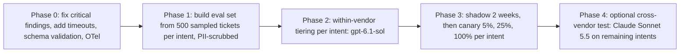

**Hypothetical evidence outcome (to be measured in the pilot):**

| Intent class | Share of tickets | gpt-6.1-sol verdict | Action |
| --- | --- | --- | --- |
| Order status and tracking | 40% | `compatible` | Move |
| Returns and refunds policy | 30% | `compatible-with-adapter` (prompt variant plus refund-amount validator) | Move with adapter |
| Billing disputes | 18% | `lossy`: resolution-quality delta CI \[−7, −1\] points | Stay on astra; re-test with Sonnet 5.5 in Phase 4 |
| Escalations and legal threats | 12% | Not tested; policy keeps the flagship plus human review | Stay |

**Economics if the hypothetical holds** (70% of tickets on gpt-6.1-sol at $2/$10, i.e. $0.020 per attempt):

```latex
0.30 \times \$0.100 + 0.70 \times \$0.020 = \$0.044 \text{ per attempt} \Rightarrow \approx \$52.8\text{k/month}
```

That is a projected marginal reduction of about $67k per month **before** migration costs. Migration expense is estimated at 6–10 engineer-weeks, plus about 4 weeks of dual-running evals and shadow traffic, plus re-indexing (none, since the embedder is unchanged). Every figure is presented as a range in the product, with the success-rate CI widening the range. If shadow traffic shows a higher escalation rate for the moved intents, the cost per **successful** task rises and the product recomputes the recommendation.

**Governance trail.** Approvals by the support-ops owner (quality) and the security lead (data flows unchanged, same vendor). The risk acceptance is recorded for the `compatible-with-adapter` intent, and the rollback plan is a flag flip per intent plus the previous manifest revision.

## 24. ADRs and architectural tradeoffs

| ADR | Decision | Alternatives considered | Tradeoff accepted | Revisit trigger |
| --- | --- | --- | --- | --- |
| ADR-001 | Modular monolith (FastAPI) plus workers; import-linter boundaries | Microservices; serverless functions | Single deploy blast radius; scaling granularity is per process type | > 3 teams, or a module needs a different runtime or SLA |
| ADR-002 | Postgres for relational, JSONB documents, queue and eval rows | Mongo plus Kafka plus ClickHouse | JSONB query ergonomics; eval analytics are slower at scale | Eval rows > 50M per month or analytic p95 > 5 s |
| ADR-003 | JSON Schema 2020-12 plus `x-aistack` as canonical; Pydantic for authoring | Protobuf/IDL; Pydantic as source of truth | Custom vocabulary needs our tooling; non-Python users get schema only | TypeScript generation in P2 |
| ADR-004 | Typed in-process adapters; MCP only at ecosystem boundaries | MCP everywhere | We maintain adapters ourselves | A port with > 10 third-party implementations favours MCP |
| ADR-005 | Three-dimension compatibility with five verdicts; `unverified` default | Single score; vendor claims | More UI complexity; fewer "green" results early | User research shows verdicts confuse more than they help |
| ADR-006 | Generated apps have no runtime dependency on the platform; OSS `aistack-runtime` library | Hosted runtime or proxy | Less telemetry, weaker lock-in, harder monetisation | Customers ask for a hosted control plane (P2 option) |
| ADR-007 | Deterministic template-based generation; LLM only for prose and synthetic cases | LLM-generated code | Less flexible output; templates need maintenance | Templates > 10 or demand for bespoke code (delegate to coding agents) |
| ADR-008 | Static-only brownfield import at P0; no code execution | Execute tests in a sandbox | Lower recall on dynamic patterns | P1 runtime evidence via uploaded OTel traces |
| ADR-009 | Postgres job queue and outbox; no workflow engine for the platform | Temporal from day one | Hand-rolled retries and long waits | Multi-day approval workflows in P1/P2 |
| ADR-010 | Price catalog with human-reviewed updates | Live scraping; vendor APIs | Lag of up to 24–48 h on price changes | Vendors expose machine-readable price APIs |
| ADR-011 | Two model providers at P0 (Anthropic, OpenAI) via native SDKs | LiteLLM as the only adapter | More code; deeper fidelity (caching, structured output) | P1 adds a LiteLLM adapter for breadth, labelled with lower fidelity |
| ADR-012 | BYOK for live tests and evals; we never pay customer inference | Platform-billed inference | Onboarding friction (key entry) | Free-credit offer for the first run if conversion suffers |

## 25. P0/P1/P2 roadmap and dependency sequence

### 25.1 Team assumptions

Six engineers: one tech lead and architect, three Python backend, one full-stack (Next.js plus Python), one eval or ML engineer. Plus 0.5 PM, 0.5 product designer and 0.25 security engineer (fractional or contractor). Effective focus is assumed at 80% after meetings, support and on-call. Engineer-week estimates are mid-points with ±25% uncertainty.

### 25.2 P0 effort

| Workstream | Engineer-weeks |
| --- | --- |
| Platform kernel: auth, RBAC, RLS, jobs, outbox, audit, API skeleton | 10 |
| Manifest: schema, versions, diff, overrides, rollback, push/pull | 8 |
| Contracts: vocabulary, decorators, conversion, compat checker, OpenAPI export | 8 |
| Catalog plus price catalog (about 40 entries, review tooling) | 6 |
| `aistack-runtime`: 2 model adapters, embedder, pgvector, 1 tool, middleware, conformance suites | 12 |
| Recommender plus onboarding (profile extraction, rules, question selection, golden set) | 9 |
| Factory plus 3 templates plus template CI | 12 |
| Eval harness, synthetic cases, statistics | 9 |
| Compatibility engine plus swap harness (one evidenced swap) | 7 |
| Cost engine | 5 |
| Brownfield importer, 24-rule pack, 15 labelled fixture repos | 10 |
| Web UI: 5 screens | 16 |
| Sandbox infrastructure, security hardening, SBOM, external pen test prep | 7 |
| Docs and developer relations | 4 |
| **Total** | **133** (about 28 calendar weeks at 6 × 0.8; includes a 15% integration allowance) |

**Updated for the demo-accepted scope (section 7.5, backlog E15).** E15 now totals 93 engineer-days (every demo requirement plus the demo learnings promoted to P0), bringing story work to 673 d. The P0 total becomes about **155 engineer-weeks** with the 15% allowance, or about **32 calendar weeks** for six engineers (6 × 0.8).

**Scope challenge.** 28 weeks is too long for a first validation loop. The recommended plan is two releases:

- **P0-alpha (week 16):** CLI plus API only, with the `simple-llm` and `rag` templates, manifest, contracts, both adapters, the evals and cost engines, and the evidenced swap. No web UI beyond a read-only manifest viewer. That puts it in front of 30–50 developers to test H1 and H2.
- **P0-GA (week 28):** adds the tool-workflow template, web layered cake and modal, brownfield importer and the remaining requirements.

Cuts if the team is 4 engineers instead of 6: defer FR-CON-3 (TypedDict and dataclass import), FR-GEN-3's 3-way merge (regenerate to a branch instead) and the Import Assessment screen (HTML report only). That brings the total to about 110 engineer-weeks, roughly 34 weeks at 4 × 0.8.

### 25.3 Phases

| Phase | Window | Theme | Exit criteria |
| --- | --- | --- | --- |
| P0-alpha | Weeks 0–16 | Developer CLI loop | 3 golden flows green; 30 external devs onboarded; H1 signals measured |
| P0-GA | Weeks 16–28 | Full Builder Mode plus limited Architect Mode | All P0 FRs pass; SLOs met for 4 weeks; 10 design-partner imports |
| P1 | Months 7–12 | Enterprise pilot: runtime evidence, migration planning, SSO, approvals, LiteLLM and Gemini adapters, MCP server for coding agents, JEV as a `DecisionModel` option | 3 paid pilots; one evidence-backed migration completed by a customer |
| P2 | Months 13–24 | Continuous assessment: drift, policy-as-code, automated change proposals, verified migrations, TypeScript, self-hosted option | Net revenue retention and policy adoption targets (section 27) |

### 25.4 Dependency sequence

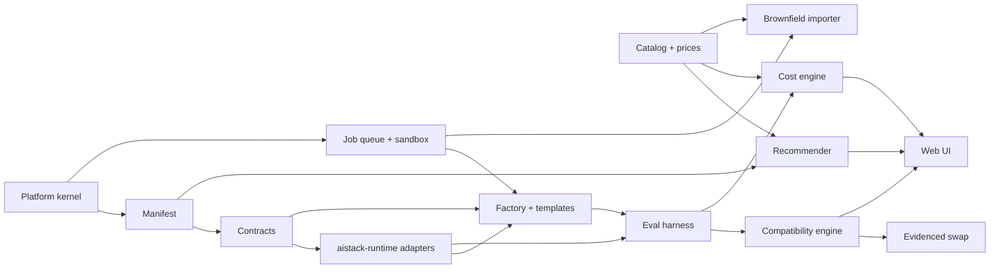

The critical path is kernel → manifest → contracts → runtime → factory → evals → compatibility → evidenced swap. The catalog, cost engine and importer run in parallel off the critical path.

### 25.5 AI-assisted delivery: Claude implements, two engineers steer

The build will be done mainly by Claude (Claude Code), with Claude writing roughly 85–90% of the code. People are then needed for direction, review, security sign-off and work that cannot be delegated. That cuts human effort from 580 to about **145 engineer-days (167 with the 15% allowance)**. The expected calendar becomes an alpha in about 12 weeks and GA in about 21 weeks with two engineers. These are model-based estimates, to be recalibrated after M1.

**Human effort by epic.** Each factor reflects how much the work compresses: boilerplate, adapters, templates, tests and docs about 5–6×; algorithmic modules about 4×; labelling, vendor-fact checks, UX iteration and the pen test about 1–2×.

| Epic | Engineer-days, people only | Human days with Claude | Work that stays human |
| --- | --- | --- | --- |
| Platform foundations | 35 | 7 | Review of RLS, auth and tenant isolation |
| Manifest | 37 | 6 | — |
| Contracts | 40 | 8 | `x-aistack` vocabulary design |
| Catalog and prices | 30 | 10 | Checking vendor facts and licences |
| Model adapters | 52 | 13 | Live-API edge cases, recorded fixtures |
| Recommender | 36 | 13 | Labelling the 60-prompt golden set |
| Factory and templates | 60 | 10 | — |
| Evals | 45 | 12 | Accepting test cases |
| Compatibility and swap | 35 | 9 | Judging swap evidence |
| Cost engine | 25 | 5 | — |
| Brownfield importer | 50 | 16 | Labelling the 15 fixture repos |
| Web UI | 80 | 20 | Design and UX iteration |
| Security | 35 | 12 | External pen test and remediation sign-off |
| Docs | 20 | 4 | — |
| **Total** | **580** | **145** (167 with allowance) |  |

**Team:** a lead engineer (architecture and security review), a full-stack engineer (UI and templates), plus a part-time PM and designer. Each engineer runs 2–3 parallel Claude Code sessions, using Sonnet 5.5 for most coding and Opus 5.5 for about 15% of the work (RLS, verdict engine, contract vocabulary, semantic diff).

| Scenario | Human days | 2 engineers: alpha / GA | 3 engineers: alpha / GA |
| --- | --- | --- | --- |
| Optimistic (little rework) | 109 | about week 8 / 16 | about week 6 / 16 |
| **Expected** | **167** | **about week 12 / 21** | about week 8 / 15 |
| Conservative (heavy rework) | 253 | about week 19 / 32 | about week 13 / 21 |

Some floors cannot be compressed whoever writes the code: 4 weeks of SLO data before GA, pen-test scheduling and remediation (about 3 weeks), and about 3 weeks of alpha-cohort feedback. GA earlier than about week 16 is not realistic.

**Token estimate.** Applies to about 530 engineer-day equivalents Claude can do. The human-only items above are excluded.

| Assumption or result | Low | Expected | High |
| --- | --- | --- | --- |
| Agent steps per engineer-day of work | 60 | 100 | 160 |
| Rework multiplier | 1.2 | 1.5 | 2.0 |
| Context read per step (tokens) | 40k | 60k | 90k |
| Output per step (tokens) | 500 | 700 | 1,000 |
| Cache hit rate | 92% | 90% | 85% |
| Total agent steps | 38k | 80k | 170k |
| Input tokens | 1.5B | 4.8B | 15B |
| Output tokens | 19M | 56M | 170M |
| Agent run time (25–40 s per step) | about 265 h | about 660 h | about 1,900 h |
| Cost at API rates, all Opus 5.5 | about $1.3k | about $4.4k | about $17.5k |
| Cost at API rates, all Sonnet 5.5 | about $0.6k | about $2.2k | about $9k |

API rates are from [Claude pricing](https://claude.com/pricing) as of 2026-10-08 (Opus 5.5: $4 input, $20 output, $0.20 cache read, $5 cache write per million tokens; Sonnet 5.5 at half). Add a few hundred dollars for the product's own live model calls during development (probes, eval runs, the evidenced swap).

**Subscription fit (expected 660 agent-hours).** Plans have rolling 5-hour and weekly caps shared across chat and Claude Code, and Anthropic does not publish them as tokens. The hours below are **third-party estimates from mid-2026**, not official.

| Plan | Estimated weekly Claude Code hours | Weeks of quota if all Sonnet | Weeks if all Opus | What limits the pace |
| --- | --- | --- | --- | --- |
| Pro | Sonnet 40–80; Opus limited | 8–17 | Not practical | The usage quota |
| Max 5x | Sonnet 140–280, Opus 15–35 | 2.5–5 | 19–44 | Quota, if Opus-heavy |
| Max 20x | Sonnet 240–480, Opus 24–40 | 1.5–3 | 17–28 | Human review (recommended) |
| API billing | No weekly cap | — | — | Human review, about $2–5k total |

**Recalibration rule.** After M1, divide the tokens actually used (from `/usage` in Claude Code, or API billing) by M1's 35 engineer-days. Rescale the token and calendar tables with that real rate, and re-plan M2–M10 if it differs by more than 30%.

**Updated for the demo-accepted scope (E15).** Human effort with Claude rises from 145 to about **173 days (199 with allowance)**. The expected calendar with two engineers becomes alpha at about **week 14** and GA at about **week 25**. Expected tokens rise about 17%, to roughly 5.6B input and 66M output, or about $5.1k at Opus 5.5 API rates.

## 26. Pricing and GTM hypotheses

All prices below are hypotheses to test, not decisions. We never mark up or resell inference (BYOK, ADR-012).

| Tier | Hypothesised price | Includes | Who | Hypothesis to test |
| --- | --- | --- | --- | --- |
| Free | $0 | CLI, OSS runtime, 3 projects, manifest history 30 days, 20 platform eval runs per month (BYOK), public catalog | Maya | Free tier drives ≥ 70% of team-plan signups |
| Pro | $29 per user per month | Unlimited projects, full history, swap harness, cost scenarios, GitHub CI check | Dev | 4% of active free users convert within 60 days |
| Team | $79 per user per month (min 3) | Shared catalog and contracts, org policies (basic), RBAC, imports of 10 repos | Startup teams, platform pods | Team plans reach 30% of revenue by month 12 |
| Architecture Assessment (service-assisted) | $15k–$40k fixed fee | Up to 10 repos imported, usage data ingestion, assessment plus migration plan, 2 workshops | Arjun (pilot) | 3 of 10 design partners pay; ≥ 50% convert to Enterprise |
| Enterprise | From $60k per year (platform) plus per-repo continuous assessment | SSO/SCIM, approvals, audit export, EU region, policy-as-code, SLAs, premium support | Arjun, Lena | Average contract value ≥ $90k by month 18 |

**GTM motions.**

1. **Developer-led (P0).** Open-source `aistack-runtime` and templates on GitHub; "stack teardown" content (honest comparisons with evidence); a Claude Code and Cursor agent skill that reads `aistack.yaml`; launch on Hacker News and Python and AI communities. Metric: weekly active projects.
2. **Design partners (from P0-alpha).** 10 companies with ≥ 5 AI apps or ≥ $20k per month of model spend. Free assessment in exchange for case-study rights and labelled fixture repos.
3. **Enterprise (P1).** Founder-led sales triggered by cost events (provider price change, vendor acquisition, budget review). Partners: consulting firms running AI modernisation, and observability vendors (we feed them; they feed us evidence).

**Pricing risks.** Seat pricing may misalign with value, since a few architects can drive outcomes that save a lot. Test a per-assessed-application metric in P1.

## 27. Metrics and experiment plan

**North-star metric:** weekly active manifests, meaning projects whose manifest was validated, tested or changed in the last 7 days. It captures the thesis that the manifest is the system of record.

| Funnel stage | Metric | P0-GA target (90 days) | Instrumentation |
| --- | --- | --- | --- |
| Activation | Project created → app generated | ≥ 60% | Product analytics events |
| Activation | Generated → first passing `aistack test` | ≥ 35% of created | CLI telemetry (opt-in) plus CI check |
| Time to value | Median minutes from first question to a passing test | ≤ 15 | Event timestamps |
| Engagement | Projects with ≥ 2 manifest revisions in 30 days | ≥ 40% of retained | Manifest table |
| Retention | Week-4 retention of activated users | ≥ 20% | Cohorts |
| Decision impact | Cost comparison viewed → component changed | ≥ 25% | Event join |
| Trust | Recommendation edited away from default | Track only (watch for > 50%) | Diff ops |
| Quality | Template recommendation accuracy on golden set | ≥ 90% | CI |
| Quality | Importer precision / recall | ≥ 90% / ≥ 85% | Fixture CI |
| Enterprise | Design-partner imports → paid pilot | 3 of 10 | CRM |
| Reliability | API availability / generation p95 | 99.5% / ≤ 45 s | SLO dashboards |

### Experiments (first 6 months after alpha)

| # | Hypothesis | Design | Success criterion |
| --- | --- | --- | --- |
| E1 | Showing None layers with reasons increases trust and activation | A/B: None rows visible vs hidden | +5 points generate→test rate, no drop in satisfaction |
| E2 | Cost per success beats cost per call for decisions | A/B on the cost panel headline | Higher model-change rate with no rise in gate failures |
| E3 | Conditional questions beat a fixed 8-question form | A/B onboarding | Lower time to first generation; equal recommendation acceptance |
| E4 | Kitchen analogies help beginners without harming experts | A/B labels; segment by self-reported experience | Beginners +activation; experts no worse on task-success survey |
| E5 | A free first eval run (platform-paid, ≤ $0.50) lifts BYOK conversion | Holdout | +10 points in first live-test completion; CAC within budget |
| E6 | The coding-agent skill drives retained usage | Cohort comparison of skill installers | Higher week-4 retention |

## 28. Risks, uncertainties and validation needs

| # | Risk | Likelihood | Impact | Mitigation | Validation needed |
| --- | --- | --- | --- | --- | --- |
| R1 | Coding agents (Claude Code, Cursor, Codex) absorb the "idea to app" job | High | High | Position the manifest and evidence as their input; ship the agent skill and MCP server; do not compete on code generation | Interview 20 coding-agent users on stack decisions |
| R2 | Catalog and price data go stale and erode trust | High | High | `verified_at` on every entry, staleness UI, nightly diff with human review, a cap on catalog size | Measure staleness weekly; target ≤ 5% stale |
| R3 | Compatibility verdicts read as guarantees and lead to customer incidents | Medium | High | Scoped verdicts, evidence expiry, "not a guarantee" copy, staged rollout required for `lossy` | Legal review of claims; usability test of verdict comprehension |
| R4 | Eval suites too small to detect regressions | Medium | High | Show the detectable effect size; push production samples in P1 | Power analysis per template |
| R5 | Brownfield import security incident (source leak) | Low | Critical | No execution, egress-denied sandbox, 1 h purge, external pen test before GA | Pen test; threat model review |
| R6 | Enterprises won't connect repos to a SaaS | Medium | High | Zip upload, self-hosted import runner (P2), derived-facts-only retention | Ask 10 design partners for their security requirements in month 1 |
| R7 | Recommendations reflect our catalog's bias (missing vendors) | Medium | Medium | Publish the catalog methodology; `custom` layer state; community entries labelled | Track "custom" frequency by layer |
| R8 | Health-related example implies medical capability | Low | High | Deterministic nutrition math, dosing refusal gate, disclaimers, no PHI by default | Clinical-advisor review of the example copy |
| R9 | Vendor terms forbid benchmark publication | Medium | Medium | Publish only the user's own evidence privately; aggregate public data only where terms allow | Legal review per provider's terms |
| R10 | Scope overrun (P0 = 133 engineer-weeks) | High | High | Alpha/GA split; cut list in 25.2; weekly burn-up | Re-estimate at end of M3 |
| R11 | Market churn: acquired or deprecated vendors (Helicone, TGI, Manus) | High | Medium | Catalog status field; deprecation alerts to affected manifests | — (this is also a feature) |
| R12 | Protocol volatility (MCP auth changes, AG-UI governance) | Medium | Medium | Protocols at the edges only (ADR-004); version pins | Track the spec changelog |

**Risks added by the demo-accepted scope:**

| # | Risk | Mitigation | Validation needed |
| --- | --- | --- | --- |
| R13 | Store prices are sample values; real Walmart and Whole Foods prices vary by location and date | Always labelled "sample"; links go to the store's search page only | Partner or affiliate API terms; price freshness under 24 h |
| R14 | Library photos show similar dishes, not the recipe | Captioned "similar dish" with attribution and licence | Licence audit of every photo; image-generation vendor review (P1) |
| R15 | Approximate nutrient values could mislead a person managing diabetes | Disclaimer on every card; carbs never from the model; verified source before GA | Replace the table with USDA FoodData Central; dietitian review |
| R16 | Keto and goal tiles read as medical advice | Care-team note on Keto; goals described as targets, not guidance | Clinical-advisor review of goal copy |
| R17 | Enhancement drafts may be taken as approved scope | Every draft shows who drafted it; drafts are suggestions until a PM accepts them | PM review workflow (P1) |

**Open questions to resolve before M4.** (1) Is the evidence corpus legally shareable across customers in anonymised form? (2) Will buyers accept seat pricing or demand value-based pricing? (3) Is Python-only acceptable to the first 10 design partners? (4) What minimum eval size will an enterprise risk officer accept for a `compatible` verdict?

## 29. Engineering backlog

The P0 backlog has 14 epics. Estimates are in engineer-days (d) and total 580 d (116 engineer-weeks) of story work. The section 25.2 figures add a 15% integration and stabilisation allowance, which gives 133. Each story's "done" is the linked FR acceptance criterion, plus tests, docs and an audit event where it mutates state.

| ID | Epic · story | FR | Est. | Milestone |
| --- | --- | --- | --- | --- |
| E1-1 | Kernel · Repo, CI, import-linter contracts for 11 modules, container image | — | 5d | M1 |
| E1-2 | Kernel · OIDC login (GitHub, Google), org/project/membership, RBAC policy module | PLT | 8d | M1 |
| E1-3 | Kernel · Postgres RLS on tenant tables plus a cross-tenant leakage test suite | NFR | 6d | M1 |
| E1-4 | Kernel · Job queue (SKIP LOCKED), outbox, idempotency keys, worker chaos test | NFR | 8d | M1 |
| E1-5 | Kernel · Audit log middleware plus hash chain | FR-PLT-3 | 4d | M2 |
| E1-6 | Kernel · OTel tracing, problem+json errors, OpenAPI publishing | FR-PLT-1 | 4d | M1 |
| E2-1 | Manifest · JSON Schema v1 plus `aistack validate` | FR-MAN-1 | 6d | M2 |
| E2-2 | Manifest · Immutable versions, JCS hashing, history API | FR-MAN-2 | 5d | M2 |
| E2-3 | Manifest · Semantic diff ops plus evidence invalidation | FR-MAN-3 | 8d | M3 |
| E2-4 | Manifest · Env overrides with allow-listed paths; resolve API | FR-MAN-5 | 5d | M3 |
| E2-5 | Manifest · Rollback; migration framework skeleton plus fixtures | FR-MAN-4/6 | 4d | M3 |
| E2-6 | Manifest · CLI push/pull with conflict detection | FR-MAN-8 | 5d | M4 |
| E2-7 | Manifest · Field provenance and confidence | FR-MAN-7 | 4d | M3 |
| E3-1 | Contracts · `x-aistack` meta-schema plus Pydantic decorators | FR-CON-1 | 8d | M2 |
| E3-2 | Contracts · Pydantic ↔ JSON Schema round-trip property tests | FR-CON-2 | 6d | M2 |
| E3-3 | Contracts · TypedDict, dataclass and function import (40 fixtures) | FR-CON-3 | 7d | M5 |
| E3-4 | Contracts · Version compat checker (30 fixture pairs) | FR-CON-5 | 8d | M3 |
| E3-5 | Contracts · OpenAPI 3.1 export | FR-CON-4 | 4d | M3 |
| E3-6 | Contracts · 12 P0 standard contracts (chat, retrieval, tool, stream, error, context) | FR-CON-1 | 7d | M2 |
| E4-1 | Catalog · Data model, versioning, staleness, admin review UI (minimal) | FR-CAT-1 | 10d | M2 |
| E4-2 | Catalog · About 40 entries with sources and licence class | FR-CAT-1 | 12d | M3 |
| E4-3 | Catalog · Price catalog, nightly diff job, review queue | 15.5 | 8d | M4 |
| E5-1 | Runtime · Ports plus middleware (deadline, retry, limiter, breaker, span, redaction, validation) | FR-ADP | 12d | M3 |
| E5-2 | Runtime · Anthropic adapter plus conformance suite plus recorded fixtures | FR-ADP-1 | 10d | M3 |
| E5-3 | Runtime · OpenAI adapter plus conformance suite plus fixtures | FR-ADP-1 | 10d | M4 |
| E5-4 | Runtime · Embedder, pgvector, search tool adapters | FR-ADP | 10d | M4 |
| E5-5 | Runtime · Nightly capability probes plus alerting | FR-ADP-2 | 6d | M5 |
| E5-6 | Runtime · PyPI release pipeline, SBOM, signing | NFR | 4d | M4 |
| E6-1 | Recommend · Profile extraction (structured output) plus golden set of 60 | FR-ONB-1 | 10d | M3 |
| E6-2 | Recommend · Rules engine, `driven_by`, None-by-default, policy filter | FR-REC-1/3/5 | 12d | M4 |
| E6-3 | Recommend · Follow-up selection by decision impact | FR-ONB-3 | 8d | M4 |
| E6-4 | Recommend · Rationale and alternatives writer; determinism test | FR-REC-2/4 | 6d | M4 |
| E7-1 | Factory · Copier engine, managed regions, plan/diff | FR-GEN-3 | 10d | M4 |
| E7-2 | Factory · `simple-llm` template plus CI matrix | FR-GEN-1/2 | 10d | M4 |
| E7-3 | Factory · `rag` template plus ingestion | FR-GEN-1 | 12d | M5 |
| E7-4 | Factory · `tool-workflow` template (PydanticAI, checkpoint, approval hook) | FR-GEN-1 | 15d | M7 |
| E7-5 | Factory · Diagrams, README, readiness, AGENTS.md generation | 16.3 | 8d | M5 |
| E7-6 | Factory · Deploy descriptors (Dockerfile, Fly, Render, Cloud Run) | 16.2 | 5d | M7 |
| E8-1 | Evals · pytest-native harness, metric types, evidence writer | FR-EVL-1 | 12d | M5 |
| E8-2 | Evals · Bootstrap CI, non-inferiority, power warning | 18.3 | 6d | M5 |
| E8-3 | Evals · Synthetic generation plus acceptance UI and CLI | FR-EVL-2 | 10d | M6 |
| E8-4 | Evals · Template baseline suites (≥ 25 cases each) | FR-EVL-1 | 9d | M5–M7 |
| E8-5 | Evals · Sandboxed BYOK run worker plus key handling | NFR | 8d | M5 |
| E9-1 | Compat · Verdict function plus rule trace plus evidence expiry | FR-CMP-1 | 10d | M6 |
| E9-2 | Compat · Swap harness (contract, eval, latency, cost) plus `aistack swap` | FR-CMP-2 | 15d | M6 |
| E9-3 | Compat · Evidenced Anthropic ↔ OpenAI swap on RAG; published report | FR-CMP-2 | 10d | M6 |
| E10-1 | Cost · Estimator with ranges and four cost classes | FR-CST-1/2 | 15d | M5 |
| E10-2 | Cost · Scenario API plus cascade and caching levers | 15.3 | 10d | M6 |
| E11-1 | Brownfield · Sandbox import worker, GitHub App, zip upload, purge | 20.4 | 12d | M7 |
| E11-2 | Brownfield · Signal parsers (lockfiles, AST, env, Docker) | FR-BRF-1 | 12d | M7 |
| E11-3 | Brownfield · Mapper plus confidence; 15 labelled fixture repos | FR-BRF-1 | 14d | M8 |
| E11-4 | Brownfield · 24-rule pack plus report | FR-BRF-2 | 12d | M8 |
| E12-1 | UI · Design system, auth shell, project list | — | 12d | M5 |
| E12-2 | UI · Onboarding with assumptions panel | FR-ONB-2 | 12d | M7 |
| E12-3 | UI · Layered cake, rails, cost and limits columns | 17.2 | 22d | M7 |
| E12-4 | UI · Comparison modal | 17.3 | 12d | M8 |
| E12-5 | UI · Generate and evidence views; import assessment view | 17.6 | 14d | M9 |
| E12-6 | UI · Accessibility audit and fixes (WCAG 2.2 AA) | NFR | 8d | M9 |
| E13-1 | Security · Threat model, sandbox hardening (gVisor), KMS envelope encryption | NFR | 15d | M5–M7 |
| E13-2 | Security · External pen test plus remediation | NFR | 10d | M9 |
| E13-3 | Security · Backups, restore drill, SLO dashboards | NFR | 10d | M9 |
| E14-1 | Docs · Quickstart, concepts, CLI reference, catalog methodology | — | 12d | M4–M9 |
| E14-2 | Docs · Coding-agent skill (reads `aistack.yaml`) | — | 8d | M8 |

**E15 · Demo-accepted scope (section 7.5), 96 engineer-days in total (E15-1 to E15-29):**

| ID | Story | FR | Est. |
| --- | --- | --- | --- |
| E15-1 | One-question wizard, typed suggestions, live summary | FR-DMO-1/2/3 | 2d |
| E15-2 | App preview: photo, recipe card, tunable tiles | FR-DMO-5/6/7 | 5d |
| E15-3 | Nutrients per meal, goal tiles, deterministic goal boosting | FR-DMO-8/9/10/11 | 5d |
| E15-4 | Health conditions and restrictions | FR-DMO-12 | 3d |
| E15-5 | Store prices, budget options, savings panel | FR-DMO-13/14/15 | 4d |
| E15-6 | Licensed photo library and matcher | FR-DMO-5 | 2d |
| E15-7 | Deployment choice per layer, stored in the manifest | FR-DMO-19 | 4d |
| E15-8 | Eval & Quality column | FR-DMO-20 | 3d |
| E15-9 | Guardrails column, review modal, source viewer | FR-DMO-21/23 | 4d |
| E15-10 | Agent registry layer and modal | FR-DMO-22 | 3d |
| E15-11 | Enhancement → PRD drafter (Claude + offline rules) | FR-DMO-17/18 | 5d |

The verified nutrition source (USDA FoodData Central) is P0 MVP (see "Demo learnings promoted to P0 MVP"). P1 follow-ons: live store prices (partner API, by location), per-recipe image generation, and an LLM-assisted profile pass.

**Deferred to P1 backlog (not estimated in detail):** runtime trace ingestion, semantic gap detection, adapter generation PRs, migration planner, multi-approver workflows, SSO/SCIM, EU region, LiteLLM and Gemini adapters, MCP server and client, AG-UI adapter, the JEV `DecisionModel` adapter, calibrated LLM judges, OpenFeature rollout integration.

## 30. First ten milestones and final build recommendation

| Milestone | Week (from start) | Demonstrable outcome | Exit test |
| --- | --- | --- | --- |
| M1 Foundations | 3 | Login, orgs, RLS, job queue, OTel, CI with module boundaries | Cross-tenant leakage suite green; a killed worker's job completes |
| M2 Manifest and contracts core | 6 | `aistack validate` on the v1 schema; 12 standard contracts; catalog skeleton | FR-MAN-1/2, FR-CON-1/2 pass |
| M3 First adapter and diff | 9 | Anthropic adapter passes conformance; semantic diff; overrides; profile extraction golden set | FR-MAN-3/5, FR-ADP-1 (Anthropic) pass |
| M4 First generated app | 11 | `aistack init` → `generate` → `test` for `simple-llm` offline; OpenAI adapter | FR-GEN-1/2 on simple-llm; FR-REC-1 ≥ 90% |
| M5 RAG plus evals plus cost | 14 | `rag` template; eval harness with CIs; cost estimator with ranges; BYOK sandbox runs | FR-EVL-1, FR-CST-1 pass |
| M6 **P0-alpha**: evidenced swap | 16 | `aistack swap` produces a full Anthropic ↔ OpenAI report on RAG; 30 external developers onboarded | FR-CMP-1/2 pass; alpha cohort metrics flowing |
| M7 Web Builder Mode plus tool workflow | 20 | Onboarding and layered cake in the web app; `tool-workflow` template; import worker sandbox | FR-ONB-2, FR-GEN-1 (all 3 templates) |
| M8 Architect Mode (limited) | 23 | Repo import → inferred manifest → 24-rule findings; comparison modal; coding-agent skill | FR-BRF-1/2 on 15 fixture repos |
| M9 Hardening | 26 | Pen test remediated; accessibility audit; restore drill; SLO dashboards | 0 open critical or high findings; RTO drill ≤ 4 h |
| M10 **P0-GA** | 28 | Public launch; 10 design-partner imports scheduled | All P0 FRs pass; 4 weeks of SLO data at target |

### Final build recommendation

**Build it, but as an evidence-and-manifest product first and a generator second.** The generator is the on-ramp. The manifest, contracts and compatibility evidence are what the customer keeps paying for.

1. **Start with the alpha slice (M1–M6, 16 weeks):** CLI and API, two templates, two providers and one rigorously evidenced swap. If developers don't keep `aistack.yaml` in their repos and re-run `aistack test` after the first generation (H2), stop and reassess before building the web UI and importer.
2. **Hold the line on simplicity.** No microservices, no message broker, no MCP-everywhere, no multi-agent templates and no workflow engine in P0. Every one of these is a catalog option the product can recommend, not something the platform needs.
3. **Never ship an unqualified claim.** Every verdict has evidence or says `unverified`. Every cost has a range and a source. Every catalog entry has a date.
4. **Make coding agents a channel.** Ship the agent skill in P0 and the read-only MCP server in P1, so Claude Code and Cursor users meet the manifest where they already work.
5. **Earn the enterprise motion with design partners from week 8.** Their repos become importer fixtures, and their cost events become the first P1 migrations.

## Critical self-review and revisions

The draft was reviewed for overengineering, feasibility, contradictions and unverified vendor assumptions. The changes below are already applied in the sections above.

### What was cut or changed

| Issue found | Where | Revision |
| --- | --- | --- |
| Brief implied an MCP server per layer | 19, ADR-004 | Typed in-process adapters; MCP only at ecosystem boundaries and for coding agents (P1) |
| Separate document, vector and analytics stores for the platform | 10.4, ADR-002 | Postgres JSONB plus partitioned tables; ClickHouse only on a measured trigger |
| Workflow engine for platform jobs | 19.3, ADR-009 | Postgres queue plus outbox; Temporal or DBOS only for generated apps that need durability level 3 |
| LLM-generated application code | 16, ADR-007 | Deterministic templates; LLMs write prose and draft eval cases only |
| Single "compatibility %" score | 14.3 | Removed; three dimensions plus five verdicts with evidence |
| JEV as an optimisation service | 15.4 | Optional `DecisionModel` port (P1). Not recommended for the running example, where savings are about $2 per month. |
| Full web UI in the first release | 25.2 | Alpha is CLI and API at week 16; web UI at GA |
| Timeline stated as 26 weeks in the summary vs 28 in the estimate | Lead, decisions, 25 | Reconciled to 28 weeks (133 engineer-weeks including a 15% allowance), alpha at week 16 |
| Backlog total did not match the roadmap | 29 | Stated explicitly: 116 engineer-weeks of stories plus 15% allowance gives 133 |
| "Cost per successful task" figures could read as measurements | 15.2, 22.3, 23 | Every table labelled: prices verified, token profiles and success rates illustrative or hypothetical |
| Platform never in the data path vs "we run evals" | 8, ADR-012 | Evals run in sandboxed workers with the customer's own keys; generated apps never call the platform |

**Change log, 2026-10-08: demo design accepted into the PRD.** These sections changed:

- Section 7.5 adds FR-DMO-1 to 25.
- Section 9 adds the Agent registry layer, Guardrails as a column, and deployment per layer.
- Section 11 adds manifest `deployment` and `agents`.
- Section 12.5 records the contract versions.
- Section 17 updates the UX.
- Section 25 updates effort (155 engineer-weeks; AI-assisted GA about week 25).
- Section 28 adds R13-R17.
- Section 29 adds backlog E15.

Where older text conflicts, section 7.5 wins.

### Remaining tensions (accepted, monitored)

- **Determinism vs LLM extraction.** FR-REC-2 requires deterministic recommendations, but profile extraction uses an LLM. The resolution: determinism applies from a given profile onward, and the extracted profile is stored and editable.
- **Vendor neutrality.** The P0 catalog is weighted toward providers we have adapters for. The UI labels other vendors `unverified` instead of hiding them. This is "replaceable where verified", not neutrality.
- **Promptfoo neutrality.** It is now OpenAI-owned. When it is used as a red-team runner in comparisons involving OpenAI, the report discloses this.
- **The health example.** It is a good demonstration of semantic contracts, but it carries regulatory and safety risk. The design keeps PHI out by default and needs a clinical-advisor review (R8).

### Evaluation against the brief's criteria

| Criterion | Assessment | Evidence in this PRD |
| --- | --- | --- |
| Clear product differentiation | Strong, if R1 (coding agents) is managed | 2, 4, ADR-005/006 |
| Developer accessibility | Strong: three questions, offline CLI, OSS runtime | 6, 16, 22.5 |
| Enterprise value | Credible for P1. P0 offers only assessment previews. | 20, 21, 23.2 |
| One common underlying platform | Met: one manifest, one registry, one evidence store for both modes | 6, 10 |
| Manifest-centred architecture | Met | 11, 14 (evidence invalidation on diff) |
| Semantic and behavioural interoperability | Met in design. Behavioural evidence is proven for only one pair at P0. | 12, 14 |
| Cost visibility | Met, with ranges and provenance | 15, 22.3 |
| Minimal initial complexity | Met: None-by-default layers, monolith, Postgres | 5, 10, 19 |
| Enterprise upgrade paths | Defined per capability | 21, 25.3 |
| Testable engineering requirements | Met: every FR has an acceptance test | 7, 29 |
| Credible small-team implementation | Tight but credible with the alpha/GA split and cut list | 25, 30 |

### Unverified items that must be confirmed before external publication

Gemma licence (sources conflict); Mem0, Letta and Supermemory licences (sources conflict); MultiOn operating status; Manus ownership after the reported unwind; whether the Lakera acquisition closed; n8n licence wording; Google Gemini API pricing (aggregator figures only, $1.50/$9.00 for Gemini 3.5 Flash); OpenAI caching discount for gpt-6.1-sol; the USDA FoodData Central API's terms; SOC 2 timelines (targets only).

## Sources

Sources were opened or searched on 2026-10-08. "Primary" means the vendor's own page.

| Topic | Source | Type |
| --- | --- | --- |
| Claude API prices (Fable 5.1, Opus 5.5, Sonnet 5.5, Haiku 5.5; batch 50%; caching) | [claude.com/pricing](https://claude.com/pricing) | Primary |
| OpenAI API prices (gpt-6-astra, gpt-6.1-sol, gpt-6-luna; batch 50%) | [developers.openai.com/api/docs/pricing](https://developers.openai.com/api/docs/pricing) | Primary |
| JEV: launch, outputs, price, analyst views | [TechTarget](https://www.techtarget.com/it-infrastructure/news/366650696/Jev-decision-model-touted-as-quicker-cheaper-LLM-alternative) | Press |
| JEV: context limits, access paths, fit and non-fit | [Firecrawl: What is Jev?](https://www.firecrawl.dev/blog/what-is-jev) | Third-party technical |
| JEV: independent annotation evaluation | [arXiv 2609.24574](https://arxiv.org/pdf/2609.24574) | Preprint (search summary) |
| JEV: vendor speed and cost claims | [Tom's Hardware](https://www.tomshardware.com/tech-industry/artificial-intelligence/typesafe-ais-jev-offers-an-alternative-to-llms-that-claims-to-be-193x-faster-and-445x-cheaper-system-one-type-model-is-bespoke-for-probabilistic-decision-making) | Press |
| Gemini Spark | [Engadget](https://engadget.com/2176556/googles-gemini-spark-is-an-agentic-ai-assistant), [The Next Web](https://thenextweb.com/news/google-gemini-spark-agentic-assistant-gmail-io-2026) | Press |
| Manus acquisition and review | [Fortune](https://www.fortune.com/2025/12/30/meta-manus-acquisition-claims-no-chinese-ownership-singapore), [Gigazine](https://gigazine.net/gsc_news/en/20260614-meta-unwind-manus-deal-beijing-demand) | Press, secondary |
| Promptfoo to OpenAI | [Security Boulevard](https://securityboulevard.com/2026/03/openai-acquires-security-startup-promptfoo-to-fortify-ai-agents) | Press |
| Langfuse to ClickHouse | [ClickHouse blog](https://clickhouse.com/blog/clickhouse-acquires-langfuse-open-source-llm-observability) | Primary |
| Lakera to Check Point | [CSO Online](https://www.csoonline.com/article/4058653/check-point-acquires-lakera-to-build-a-unified-ai-security-stack.html) | Press |
| Robust Intelligence to Cisco AI Defense | [Cisco](https://www.cisco.com/site/us/en/products/security/ai-defense/robust-intelligence-is-part-of-cisco/index.html) | Primary |
| Helicone to Mintlify, maintenance mode | [Helicone blog](https://helicone.ai/blog/joining-mintlify) | Primary |
| TGI maintenance mode | [Hugging Face TGI docs](https://huggingface.co/docs/text-generation-inference/index) | Primary |
| MCP and the Agentic AI Foundation | [Linuxiac](https://linuxiac.com/model-context-protocol-joins-linux-foundation-in-major-ai-shift/), [AAIF](https://aaif.io/blog/aaifs-first-quarter-success-story-new-members-technical-wins-and-open-governance) | Press, primary |
| AG-UI protocol | [CopilotKit AG-UI docs](https://docs.copilotkit.ai/ag-ui) | Primary |
| Arcade and MCP authorisation | [SiliconANGLE](https://siliconangle.com/2025/11/25/arcade-dev-anthropic-advance-mcp-new-secure-authorization-flow/), [Arcade docs](https://docs.arcade.dev/home/mcp-overview) | Press, primary |
| MultiOn status | [MultiOn blog](https://multion.ai/blog/2024-eoy-team-and-business-updates) | Primary (dated); current status unverified |
| Open-weight licences | [DataNorth](https://datanorth.ai/blog/the-best-open-source-llm-in-2026), [Let's Data Science](https://letsdatascience.com/blog/open-source-vs-closed-llms-choosing-the-right-model-in-2026) | Secondary; check licence files |
| Memory-layer licences and architecture | [mcp.directory comparison](https://mcp.directory/blog/mem0-vs-letta-vs-zep-vs-cognee-2026) | Secondary, conflicting |
| AI gateway landscape | [TrueFoundry guide](https://truefoundry.com/blog/a-definitive-guide-to-ai-gateways-in-2026-competitive-landscape-comparison) | Vendor-authored |
| Gemini 3.5 Flash price | [pricepertoken.com](https://pricepertoken.com/pricing-page/model/google-gemini-3.5-flash) | Aggregator, unverified |

Not re-verified this session and stated from general knowledge: framework and SDK categorisations (LangGraph, CrewAI, AG2, CAMEL, Mastra, PydanticAI, OpenAI Agents SDK, Google ADK), sandbox vendors (E2B, Daytona, Modal), vector stores, automation vendors, and standards (JSON Schema 2020-12, OpenAPI 3.1, RFC 9457, RFC 8785, OpenTelemetry GenAI conventions, CycloneDX, Sigstore).

Subscription usage estimates for section 25.5 (third-party, unofficial): [zenken](https://ai.zenken.co.jp/en/post/claude-usage/), [ai-toolbox](https://www.ai-toolbox.co/claude-management-and-productivity/claude-usage-limits-2026), [DataCamp](https://www.datacamp.com/tutorial/claude-code-usage-limits).
