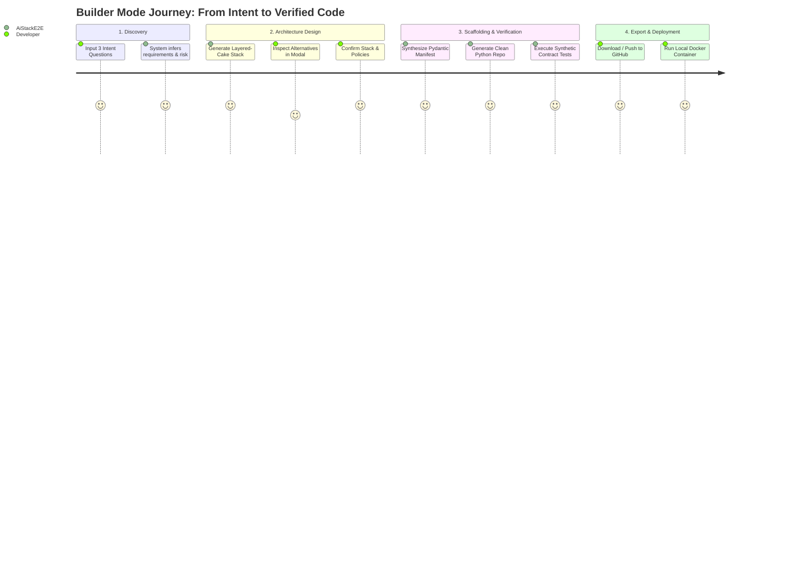
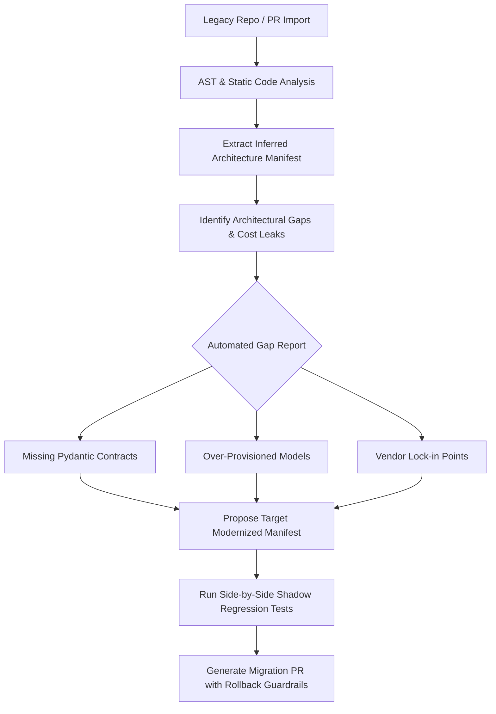
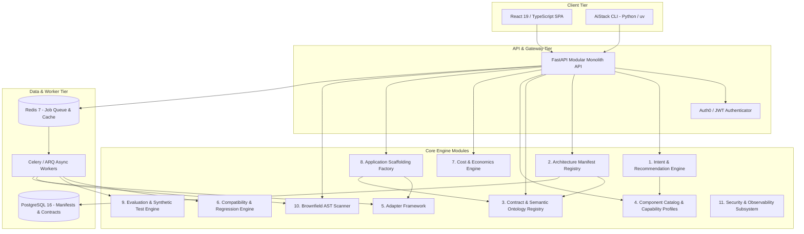
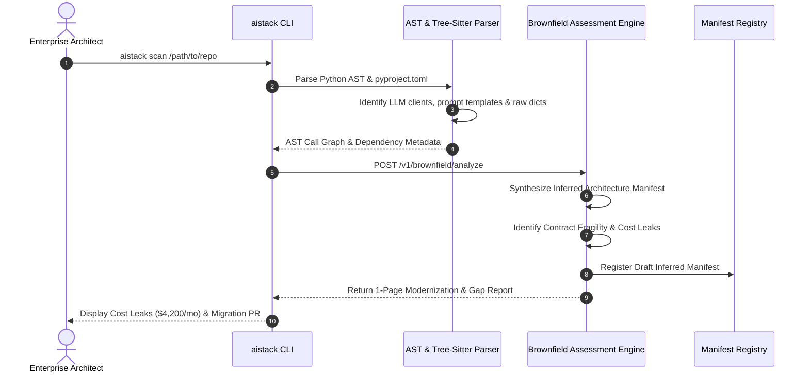

# AiStackE2E: Product Requirements Document (PRD)
**Version:** 1.0.0-PROD-SPEC  
**Author:** Founding Engineering & Product Leadership Team  
**Date:** October 2026  
**Status:** Approved for Engineering Implementation  

---

## Executive Overview & Architectural North Star

### Central Product Promise
> **"Start with what you want to build. AiStackE2E recommends the simplest viable architecture, explains every decision, enforces reliable contracts, and lets you replace components as your requirements evolve."**

AiStackE2E is a software-only SaaS platform and developer toolkit that solves the AI application reliability crisis. Instead of treating AI engineering as an ad-hoc exercise in duct-taping LLM calls, vector databases, and multi-agent harnesses, AiStackE2E introduces an opinionated, contract-driven architecture engine. It serves two interconnected lifecycles:
1. **Builder Mode (Greenfield):** From plain-English user intent, automatically synthesize the simplest viable architecture, generate production-grade Python scaffolding with Pydantic contracts, run synthetic evaluations, and deploy.
2. **Architect Mode (Brownfield):** Ingest existing legacy AI codebases, extract an inferred architecture manifest via AST static analysis, identify architectural gaps and cost leaks, run regression test suites across provider swaps, and execute staged, rollback-safe migrations.

---

## Table of Contents
1. [Key Architecture Decisions & One-Page MVP Definition](#key-architecture-decisions--one-page-mvp-definition)
2. [Section 1: Executive Summary and Product Thesis](#section-1-executive-summary-and-product-thesis)
3. [Section 2: Personas and Jobs to Be Done (JTBD)](#section-2-personas-and-jobs-to-be-done-jtbd)
4. [Section 3: Market Research and Competitor Analysis](#section-3-market-research-and-competitor-analysis)
5. [Section 4: Positioning and Business Model Hypotheses](#section-4-positioning-and-business-model-hypotheses)
6. [Section 5: Product Principles, Constraints, and Non-Goals](#section-5-product-principles-constraints-and-non-goals)
7. [Section 6: Builder Mode Journey](#section-6-builder-mode-journey)
8. [Section 7: Architect Mode Journey](#section-7-architect-mode-journey)
9. [Section 8: Functional Requirements Table](#section-8-functional-requirements-table)
10. [Section 9: Nonfunctional Requirements (SLOs, Durability, Performance)](#section-9-nonfunctional-requirements-slos-durability-performance)
11. [Section 10: Full Software Layer Taxonomy](#section-10-full-software-layer-taxonomy)
12. [Section 11: Opinionated Default Stack Selection Rubric](#section-11-opinionated-default-stack-selection-rubric)
13. [Section 12: Logical Platform Architecture](#section-12-logical-platform-architecture)
14. [Section 13: Architecture Manifest Schema and Examples](#section-13-architecture-manifest-schema-and-examples)
15. [Section 14: Contract Ontology and Pydantic Models](#section-14-contract-ontology-and-pydantic-models)
16. [Section 15: Provider Adapter Interfaces](#section-15-provider-adapter-interfaces)
17. [Section 16: Compatibility Engine and Behavioral Tests](#section-16-compatibility-engine-and-behavioral-tests)
18. [Section 17: Economics Engine and Quality-Adjusted Optimization](#section-17-economics-engine-and-quality-adjusted-optimization)
19. [Section 18: UX Screens, Layered-Cake Design, and Comparison Modal](#section-18-ux-screens-layered-cake-design-and-comparison-modal)
20. [Section 19: Application Scaffolding and Delivery Pipeline](#section-19-application-scaffolding-and-delivery-pipeline)
21. [Section 20: Evals, Synthetic Data, A/B and Regression Testing](#section-20-evals-synthetic-data-ab-and-regression-testing)
22. [Section 21: Orchestration, Agent Registry, Workflow, and MCP Decisions](#section-21-orchestration-agent-registry-workflow-and-mcp-decisions)
23. [Section 22: Enterprise Security, Observability, and Governance](#section-22-enterprise-security-observability-and-governance)
24. [Section 23: Brownfield Importer and Migration Planner](#section-23-brownfield-importer-and-migration-planner)
25. [Section 24: REST API and CLI Specifications](#section-24-rest-api-and-cli-specifications)
26. [Section 25: Greenfield and Brownfield Worked Examples](#section-25-greenfield-and-brownfield-worked-examples)
27. [Section 26: Day-Zero Architecture and Technology Decisions](#section-26-day-zero-architecture-and-technology-decisions)
28. [Section 27: P0 / P1 / P2 Scope and Phased Roadmap](#section-27-p0--p1--p2-scope-and-phased-roadmap)
29. [Section 28: Engineering Milestones and Resource Estimates](#section-28-engineering-milestones-and-resource-estimates)
30. [Section 29: Pricing and Packaging Hypotheses](#section-29-pricing-and-packaging-hypotheses)
31. [Section 30: KPIs and Instrumentation](#section-30-kpis-and-instrumentation)
32. [Section 31: Product and Technical Risk Register](#section-31-product-and-technical-risk-register)
33. [Section 32: Validation Experiments](#section-32-validation-experiments)
34. [Section 33: Architecture Decision Records (ADRs)](#section-33-architecture-decision-records-adrs)
35. [Section 34: First 10 Implementation Milestones](#section-34-first-10-implementation-milestones)

---

## Key Architecture Decisions & One-Page MVP Definition

### 1. Key Architecture Decisions (Summary Table)

| ID | Decision Area | Architectural Choice | Core Rationale | Alternatives Rejected |
|:---|:---|:---|:---|:---|
| **ADR-001** | Platform Topology | **Modular Monolith + Async Workers** | Minimizes distributed systems tax; permits rapid internal refactoring while guaranteeing strict domain boundaries. | Microservices (premature complexity); Serverless lambdas (cold starts, execution timeouts). |
| **ADR-002** | Source of Truth | **Declarative Architecture Manifest (`.yaml`)** | Provides versioned, GitOps-compatible desired state separate from runtime telemetry. | Graph database state (opaque diffs); Database-only schema (poor developer ergonomics). |
| **ADR-003** | Contract Engine | **Pydantic v2 + JSON Schema Draft 2020-12** | Fast Rust-backed validation, universal Python adoption, automatic OpenAPI & TypeScript export. | Marshmallow (slow); Protobuf/gRPC (too rigid for dynamic LLM prompt outputs). |
| **ADR-004** | Brownfield Ingestion | **Static AST Extraction + Tree-Sitter + Dependency Graph** | Zero security risk (no customer code executed on servers); works in air-gapped CI/CLI. | Dynamic runtime tracing (requires executing unverified customer code; high security risk). |
| **ADR-005** | FinOps Metric | **USD per 1,000 Successful Tasks ($/1kST)** | Normalizes cost against actual business outcomes; accounts for retries, evals, and failures. | Blended cost per token (ignores retries and latency); Flat hourly infra cost (misleading). |
| **ADR-006** | System-1 Routing | **Optional JEV (TypeSafe AI) Integration** | High-speed, non-autoregressive decision model ($0.042/M tokens, free output) for deterministic routing. | Forcing GPT-4o for trivial binary triage; Heavy local BERT classifiers (high ops burden). |
| **ADR-007** | Protocol Interop | **Selective Native Python Adapters + Optional MCP** | Direct in-process typed calls for internal layers; expose MCP only when external tool interop is needed. | Mandatory MCP server per internal module (massive IPC latency overhead). |
| **ADR-008** | State Segregation | **Strict Separation: Intended Spec vs Observed Evidence** | Prevents architectural drift from overwriting governance policies; preserves deterministic replayability. | Merged runtime-spec objects (creates state corruption and non-reproducible builds). |

---

### 2. One-Page MVP Definition (P0 Defensible Core)

```
+----------------------------------------------------------------------------------------------------+
|                                      AiStackE2E MVP SCOPE (P0)                                     |
+----------------------------------------------------------------------------------------------------+
|  CORE OBJECTIVE: Deliver a working end-to-end slice enabling a developer to describe an app,       |
|  receive an optimal 3-layer architecture, scaffold verified Python code, test a model swap, and    |
|  audit an existing repo's architecture and cost leakages.                                          |
+----------------------------------------------------------------------------------------------------+
|  1. USER INPUTS & DISCOVERY:                                                                       |
|     - 3-Question Guided Intent Prompt: (What app? Who uses it? What must it achieve?).             |
|     - Rule-based Intent Engine classifying intent into 1 of 3 Reference Templates.                |
|                                                                                                    |
|  2. SUPPORTED ARCHITECTURE TEMPLATES (3 ONLY):                                                     |
|     - Template 1: Single-Model Structured Output (FastAPI + Pydantic + LiteLLM + Postgres).         |
|     - Template 2: RAG Application (FastAPI + Pydantic + Pgvector/BM25 hybrid + LiteLLM).           |
|     - Template 3: Tool-Using AI Workflow (FastAPI + Pydantic + Deterministic State Machine + Tools).|
|                                                                                                    |
|  3. THE VERSIONED MANIFEST:                                                                        |
|     - AiStackManifest v1 schema (YAML/JSON). Includes layers, contracts, policies, and costs.      |
|     - Deterministic semantic validator ensuring contract compatibility.                            |
|                                                                                                    |
|  4. PROVIDER ADAPTERS & MODEL SWAPPING:                                                            |
|     - 2 Verified Model Providers: OpenAI (gpt-4o, gpt-4o-mini) and Anthropic (claude-3-5-sonnet,   |
|       claude-3-5-haiku) via standardized, normalized adapter interfaces.                           |
|     - 1 Optional System-1 Router: JEV (TypeSafe AI) for fast intent classification / routing.      |
|     - 1 Verified Model Substitution Workflow: Swap gpt-4o -> claude-3-5-sonnet or gpt-4o-mini with  |
|       automated structural and behavioral regression tests on 20 synthetic cases.                  |
|                                                                                                    |
|  5. ECONOMICS & FINOPS:                                                                            |
|     - Normalized Cost Estimator: Real-time calculation of USD per 1,000 successful tasks.          |
|     - Token breakdown (Prompt + Completion), retries, and hosting costs.                           |
|                                                                                                    |
|  6. SCAFFOLDING FACTORY:                                                                           |
|     - Export complete, runnable Python 3.12 codebase (FastAPI, Pydantic v2, Dockerfile, tests).    |
|     - Zero vendor lock-in: generated code runs standalone without AiStackE2E runtime dependency.   |
|                                                                                                    |
|  7. BROWNFIELD AUDITOR (LITE):                                                                     |
|     - CLI tool (`aistack scan .`) that inspects requirements.txt/pyproject.toml and Python AST to  |
|       generate an Inferred Architecture Manifest and a 1-page Gap & Cost Leakage Report.           |
+----------------------------------------------------------------------------------------------------+
```

---

## Section 1: Executive Summary and Product Thesis

### 1.1 Executive Summary
Modern artificial intelligence engineering suffers from a structural paradox: while foundation model capabilities have exploded, the engineering discipline surrounding AI applications remains fundamentally broken. Teams construct mission-critical software by stitching together ad-hoc prompt templates, unvalidated dictionary outputs, opaque multi-agent frameworks, and bloated infrastructure. 

The consequences are systemic:
- **Catastrophic Contract Fragility:** A single unannounced model output change breaks downstream business logic.
- **FinOps Bankruptcy:** Applications default to top-tier reasoning models ($15–$30/M tokens) for tasks solvable by deterministic code, tuned heuristics, or high-speed System-1 decision engines ($0.042/M tokens).
- **Vendor Lock-in and Migration Paralysis:** Swapping providers or moving from proprietary APIs to open weights requires weeks of custom refactoring, manual prompt tweaking, and uncalibrated QA.
- **Enterprise Governance Voids:** Security and compliance teams have zero visibility into where prompts, tools, and embeddings flow.

**AiStackE2E** is the industry’s first **Architecture Engineering and Interoperability SaaS**. It treats architecture not as static documentation, but as executable, versioned, contract-enforcing code.

```
       +------------------------------------------------------------+
       |                        USER INTENT                         |
       |  "Start with what you want to build. AiStackE2E recommends  |
       |  the simplest viable architecture, explains every decision,|
       |  enforces reliable contracts, and enables seamless swaps." |
       +------------------------------+-----------------------------+
                                      |
                 +--------------------+--------------------+
                 |                                         |
                 v                                         v
       +--------------------+                    +--------------------+
       |    BUILDER MODE    |                    |   ARCHITECT MODE   |
       |    (Greenfield)    |                    |    (Brownfield)    |
       |                    |                    |                    |
       | Describe Intent    |                    | Ingest Codebase    |
       | Recommend Stack    |                    | Inferred Manifest  |
       | Scaffolding (Code) |                    | Gap & Cost Audit   |
       | Validate & Deploy  |                    | Swap & Modernize   |
       +---------+----------+                    +---------+----------+
                 |                                         |
                 +--------------------+--------------------+
                                      |
                                      v
       +------------------------------------------------------------+
       |               CANONICAL ARCHITECTURE MANIFEST              |
       |   - Typed Pydantic Contracts     - Unit Economics ($/1kST)  |
       |   - Capability Profiles          - Provider Adapters       |
       |   - Behavioral Regression Test   - Multi-Stage Governance  |
       +------------------------------------------------------------+
```

### 1.2 Product Thesis
1. **Occam's AI Razor:** The best AI architecture is the simplest one that satisfies business requirements. Multi-agent swarms and massive vector graphs must be earned through verified requirement complexity, not selected as default templates.
2. **Strict Contracts are Non-Negotiable:** Plain JSON without schemas is technical debt. Every interface boundary must be governed by strict Pydantic v2 validation and explicit semantic metadata.
3. **Economics as an Architectural Dimension:** Architectural diagrams that do not display **USD per 1,000 successful tasks** are incomplete. FinOps must be calculated at the design table, not retroactively discovered on the cloud bill.
4. **Separation of Intent and Runtime:** The Architecture Manifest represents desired architecture, contracts, and governance policies. Observed runtime telemetry represents real-world performance. Separating them enables automated drift detection and regression testing.

---

## Section 2: Personas and Jobs to Be Done (JTBD)

### 2.1 Persona Archetypes

```
+-------------------------------------------------------------------------------------------------------+
| 1. ALEX: The Pragmatic Builder (Full-Stack Engineer / Startup CTO)                                     |
|    - Background: 6 years building SaaS. Knows FastAPI, React, Postgres. Wants AI features that work. |
|    - Frustration: Tired of debugging broken JSON schemas, hallucinated outputs, and complex libraries.|
|    - Goal: Ship a reliable, typed AI feature by Friday without vendor lock-in.                       |
+-------------------------------------------------------------------------------------------------------+
| 2. PRIYA: The Enterprise Solutions Architect (Fortune 500 Enterprise IT)                             |
|    - Background: Oversees 22 disparate engineering teams experimenting with generative AI.           |
|    - Frustration: Teams are reinventing the wheel, using unvetted vector DBs, and racking up bills.   |
|    - Goal: Establish architectural standards, enforce security guardrails, and audit sprawl.         |
+-------------------------------------------------------------------------------------------------------+
| 3. MARCUS: The FinOps / Engineering Operations Lead                                                   |
|    - Background: Manages cloud and infrastructure budgets across engineering divisions.              |
|    - Frustration: AI API costs spiked 340% quarter-over-quarter; no unit economics or task attribution.|
|    - Goal: Track cost per successful business transaction; identify safe model downsizing targets.   |
+-------------------------------------------------------------------------------------------------------+
| 4. ELENA: The Chief Information Security Officer (CISO / Compliance Officer)                         |
|    - Background: Responsible for regulatory compliance (SOC2, HIPAA, GDPR, EU AI Act).               |
|    - Frustration: Developers sending raw customer PII to external third-party endpoints.              |
|    - Goal: Enforce strict DLP policies, ensure air-gapped options, and audit data flows.              |
+-------------------------------------------------------------------------------------------------------+
```

### 2.2 Jobs to Be Done (JTBD) Framework Matrix

| Persona | Trigger Event | Core Functional Job | Emotional Job | Social Job | Desired Outcome Metric |
|:---|:---|:---|:---|:---|:---|
| **Alex (Builder)** | New product spec requires AI workflow | "Synthesize the simplest typed architecture and generate runnable code." | Confidence that production won't crash on edge cases. | Seen as a high-velocity, reliable builder by founders. | Time-to-first-working-scaffold < 15 minutes; 0 runtime contract exceptions. |
| **Priya (Architect)** | Quarterly review of 15 ad-hoc AI apps | "Scan repositories, extract architecture manifests, and flag anti-patterns." | Relief from chaos and uncontrolled tech debt. | Recognized as an enabler of standard enterprise excellence. | 100% visibility into AI inventory; 80% contract adoption across teams. |
| **Marcus (FinOps)** | Monthly API invoice exceeds budget by $40k | "Simulate cost impact of swapping models and routing simple tasks to cheap engines." | Freedom from unexpected billing surprises. | Demonstrates clear ROI and fiscal discipline to executive board. | >40% cost reduction per 1,000 tasks without quality regression. |
| **Elena (CISO)** | Security audit flags unmonitored external LLM calls | "Enforce DLP masking, data boundary compliance, and audit log generation." | Certainty that no regulatory breaches or leaks occur. | Builds trust with enterprise customers and regulators. | 0 data leakage incidents; 100% compliance audit trail pass rate. |

---

## Section 3: Market Research and Competitor Analysis

### 3.1 Competitive Landscape Segmentation

```
+----------------------------------------------------------------------------------------------------+
|                                     COMPETITIVE MATRIX OVERVIEW                                    |
+----------------------------------------------------------------------------------------------------+
|  Category               | Representative Players      | Key Strengths          | Fatal Blindspot   |
+-------------------------+-----------------------------+------------------------+-------------------+
|  1. Orchestration &     | LangChain, LangGraph,       | Broad integrations,    | Extreme lock-in,  |
|     Agent Frameworks    | CrewAI, LlamaIndex,         | active community, rich | bloat, breaking   |
|                         | PydanticAI                  | agentic abstractions   | API changes, poor |
|                         |                             |                        | FinOps modeling.  |
+-------------------------+-----------------------------+------------------------+-------------------+
|  2. LLM Gateways &      | LiteLLM, Portkey,           | High-throughput proxy, | Pure runtime proxy|
|     Routing Proxies     | OpenRouter                  | fallback routing, basic| lacking manifest  |
|                         |                             | rate limiting          | architecture, AST |
|                         |                             |                        | or contract tests.|
+-------------------------+-----------------------------+------------------------+-------------------+
|  3. Observability &     | Langfuse, Braintrust,       | Excellent tracing,     | Post-hoc only.    |
|     Evaluations         | Arize Phoenix, LangSmith,   | latency dashboards,    | Cannot guide      |
|                         | Helicone                    | prompt playground      | greenfield design |
|                         |                             |                        | or enforce design.|
+-------------------------+-----------------------------+------------------------+-------------------+
|  4. Enterprise AI       | IBM watsonx.governance,     | Enterprise compliance, | Disconnected from |
|     Governance          | Cisco Robust Intelligence,  | audit checklists, risk | real developer    |
|                         | Lakera                      | dashboards             | IDEs and code gen.|
+-------------------------+-----------------------------+------------------------+-------------------+
|  5. AiStackE2E          | AiStackE2E                  | End-to-end manifest,   | N/A               |
|     (Our Positioning)   |                             | contracts, FinOps,     | (Software-only,   |
|                         |                             | code gen, AST auditor. | developer-first). |
+----------------------------------------------------------------------------------------------------+
```

### 3.2 Deep Competitive Differentiation

1. **Versus LangChain / CrewAI:** Those are execution frameworks that run inside your runtime and dictate code structure. AiStackE2E is a meta-architecture platform: it generates clean, native Python/FastAPI code that runs *without requiring an AiStackE2E proprietary library in production*.
2. **Versus LiteLLM:** LiteLLM is a runtime proxy. AiStackE2E uses LiteLLM as an optional runtime adapter, but wraps it with formal Pydantic contract ontologies, architectural manifest governance, synthetic regression testing, and quality-adjusted FinOps modeling.
3. **Versus Langfuse / Braintrust:** Tracing tools tell you what happened after you built and deployed an app. AiStackE2E tells you *what to build*, *how to structure it*, *what contracts to enforce*, and *how to safely swap components before and during production*.

---

## Section 4: Positioning and Business Model Hypotheses

### 4.1 Value Proposition Canvas
- **For the Developer (Bottom-Up Wedge):** "Zero-fluff AI architecture. Stop guessing which database or model to use. Get a clean, typed FastAPI codebase in 60 seconds with tests and cost estimates included."
- **For the Enterprise (Top-Down Expansion):** "The control plane for AI modernization. Audit your company’s AI sprawl, enforce strict Pydantic contracts, eliminate 50%+ of inference costs through certified model swaps, and guarantee security compliance."

### 4.2 GTM & Business Model Hypotheses

```
+----------------------------------------------------------------------------------------------------+
|                                    TIERED MONETIZATION HYPOTHESES                                  |
+----------------------------------------------------------------------------------------------------+
|  Tier               | Target Audience         | Pricing Model          | Core Value Drivers        |
+---------------------+-------------------------+------------------------+---------------------------+
|  COMMUNITY          | Individual Developers,  | Free Forever           | - Web builder & CLI       |
|  (Developer Wedge)  | Hackers, Students       | (Self-serve)           | - 3 code exports/month    |
|                     |                         |                        | - Public template catalog |
+---------------------+-------------------------+------------------------+---------------------------+
|  PRO DEVELOPER      | Indie Founders, Senior  | $29 / user / month     | - Unlimited code exports  |
|                     | Full-Stack Engineers    | (Credit Card)          | - Automated model swap QA |
|                     |                         |                        | - 100 synthetic test runs |
+---------------------+-------------------------+------------------------+---------------------------+
|  TEAM & SCALE       | Growing Startups,       | $149 / seat / month    | - Shared Manifest Registry|
|                     | Mid-Market Tech Teams   | (Credit Card / Invoiced)| - CI/CD GitHub Actions bot|
|                     |                         |                        | - Live FinOps drift alerts|
+---------------------+-------------------------+------------------------+---------------------------+
|  ENTERPRISE         | Fortune 2000, Banks,    | $36,000 - $120,000/yr  | - Brownfield AST Scanner  |
|  MODERNIZATION      | Healthcare, Defense     | (Annual Contract)      | - On-prem private worker  |
|                     |                         |                        | - Custom compliance packs |
|                     |                         |                        | - Dedicated migration SLA |
+----------------------------------------------------------------------------------------------------+
```

---

## Section 5: Product Principles, Constraints, and Non-Goals

### 5.1 Guiding Principles
1. **Occam's AI Razor:** Default to deterministic code first, single structured models second, retrieval third, and agentic workflows last. Complexity must justify its latency and cost.
2. **Contracts Over Prompts:** Prompts change; contracts endure. The contract (input/output Pydantic model) is the stable interface boundary.
3. **Transparent Decisioning:** Never present a black-box recommendation. Every architecture layer must display an explicit rationale, trade-offs, and leading alternatives.
4. **Economics as an Architectural Dimension:** Architectural diagrams without cost metrics ($/1,000 tasks) are incomplete.
5. **Zero Proprietary Lock-In:** Code generated by AiStackE2E must be 100% open, idiomatic Python. If the customer cancels their subscription, their application must continue running indefinitely.

### 5.2 Hard Constraints
- **Software-Only SaaS:** AiStackE2E never hosts customer inference or acts as a mandatory network proxy for production data traffic.
- **Stateless Code Scanning:** The Brownfield Scanner operates locally via CLI or ephemeral sandboxes; customer source code is never permanently persisted in AiStackE2E databases.
- **Python Ecosystem Primacy:** Python 3.11+ and Pydantic v2 are the tier-1 targets, followed by TypeScript/OpenAPI.

### 5.3 Non-Goals
- **Not an Inference Provider:** We do not sell GPU compute or host LLMs.
- **Not a General No-Code Web App Builder:** We do not build drag-and-drop consumer mobile apps or landing pages. We build the typed backend AI architecture.
- **Not an Autonomous Multi-Agent Playground:** We do not support open-ended, unconstrained agent swarms that loop indefinitely without contracts.

---

## Section 6: Builder Mode Journey

Builder Mode empowers developers to move from raw intent to a verified, typed, production-ready codebase in under 5 minutes.



### Step-by-Step Walkthrough
1. **Intent Formulation:** User answers 3 core questions:
   - *What do you want to build?* (e.g., "A diabetes-safe recipe generator using on-hand ingredients").
   - *Who will use it?* (e.g., "Type-2 diabetes patients and caregivers").
   - *What must it achieve?* (e.g., "Strict glycemic safety, verified ingredient utilization, structured recipe JSON").
2. **Requirement Inference:** Engine infers: Task Type = Structured Generation + Medical Safety Guardrails; Latency Budget = 2000ms; Risk = High (Medical/Dietary); Quality Target = 99.5% schema adherence.
3. **Layered-Cake Synthesis:** Displays 6 core layers with defaults, costs, and alternatives.
4. **Customization & Modal Deep-Dive:** User clicks Model Layer, evaluates GPT-4o vs Claude 3.5 Sonnet vs Gemini 1.5 Flash. Sees cost-per-1,000-recipes differences.
5. **Contract Synthesis:** Engine compiles Pydantic models with strict field validation (e.g., `max_glycemic_index <= 55`).
6. **Verification & Export:** Engine runs 20 synthetic tests against chosen provider, validates schema conformance, and generates a standalone FastAPI repository.

---

## Section 7: Architect Mode Journey

Architect Mode addresses the enterprise reality: dozens of unmonitored, expensive, fragile AI apps running in production without contracts or governance.



### Step-by-Step Walkthrough
1. **Repository Import:** User runs `aistack scan .` in CLI or links a GitHub repository.
2. **AST Static Extraction:** Tree-sitter parsers scan Python files, extracting LLM client calls (`openai.chat.completions`, `anthropic.messages`), prompt templates, vector queries, and raw dictionary outputs.
3. **Inferred Manifest Generation:** A draft `AiStackManifest` is constructed, marking detected components, estimated monthly spend, and confidence ratings.
4. **Gap & Risk Assessment:** Flags critical anti-patterns:
   - *Gap 1 (Fragility):* Prompt outputs are parsed with `json.loads()` without Pydantic schema validation.
   - *Gap 2 (FinOps Leak):* GPT-4o is called for simple binary sentiment triage (wasting $2,400/month).
   - *Gap 3 (Coupling):* Direct OpenAI SDK calls scattered across 18 backend files.
5. **Modernization Proposal:** AiStackE2E generates an optimized Target Manifest:
   - Introduces typed Pydantic output contracts.
   - Replaces binary triage LLM call with a System-1 decision engine (JEV at $0.042/M tokens).
   - Introduces a normalized model adapter.
6. **Shadow Verification:** Runs golden evaluation datasets against both legacy and target stacks. Verifies behavioral equivalence score > 98%.
7. **Migration PR:** Outputs a clean Git pull request with modular code and automated fallback switches.

---

## Section 8: Functional Requirements Table

| ID | Module / Feature | Priority | Dependencies | Technical Description | Failure Modes & Edge Cases | Objective Acceptance Criteria |
|:---|:---|:---:|:---|:---|:---|:---|
| **FR-001** | Guided Intent Capture | P0 | None | Web & CLI prompt collecting 3-question user intent with fuzzy autocomplete and domain tags. | Empty strings; overly ambiguous prompts (e.g., "Build an AI"). | Rejects input < 10 characters; prompts user for clarification with specific prompt examples. |
| **FR-002** | Rule-Based Intent Classifier | P0 | FR-001 | Classifies user intent into: Structured Output, RAG, Tool Workflow, or Agentic. | Ambiguous intent bridging RAG and Tool Workflow. | Deterministically outputs exact template match with >0.85 confidence score or prompts triage question. |
| **FR-003** | Layered-Cake Visualizer | P0 | FR-002 | Visual canvas rendering horizontal architecture rows and 4 vertical governance rails. | Rendering failure on small screen viewports. | Renders responsive grid in <300ms; supports Beginner and Expert detail toggles. |
| **FR-004** | Architecture Manifest Generator | P0 | FR-002 | Generates versioned `AiStackManifest` v1 YAML containing layers, contracts, and policies. | Missing required layer fields; schema syntax errors. | Manifest passes 100% strict JSON Schema validation against `AiStackManifest.v1.json`. |
| **FR-005** | Pydantic Contract Compiler | P0 | FR-004 | Synthesizes Python Pydantic v2 classes from manifest contract definitions. | Unsupported nested data types; recursion errors. | Outputs valid Python code importable via `ast.parse()` without syntax errors. |
| **FR-006** | Normalized Model Adapter (OpenAI) | P0 | FR-005 | Standardized adapter executing chat/structured outputs against OpenAI API via LiteLLM/direct SDK. | API rate limits; 429 errors; unparseable structured outputs. | Handles exponential backoff; validates outputs against Pydantic schema; raises typed error. |
| **FR-007** | Normalized Model Adapter (Anthropic) | P0 | FR-005 | Standardized adapter executing chat/structured outputs against Anthropic API. | Tool-use schema mismatches; streaming chunk truncation. | Normalizes output to identical canonical format as FR-006 with exact token attribution. |
| **FR-008** | Normalized Decision Router (JEV) | P0 | FR-005 | Adapter for TypeSafe AI JEV model for low-latency ($0.042/M token) classification & decision triage. | JEV endpoint outage; invalid question space formatting. | Graceful fallback to secondary cheap LLM (e.g., gpt-4o-mini); returns typed boolean/categorical output. |
| **FR-009** | Normalized FinOps Estimator | P0 | FR-004 | Computes estimated cost per 1,000 successful tasks ($/1kST) based on token math and retry models. | Division by zero when success probability = 0. | Outputs dollar estimate with lower/upper 95% confidence bounds and source pricing citations. |
| **FR-010** | Synthetic Dataset Generator | P0 | FR-005 | Generates 20 boundary-condition test cases from Pydantic schema definitions. | Edge case values violating schema constraints. | Generates valid JSON payloads covering min, max, null, and regex field constraints. |
| **FR-011** | Model Substitution Test Harness | P0 | FR-006, FR-007, FR-010 | Runs synthetic test suite against Provider A and Provider B; computes behavioral equivalence score. | Provider B returns schema violation; network timeout. | Outputs diff report showing schema pass rate, latency delta, and cost savings percentage. |
| **FR-012** | Python Scaffolding Factory | P0 | FR-004, FR-005 | Bundles generated FastAPI app, Pydantic models, adapters, tests, and Dockerfile into ZIP/Git repo. | File writing permissions; invalid template variable syntax. | Generated project boots via `docker compose up` and passes health check in <30 seconds. |
| **FR-013** | Brownfield CLI Scanner (`aistack scan`) | P0 | None | CLI command parsing local repository AST to extract dependencies, LLM calls, and prompts. | Obfuscated code; non-standard dynamic imports. | Scans 100k LOC repository in <15 seconds; extracts detected providers and missing contracts. |
| **FR-014** | Brownfield Gap & Leak Reporter | P0 | FR-013 | Generates markdown/PDF audit report highlighting cost leaks, unvalidated prompts, and lock-in. | Incomplete dependency graph. | Outputs categorized risk matrix with actionable remediation pull request recommendations. |
| **FR-015** | OpenTelemetry AI Instrumentation | P0 | FR-012 | Injects standardized OpenTelemetry GenAI spans (tokens, latency, provider, cost) into scaffolding. | Span export failure crashing application. | Non-blocking background span exporter; 100% compliant with OpenTelemetry GenAI semantic conventions. |
| **FR-016** | Semantic Manifest Diff Engine | P1 | FR-004 | Calculates semantic differences between Manifest vN and Manifest vN+1. | Circular dependencies in layers. | Flags breaking contract changes, cost delta, and required migration testing steps. |
| **FR-017** | MCP Server Selective Wrapper | P1 | FR-005 | Exposes designated tool contracts as Model Context Protocol (MCP) compliant servers. | Protocol handshake failure; client disconnect. | Conforms to MCP 2024 spec; enables seamless connection to Claude Desktop or Cursor. |
| **FR-018** | Staged Migration Rollout Manager | P1 | FR-011 | Generates canary routing rules (90/10 split) with automated rollback on error rate spike. | Canary errors exceeding threshold. | Triggers instant rollback to baseline provider within 500ms of threshold breach. |

---

## Section 9: Nonfunctional Requirements (SLOs, Durability, Performance)

### 9.1 Performance SLOs
- **Intent Synthesis Latency:** Plain-text intent to initial Layered-Cake visual rendering must complete in **< 1,500 ms** (P95).
- **Manifest Validation Latency:** Validating a 50-node manifest against JSON Schema and Pydantic rules must complete in **< 150 ms** (P99).
- **Code Scaffolding Compilation:** Generating and zipping a complete 15-file FastAPI repository must complete in **< 2,500 ms** (P95).
- **Brownfield AST Scan:** Scanning an enterprise codebase containing 100,000 lines of Python code must complete in **< 15 seconds** using local CLI CPU resources.

### 9.2 Reliability & Availability
- **Platform Availability:** The SaaS Management API and Registry must maintain **99.9% uptime** (excluding planned maintenance).
- **Zero Runtime Interference:** Because generated applications run in customer environments, AiStackE2E platform outages must have **0% impact** on customer runtime execution.
- **Background Worker Durability:** All synthetic eval suites and AST scans are processed via Postgres-backed transactional outbox workers with persistent retry state.

### 9.3 Security, Privacy & Data Isolation
- **Code Privacy Guarantee:** Customer code scanned via `aistack scan` is processed strictly in-memory or locally on the developer's machine. Zero customer proprietary source code is stored on AiStackE2E database volumes.
- **Data Protection:** All stored manifests, telemetry tokens, and credentials are encrypted using **AES-256-GCM** at rest and **TLS 1.3** in transit.
- **Secrets Management:** Provider API keys (OpenAI, Anthropic, AWS) entered for synthetic testing are stored in transient encrypted memory or passed directly via developer-owned environment variables.

---

## Section 10: Full Software Layer Taxonomy

The AI engineering ecosystem is plagued by category confusion. The following 16-layer taxonomy represents the canonical software stack for enterprise AI applications.

```
+----------------------------------------------------------------------------------------------------+
|                                    16-LAYER SOFTWARE TAXONOMY                                      |
+----+-----------------------+-----------------------------+-----------------------+-----------------+
| #  | Layer Category        | Primary Functional Role     | Top 3 Candidates      | Managed / None  |
+----+-----------------------+-----------------------------+-----------------------+-----------------+
| 1  | Applications          | End-user UI / Product       | ChatGPT, Claude,      | Custom Frontend |
|    |                       | experience                  | Cursor, Custom Web    | (React / Next)  |
+----+-----------------------+-----------------------------+-----------------------+-----------------+
| 2  | Agent Harness         | Interactive developer /     | Claude Code, Cursor,  | None (Headless  |
|    |                       | execution client            | Gemini Spark          | API default)    |
+----+-----------------------+-----------------------------+-----------------------+-----------------+
| 3  | Agent Frameworks      | Multi-step execution &      | LangGraph, PydanticAI,| None (Default to|
|    |                       | state graph coordination    | CrewAI                | state machine)  |
+----+-----------------------+-----------------------------+-----------------------+-----------------+
| 4  | SDK / Runtime         | Language bindings &         | OpenAI SDK, Google    | Native Python   |
|    |                       | execution client            | ADK, CopilotKit       | Standard Lib    |
+----+-----------------------+-----------------------------+-----------------------+-----------------+
| 5  | Tools & APIs          | External actions, data      | Composio, Firecrawl,  | None / Custom   |
|    |                       | retrieval, scraping         | Tavily                | REST Client     |
+----+-----------------------+-----------------------------+-----------------------+-----------------+
| 6  | Automation & Workflow | Cross-system enterprise     | Temporal, n8n,        | None (FastAPI   |
|    |                       | durable execution           | Celery / ARQ          | background task)|
+----+-----------------------+-----------------------------+-----------------------+-----------------+
| 7  | Execution Sandboxes   | Isolated code execution     | E2B, Modal, Daytona   | None (Docker    |
|    |                       | environments                |                       | container)      |
+----+-----------------------+-----------------------------+-----------------------+-----------------+
| 8  | Interop & Protocols   | Tool & agent communication  | MCP, OpenAPI 3.1,     | Native Python   |
|    |                       | standards                   | OpenTelemetry         | Function Calls  |
+----+-----------------------+-----------------------------+-----------------------+-----------------+
| 9  | Knowledge & Retrieval | Vector, hybrid, and lexical | Pgvector, Qdrant,     | None (Lexical / |
|    |                       | index search                | Pinecone              | SQLite BM25)    |
+----+-----------------------+-----------------------------+-----------------------+-----------------+
| 10 | Memory & State        | Session state, semantic     | Postgres JSONB, Mem0, | None (Stateless |
|    |                       | chat history persistence    | Zep                   | default)        |
+----+-----------------------+-----------------------------+-----------------------+-----------------+
| 11 | Routing & Gateways    | Model switching, fallbacks, | LiteLLM, JEV          | Direct Provider |
|    |                       | System-1 decision gating    | (TypeSafe AI), Portkey| SDK             |
+----+-----------------------+-----------------------------+-----------------------+-----------------+
| 12 | Foundation Models     | Frontier reasoning & text   | Anthropic Claude 3.5, | Provider Hosted |
|    |                       | generation                  | OpenAI GPT-4o, Gemini | (SaaS API)      |
+----+-----------------------+-----------------------------+-----------------------+-----------------+
| 13 | Inference Serving     | Self-hosted GPU execution   | vLLM, SGLang,         | Managed API     |
|    |                       | engines                     | TensorRT-LLM          | (Default)       |
+----+-----------------------+-----------------------------+-----------------------+-----------------+
| 14 | Evals & Observability | Tracing, quality evaluation,| Langfuse, Braintrust, | OpenTelemetry   |
|    |                       | metrics & drift detection   | Arize Phoenix         | Prometheus      |
+----+-----------------------+-----------------------------+-----------------------+-----------------+
| 15 | Security & Guardrails | DLP masking, prompt injection| Lakera, Portkey,     | Pydantic Schema |
|    |                       | defense, auth               | Promptfoo             | Validation      |
+----+-----------------------+-----------------------------+-----------------------+-----------------+
| 16 | Essential Infra       | Relational DBs, queues,     | PostgreSQL 16, Redis, | SQLite / Local  |
|    |                       | secret management           | HashiCorp Vault       | Environment     |
+----+-----------------------+-----------------------------+-----------------------+-----------------+
```

---

## Section 11: Opinionated Default Stack Selection Rubric

To prevent overengineering, AiStackE2E enforces an algorithmic selection rubric based on the user's inferred requirements:

```
+----------------------------------------------------------------------------------------------------+
|                                    DEFAULT STACK SELECTION LOGIC                                   |
+----------------------------------------------------------------------------------------------------+
| IF task requires purely structured output with fixed schema:                                       |
|    --> Select Template 1: FastAPI + Pydantic v2 + LiteLLM + Postgres 16.                          |
|    --> Reject: Vector DBs, Multi-Agent Frameworks, LangChain.                                      |
|                                                                                                    |
| IF task requires domain knowledge retrieval across > 1,000 documents:                              |
|    --> Select Template 2: FastAPI + Pgvector (Hybrid BM25 + Vector) + LiteLLM.                     |
|    --> Reject: Dedicated proprietary vector SaaS (e.g. Pinecone) unless doc volume > 10,000,000.  |
|                                                                                                    |
| IF task requires multi-step external API actions or browser interactions:                          |
|    --> Select Template 3: FastAPI + Deterministic State Machine + Pydantic Tool Contracts.         |
|    --> Reject: Autonomous agent loops without step budgets.                                        |
|                                                                                                    |
| IF task requires frequent binary classification or low-latency routing:                            |
|    --> Select JEV (TypeSafe AI) System-1 Decision Router ($0.042/M tokens).                        |
|    --> Reject: Calling GPT-4o for simple classification.                                           |
+----------------------------------------------------------------------------------------------------+
```

---

## Section 12: Logical Platform Architecture

AiStackE2E is designed as a high-cohesion **Modular Monolith** with asynchronous background job workers, ensuring operational simplicity and clear internal domain boundaries.



---

## Section 13: Architecture Manifest Schema and Examples

The **Architecture Manifest** is the definitive, version-controlled source of truth. It specifies desired architecture, typed contracts, policies, environments, and economic baselines.

### 13.1 Complete YAML Architecture Manifest (`manifest.yaml`)

```yaml
version: "aistack/v1"
metadata:
  application_id: "app_diabetic_fusion_01"
  name: "Diabetic-Safe Fusion Recipe Engine"
  description: "Recommends glycemic-optimized fusion meals based on pantry ingredients."
  created_at: "2026-10-08T00:00:00Z"
  version: "1.0.0"
  author: "engineering@foodhealth.io"
  environment: "production"

specification:
  template: "single_model_structured_output"
  intent:
    domain: "clinical_nutrition"
    user_persona: "Patients with Type-2 Diabetes and active lifestyles"
    primary_goal: "Generate glycemic-safe (GI <= 55) creative recipes from inventory"
    risk_level: "high"

  layers:
    - id: "layer_api"
      category: "essential_infra"
      component: "fastapi"
      version: "0.115.0"
      configuration:
        port: 8000
        cors_origins: ["https://app.foodhealth.io"]

    - id: "layer_router"
      category: "routing"
      component: "jev_decision_router"
      version: "1.0.0"
      configuration:
        endpoint: "https://api.typesafe.ai/v1/decide"
        cost_per_million_input: 0.042
        output_cost: 0.00
        task: "triage_medical_contraindications"

    - id: "layer_reasoning_model"
      category: "foundation_models"
      component: "claude-3-5-sonnet"
      version: "20241022"
      provider: "anthropic"
      configuration:
        temperature: 0.2
        max_tokens: 1500
        timeout_seconds: 4.5
        pricing:
          prompt_per_million: 3.00
          completion_per_million: 15.00

    - id: "layer_contracts"
      category: "interop_protocols"
      component: "pydantic_v2"
      version: "2.9.2"
      contracts:
        input: "RecipeRequestContract"
        output: "DiabeticRecipeResponseContract"

  policies:
    retries:
      max_attempts: 3
      backoff: "exponential"
      factor: 2.0
    fallbacks:
      enabled: true
      fallback_model: "gpt-4o-mini"
    security:
      dlp_masking: true
      disallowed_keywords: ["sugar_coating", "corn_syrup"]

economics_target:
  normalized_metric: "usd_per_1000_successful_tasks"
  target_threshold: 4.50
  estimated_baseline: 2.85
  currency: "USD"
```

---

## Section 14: Contract Ontology and Pydantic Models

Strict typing is enforced via Pydantic v2. Below is the executable Python contract ontology defining inputs, outputs, capabilities, and errors.

```python
"""
AiStackE2E Core Contract Ontology: Canonical Models
"""
from typing import List, Optional, Dict, Any, Literal
from pydantic import BaseModel, Field, conint, confloat, constr


class IngredientItem(BaseModel):
    name: constr(min_length=2, max_length=64) = Field(
        ..., description="Name of the ingredient item."
    )
    quantity: confloat(gt=0.0) = Field(
        ..., description="Numeric quantity of the ingredient."
    )
    unit: Literal["grams", "ml", "tbsp", "tsp", "cups", "pieces"] = Field(
        ..., description="Measurement unit."
    )


class RecipeRequestContract(BaseModel):
    user_id: constr(min_length=8, max_length=64) = Field(
        ..., description="Anonymized unique user identifier."
    )
    ingredients_on_hand: List[IngredientItem] = Field(
        ..., min_length=1, max_length=30, description="Available pantry items."
    )
    max_preparation_time_minutes: conint(ge=5, le=180) = Field(
        30, description="Maximum cooking preparation time."
    )
    dietary_flags: List[str] = Field(
        default_factory=lambda: ["type_2_diabetes"],
        description="Clinical dietary restrictions."
    )


class NutritionalBreakdown(BaseModel):
    calories: conint(ge=50, le=2000) = Field(..., description="Estimated total calories.")
    protein_grams: confloat(ge=0.0) = Field(..., description="Total protein in grams.")
    carbohydrates_grams: confloat(ge=0.0) = Field(..., description="Total carbs in grams.")
    fiber_grams: confloat(ge=0.0) = Field(..., description="Dietary fiber in grams.")
    net_carbs_grams: confloat(ge=0.0) = Field(..., description="Net carbs (Carbs - Fiber).")
    glycemic_index_estimate: conint(ge=0, le=100) = Field(
        ..., description="Glycemic index estimate (Must be <= 55 for diabetic safety)."
    )


class DiabeticRecipeResponseContract(BaseModel):
    recipe_id: str = Field(..., description="Unique generated recipe identifier.")
    title: constr(min_length=5, max_length=120) = Field(
        ..., description="Appealing recipe title."
    )
    cuisine_fusion: constr(min_length=3, max_length=64) = Field(
        ..., description="Fusion cuisine categories (e.g., Mexican-Japanese)."
    )
    preparation_time_minutes: conint(ge=5, le=180)
    ingredients: List[IngredientItem]
    instructions: List[constr(min_length=10)] = Field(
        ..., min_length=3, description="Step-by-step cooking instructions."
    )
    nutrition: NutritionalBreakdown
    clinical_safety_verified: bool = Field(
        ..., description="Affirmation that recipe meets diabetic nutritional safety bounds."
    )


class ContractExecutionError(BaseModel):
    error_code: Literal[
        "SCHEMA_VALIDATION_FAILED",
        "PROVIDER_TIMEOUT",
        "SAFETY_GUARDRAIL_VIOLATION",
        "RATE_LIMIT_EXCEEDED"
    ]
    message: str
    failed_payload: Optional[Dict[str, Any]] = None
    retryable: bool
```

---

## Section 15: Provider Adapter Interfaces

Every provider integration conforms to a strict, typed abstract base interface. This guarantees that model swaps require zero changes to application business logic.

```python
"""
AiStackE2E Provider Adapter Architecture
"""
from abc import ABC, abstractmethod
from typing import Type, TypeVar, Generic, AsyncIterator
from pydantic import BaseModel
import time

TInput = TypeVar("TInput", bound=BaseModel)
TOutput = TypeVar("TOutput", bound=BaseModel)


class AdapterTokenUsage(BaseModel):
    prompt_tokens: int
    completion_tokens: int
    total_tokens: int
    estimated_cost_usd: float


class AdapterResponse(BaseModel, Generic[TOutput]):
    output: TOutput
    token_usage: AdapterTokenUsage
    latency_ms: float
    model_name: str
    provider: str


class BaseLLMAdapter(ABC, Generic[TInput, TOutput]):
    """Vendor-neutral contract adapter for foundation models."""

    def __init__(self, api_key: str, model_name: str, timeout_seconds: float = 5.0):
        self.api_key = api_key
        self.model_name = model_name
        self.timeout_seconds = timeout_seconds

    @abstractmethod
    async def execute_structured(
        self,
        payload: TInput,
        response_model: Type[TOutput],
        system_prompt: str
    ) -> AdapterResponse[TOutput]:
        """Execute model generation and parse into strict Pydantic model."""
        pass

    @abstractmethod
    async def execute_stream(
        self,
        payload: TInput,
        system_prompt: str
    ) -> AsyncIterator[str]:
        """Stream raw chunks while preserving tracing spans."""
        pass
```

---

## Section 16: Compatibility Engine and Behavioral Tests

When a developer or enterprise swaps a model (e.g., swapping `gpt-4o` for `claude-3-5-sonnet` or `gemini-1.5-flash`), the Compatibility Engine executes a three-dimensional evaluation:

```
+----------------------------------------------------------------------------------------------------+
|                                    COMPATIBILITY EVALUATION TAXONOMY                               |
+----------------------------------------------------------------------------------------------------+
|  Dimension 1: Structural Compatibility                                                             |
|  - Validates whether Provider B adheres to the exact Pydantic schema without missing keys or type  |
|    mismatches. Pass criterion: 100% schema conformance across 50 test cases.                       |
+----------------------------------------------------------------------------------------------------+
|  Dimension 2: Semantic Compatibility                                                               |
|  - Verifies that field meanings, units, and clinical/domain constraints are preserved.             |
|    Example: Does 'preparation_time_minutes' return an integer in minutes, or text like 'half hour'?|
+----------------------------------------------------------------------------------------------------+
|  Dimension 3: Behavioral Equivalence                                                               |
|  - Compares output distributions, tone, adherence to negative constraints, and factual safety.    |
|    Pass criterion: Semantic cosine similarity >= 0.92; Judge-LLM alignment score >= 90%.          |
+----------------------------------------------------------------------------------------------------+
```

### Mapping Confidence Levels
- **Lossless (Confidence 1.0):** 100% schema compliance, 0 dropped fields, equal or better semantic score.
- **Lossy (Confidence 0.70 - 0.99):** Minor formatting differences; requires output post-processing adapter.
- **Unsupported (Confidence < 0.70):** Model fails negative constraints, hallucinates invalid JSON, or violates safety bounds. Swap blocked.

---

## Section 17: Economics Engine and Quality-Adjusted Optimization

### 17.1 Normalized Unit Economics Formulation
AiStackE2E standardizes all architecture costs on **USD per 1,000 Successful Tasks ($/1kST)**:

$$\text{Cost}_{1\text{kST}} = \frac{1000}{P(\text{success})} \times \left( C_{\text{token}} + C_{\text{compute}} + C_{\text{retrieval}} + C_{\text{tool}} + C_{\text{obs}} \right)$$

Where:
- $P(\text{success})$ = Empirical probability of a task passing schema validation and safety checks on the first attempt (e.g., 0.96).
- $C_{\text{token}}$ = Blended token cost:
  $$C_{\text{token}} = \left( T_{\text{prompt}} \times P_{\text{in}} \right) + \left( T_{\text{comp}} \times P_{\text{out}} \right) + \left( T_{\text{cache\_read}} \times P_{\text{cache}} \right)$$
- $C_{\text{compute}}$ = Operational compute infrastructure (FastAPI container, worker CPU/RAM).
- $C_{\text{retrieval}}$ = Vector queries, embedding generation, or database read ops.
- $C_{\text{tool}}$ = External API fees (e.g., Firecrawl, Tavily, SERP API).
- $C_{\text{obs}}$ = Observability trace and evaluation ingestion costs.

### 17.2 Verified Economics: JEV (TypeSafe AI) vs Frontier LLM Triage
*Verified Pricing & Benchmark Data (October 2026):*
- **Frontier LLM (GPT-4o) for Binary Decision/Triage:**
  - Input: 800 tokens @ $2.50 / M = $0.0020
  - Output: 50 tokens @ $10.00 / M = $0.0005
  - Total per triage task: **$0.0025** ($2.50 per 1,000 tasks).
- **TypeSafe AI JEV Model (System-1 Decision Engine):**
  - Input: 800 tokens @ $0.042 / M = **$0.0000336**
  - Output: Structured decision outputs are **$0.00 (Free)**.
  - Total per triage task: **$0.0000336** ($0.0336 per 1,000 tasks).
  - **Economic Delta:** **74.4x cheaper** for routing and classification tasks with 120ms latency.

---

## Section 18: UX Screens, Layered-Cake Design, and Comparison Modal

### 18.1 Screen 1: 3-Question Guided Intent Discovery

```
+----------------------------------------------------------------------------------------------------+
|                                    AiStackE2E: Intent Discovery                                    |
+----------------------------------------------------------------------------------------------------+
|                                                                                                    |
|  [1] What application do you want to build?                                                        |
|  +-----------------------------------------------------------------------------------------------+ |
|  | Create quick, healthy, tasty fusion meals based on ingredients on hand for an active user     | |
|  | managing diabetes.                                                                            | |
|  +-----------------------------------------------------------------------------------------------+ |
|                                                                                                    |
|  [2] Who will use it?                                                                              |
|  +-----------------------------------------------------------------------------------------------+ |
|  | Type-2 diabetes individuals and fitness-conscious adults.                                       | |
|  +-----------------------------------------------------------------------------------------------+ |
|                                                                                                    |
|  [3] What should the application achieve?                                                          |
|  +-----------------------------------------------------------------------------------------------+ |
|  | Ensure glycemic index <= 55, zero sugar spikes, verify ingredient inventory, return recipes.   | |
|  +-----------------------------------------------------------------------------------------------+ |
|                                                                                                    |
|                                       [ GENERATE ARCHITECTURE ]                                    |
+----------------------------------------------------------------------------------------------------+
```

### 18.2 Screen 2: Layered-Cake Architecture Canvas

```
+----------------------------------------------------------------------------------------------------+
|  AiStackE2E Architecture Canvas: Diabetic Fusion Recipe Engine                [Expert View: ON]    |
+----------------------------------------------------------------------------------------------------+
|  VERTICAL RAILS:  [Contracts: OK] | [FinOps: $2.85/1kST] | [Evals: 99.2%] | [Security: HIPAA-Ready]|
+====================================================================================================+
|  LAYER               | DEFAULT COMPONENT     | LEADING ALTERNATIVE 1 | COST / 1kST | COMPATIBILITY |
+----------------------+-----------------------+-----------------------+-------------+---------------+
|  1. Ingestion / API  | FastAPI (Python 3.12) | Node.js Express       | $0.12       | 100% Native   |
+----------------------+-----------------------+-----------------------+-------------+---------------+
|  2. Decision Router  | JEV (TypeSafe AI) *   | LiteLLM Routing Proxy | $0.03       | Lossless      |
+----------------------+-----------------------+-----------------------+-------------+---------------+
|  3. Reasoning Model  | Claude 3.5 Sonnet *   | GPT-4o                | $2.55       | Lossless (98%)|
+----------------------+-----------------------+-----------------------+-------------+---------------+
|  4. Contracts        | Pydantic v2 Models    | JSON Schema Native    | $0.00       | 100% Enforced |
+----------------------+-----------------------+-----------------------+-------------+---------------+
|  5. Persistence      | PostgreSQL 16 (JSONB) | Redis Enterprise      | $0.15       | ACID Safe     |
+----------------------+-----------------------+-----------------------+-------------+---------------+
|  TOTAL ESTIMATE      |                       |                       | $2.85 / 1k  | READY TO BUILD|
+----------------------------------------------------------------------------------------------------+
|  * Click any layer row to inspect component comparison modal.                                      |
+----------------------------------------------------------------------------------------------------+
```

### 18.3 Screen 3: Component Comparison Modal

```
+----------------------------------------------------------------------------------------------------+
|  Layer 3: Foundation Model Comparison & Substitution Modal                                      [X]|
+----------------------------------------------------------------------------------------------------+
|  Metric Vector           | Claude 3.5 Sonnet (Current) | GPT-4o (Alternative) | Gemini 1.5 Flash   |
+--------------------------+-----------------------------+----------------------+--------------------+
|  Capability Rating       | 9.8 / 10 (Clinical nuance)  | 9.7 / 10             | 8.9 / 10           |
|  Normalized Cost / 1kST  | $2.55                       | $2.75                | $0.32              |
|  Latency (P95)           | 1,420 ms                    | 1,510 ms             | 680 ms             |
|  Schema Conformance Rate | 99.4%                       | 99.1%                | 96.2%              |
|  Security & DLP          | Zero Data Retention Option  | Zero Data Retention  | Enterprise Ready   |
|  Portability Rating      | High (Standard Adapter)     | High (Standard)      | High (Standard)    |
|  Recommendation Note     | Recommended for precision   | Direct drop-in swap  | Fails complex diet |
+--------------------------+-----------------------------+----------------------+--------------------+
|  [ CANCEL ]                                                  [ SELECT AS DEFAULT & RUN REGRESSION ]|
+----------------------------------------------------------------------------------------------------+
```

---

## Section 19: Application Scaffolding and Delivery Pipeline

### 19.1 Generated Repository File Layout
When the user clicks "Export Scaffolding" or runs `aistack init`, the platform generates a standalone, idiomatic Python application:

```
diabetic-fusion-recipe-service/
├── .github/
│   └── workflows/
│       └── ai-contract-regression.yaml   # CI/CD test runner
├── app/
│   ├── __init__.py
│   ├── main.py                           # FastAPI application entry point
│   ├── config.py                         # Pydantic Settings & environment variables
│   ├── contracts/
│   │   ├── __init__.py
│   │   ├── request_models.py             # RecipeRequestContract
│   │   ├── response_models.py            # DiabeticRecipeResponseContract
│   │   └── errors.py                     # Standardized error definitions
│   ├── adapters/
│   │   ├── __init__.py
│   │   ├── base.py                       # BaseLLMAdapter ABC
│   │   ├── anthropic_adapter.py          # Claude 3.5 Sonnet implementation
│   │   └── jev_router_adapter.py         # TypeSafe JEV decision implementation
│   ├── services/
│   │   ├── __init__.py
│   │   └── recipe_orchestrator.py        # Business logic & contract enforcement
│   └── telemetry/
│       ├── __init__.py
│       └── otel_spans.py                 # OpenTelemetry GenAI span collectors
├── tests/
│   ├── test_contracts.py                 # Pydantic schema unit tests
│   ├── test_synthetic_regression.py      # 20 golden regression test cases
│   └── test_api_endpoints.py             # HTTP endpoint tests
├── aistack-manifest.yaml                 # Versioned Architecture Manifest
├── Dockerfile                            # Production multi-stage container
├── docker-compose.yaml                   # Local Postgres + API stack
├── pyproject.toml                        # Dependencies managed via uv
└── README.md                             # Architectural overview & run guide
```

---

## Section 20: Evals, Synthetic Data, A/B and Regression Testing

### 20.1 Synthetic Dataset Generation Engine
AiStackE2E generates synthetic evaluation suites directly from Pydantic contracts by inspecting type bounds, regexes, and constraints:

```python
"""
AiStackE2E Synthetic Dataset Generator from Pydantic Schemas
"""
from typing import List, Dict, Any
from pydantic import BaseModel
import random


def generate_synthetic_recipe_cases(count: int = 20) -> List[Dict[str, Any]]:
    """Synthesizes valid boundary test cases for recipe requests."""
    base_ingredients = [
        {"name": "black beans", "quantity": 100.0, "unit": "grams"},
        {"name": "salmon fillet", "quantity": 150.0, "unit": "grams"},
        {"name": "cauliflower rice", "quantity": 200.0, "unit": "grams"},
        {"name": "avocado", "quantity": 1.0, "unit": "pieces"},
        {"name": "olive oil", "quantity": 1.0, "unit": "tbsp"},
        {"name": "garlic", "quantity": 2.0, "unit": "pieces"}
    ]
    test_cases = []
    for i in range(count):
        sample_ingredients = random.sample(base_ingredients, k=random.randint(2, 5))
        test_cases.append({
            "case_id": f"synthetic_case_{i+1:03d}",
            "payload": {
                "user_id": f"test_usr_{random.randint(1000, 9999)}",
                "ingredients_on_hand": sample_ingredients,
                "max_preparation_time_minutes": random.choice([15, 20, 30, 45]),
                "dietary_flags": ["type_2_diabetes"]
            },
            "expected_constraints": {
                "max_glycemic_index": 55,
                "max_time": 45,
                "must_contain_ingredient": sample_ingredients[0]["name"]
            }
        })
    return test_cases
```

---

## Section 21: Orchestration, Agent Registry, Workflow, and MCP Decisions

### 21.1 Architectural Decision Framework: When to Use What?

```
+----------------------------------------------------------------------------------------------------+
|                               ORCHESTRATION & AGENT SELECTION MATRIX                               |
+--------------------------+-----------------------+-------------------------------------------------+
| Pattern                  | When to Choose        | When to Reject (Anti-pattern)                   |
+--------------------------+-----------------------+-------------------------------------------------+
| Deterministic Pipeline   | Fixed 1-4 step logic  | Unpredictable branching; creative tool          |
| (FastAPI + Async Python) | with strict contracts | discovery required.                             |
+--------------------------+-----------------------+-------------------------------------------------+
| State Machine / Graph    | Multi-step loops,     | Simple single-turn generation (adds massive     |
| (LangGraph / PydanticAI) | human-in-the-loop,    | latency and complexity overhead).               |
|                          | deterministic retries |                                                 |
+--------------------------+-----------------------+-------------------------------------------------+
| Autonomous Multi-Agent   | Open-ended research,  | Production business workflows with strict SLOs, |
| (CrewAI / AutoGen)       | emergent problem      | low budgets, and regulatory compliance needs.   |
|                          | solving               |                                                 |
+--------------------------+-----------------------+-------------------------------------------------+
| Model Context Protocol   | External tool interop | Internal function calls inside a microservice   |
| (MCP Server Exposure)    | with Cursor, Claude   | (imposes unnecessary IPC & JSON-RPC latency).   |
+--------------------------+-----------------------+-------------------------------------------------+
```

---

## Section 22: Enterprise Security, Observability, and Governance

### 22.1 Multi-Layer Defense in Depth
1. **DLP & PII Masking Pipeline:** Scans incoming payloads for Social Security Numbers, emails, phone numbers, and HIPAA identifiers before passing them to external foundation model adapters.
2. **Deterministic Prompt Injection Shielding:** Strict structured parsing guarantees that injected prompt overrides cannot break out of JSON string boundaries.
3. **OpenTelemetry GenAI Standard:** Every interaction emits canonical OpenTelemetry spans with standardized attributes:
   - `gen_ai.system`: "anthropic" / "openai" / "typesafe"
   - `gen_ai.request.model`: "claude-3-5-sonnet-20241022"
   - `gen_ai.usage.input_tokens`: 842
   - `gen_ai.usage.output_tokens`: 312
   - `gen_ai.task.cost_usd`: 0.007206
   - `gen_ai.contract.status`: "VALIDATED_PASS"

---

## Section 23: Brownfield Importer and Migration Planner

The Brownfield Importer allows enterprises to reverse-engineer and modernize unmanaged AI repositories.



---

## Section 24: REST API and CLI Specifications

### 24.1 OpenAPI REST Endpoints (Sample Core API)

#### `POST /v1/intents/synthesize`
Transforms 3-question natural language intent into a recommended Architecture Manifest.
- **Request:**
  ```json
  {
    "app_description": "Create quick, healthy, tasty fusion meals based on ingredients on hand for an active user managing diabetes.",
    "user_persona": "Type-2 diabetes patients and active adults",
    "primary_goal": "Ensure glycemic safety <= 55, zero sugar spikes, verify ingredient inventory"
  }
  ```
- **Response (200 OK):**
  ```json
  {
    "manifest_id": "man_98372bf9a",
    "recommended_template": "single_model_structured_output",
    "normalized_cost_per_1kst": 2.85,
    "confidence_score": 0.96,
    "manifest_yaml": "version: aistack/v1\nmetadata:\n  name: Diabetic Fusion..."
  }
  ```

#### `POST /v1/compatibility/evaluate-swap`
Runs regression tests across a proposed model or component replacement.
- **Request:**
  ```json
  {
    "manifest_id": "man_98372bf9a",
    "target_layer_id": "layer_reasoning_model",
    "proposed_component": "gpt-4o-mini",
    "synthetic_case_count": 20
  }
  ```
- **Response (200 OK):**
  ```json
  {
    "compatibility_status": "LOSSLESS",
    "structural_pass_rate": 1.0,
    "behavioral_equivalence_score": 0.94,
    "current_cost_per_1kst": 2.85,
    "new_cost_per_1kst": 0.45,
    "projected_cost_savings_pct": 84.2,
    "safe_to_migrate": true
  }
  ```

### 24.2 CLI Command Suite (`aistack`)
- `aistack init`: Interactive wizard prompting 3 questions and generating local project.
- `aistack scan [PATH]`: Scans local repository AST; outputs gap report and inferred manifest.
- `aistack validate [MANIFEST]`: Runs deterministic JSON Schema and Pydantic validation.
- `aistack test-swap --layer=[ID] --component=[NAME]`: Runs local behavioral regression suite.
- `aistack diff [MANIFEST_A] [MANIFEST_B]`: Visualizes semantic diffs, cost impact, and contract breaks.

---

## Section 25: Greenfield and Brownfield Worked Examples

### 25.1 Greenfield Worked Example: Diabetic Fusion Recipe Engine
- **Input:** "Create quick, healthy, tasty fusion meals based on ingredients on hand for an active user managing diabetes."
- **Inferred Architecture:** Single-Model Structured Output with JEV medical triage router.
- **Components:** FastAPI, Pydantic v2, Claude 3.5 Sonnet, TypeSafe JEV, PostgreSQL 16.
- **Economics:** $2.85 per 1,000 successful recipes.
- **Scaffolded Code Execution:** User runs `docker compose up`. Endpoint `/v1/recipes/generate` accepts ingredients, calls JEV to verify absence of contraindicated ingredients (120ms, $0.00003), calls Claude 3.5 Sonnet with Pydantic output grammar, parses `DiabeticRecipeResponseContract`, and returns validated meal plan.

### 25.2 Brownfield Worked Example: Enterprise Customer Support Triage Modernization
- **Legacy State (As Ingested):**
  - Architecture: Direct calls to `openai.ChatCompletion.create(model="gpt-4")` with manual JSON parsing (`json.loads`).
  - pinecone Enterprise vector index used for trivial 200-document FAQ lookup.
  - Spend: $62.50 per 1,000 support tickets. Monthly spend = $31,250 across 500,000 tickets.
  - Failures: 4.8% of responses crash with `KeyError` due to missing JSON keys.
- **AiStackE2E Gap Audit:**
  - Identifies 0 Pydantic contracts.
  - Flags massive over-provisioning: 80% of incoming tickets are simple status queries ("Where is my order?").
- **Modernization Plan:**
  - Introduce `SupportTicketTriageResponse` Pydantic contract.
  - Route incoming queries through JEV decision engine ($0.042/M tokens) to classify "Order Status" vs "Complex Technical Issue".
  - Replace Pinecone Enterprise with local PostgreSQL `pgvector` index.
  - Route "Order Status" to deterministic SQL query; route complex issues to `claude-3-5-haiku`.
- **Modernized Economics:**
  - Cost per 1,000 tickets drops from **$62.50** to **$4.18** (**93.3% net cost reduction**).
  - Monthly savings: **$29,160 / month** ($349,920 annually).
  - Schema error rate drops from 4.8% to **0.00%**.

---

## Section 26: Day-Zero Architecture and Technology Decisions

```
+----------------------------------------------------------------------------------------------------+
|                                    DAY-ZERO TECHNOLOGY SELECTIONS                                  |
+--------------------------+------------------------------+------------------------------------------+
| Layer                    | Technology Selected          | Architectural Rationale                  |
+--------------------------+------------------------------+------------------------------------------+
| Backend Service          | Python 3.12 / FastAPI        | High asynchronous throughput, native     |
|                          |                              | Pydantic v2 integration, rich ecosystem. |
+--------------------------+------------------------------+------------------------------------------+
| Contract Engine          | Pydantic v2 (Rust Core)      | 20x faster validation than v1; universal |
|                          |                              | standard across enterprise Python AI.    |
+--------------------------+------------------------------+------------------------------------------+
| Database                 | PostgreSQL 16 (with pgvector)| Single ACID database for manifests, user |
|                          |                              | auth, telemetry metadata, and vectors.   |
+--------------------------+------------------------------+------------------------------------------+
| Background Job Queue     | Redis 7 + Celery / ARQ       | Proven durability for async regression   |
|                          |                              | testing suites and AST repository scans. |
+--------------------------+------------------------------+------------------------------------------+
| Frontend Web Studio      | React 19 / TypeScript / Vite | Declarative component UI; React Flow     |
|                          |                              | for visual canvas architecture layout.   |
+--------------------------+------------------------------+------------------------------------------+
| CLI Packaging            | Python Click + uv            | Instant startup times, zero-dependency   |
|                          |                              | virtual environment execution.           |
+----------------------------------------------------------------------------------------------------+
```

---

## Section 27: P0 / P1 / P2 Scope and Phased Roadmap

```
+----------------------------------------------------------------------------------------------------+
|                                      PHASED ROADMAP OVERVIEW                                       |
+----------------------------------------------------------------------------------------------------+
|  PHASE 0: MVP Core Launch (Months 1-3)                                                             |
|  - 3-Question Guided Intent Discovery.                                                             |
|  - Layered-Cake visualizer with Beginner/Expert views.                                             |
|  - 3 Core Templates: Structured Output, RAG, Tool Workflow.                                        |
|  - Pydantic v2 contract compilation & FastAPI scaffolding.                                         |
|  - OpenAI & Anthropic adapters + TypeSafe JEV decision router.                                     |
|  - Single-model substitution regression testing harness (20 synthetic cases).                      |
|  - Brownfield AST CLI scanner (`aistack scan`) with 1-page markdown gap report.                    |
+----------------------------------------------------------------------------------------------------+
|  PHASE 1: Enterprise Expansion (Months 4-7)                                                        |
|  - Team Manifest Registry with GitOps sync (GitHub/GitLab PR webhooks).                           |
|  - Multi-model canary routing (90/10 split) and automated rollback engine.                         |
|  - Extended adapter library (Google Gemini, Mistral, Groq, Cohere, Bedrock).                       |
|  - Selective Model Context Protocol (MCP) server exporter.                                        |
|  - OpenTelemetry telemetry collector for live production cost drift alerts.                       |
+----------------------------------------------------------------------------------------------------+
|  PHASE 2: Autonomous Governance & Scale (Months 8-12)                                              |
|  - Enterprise SSO (SAML/Okta), RBAC, and SOC2/HIPAA compliance policy packs.                       |
|  - Continuous architecture drift detection across 500+ production repos.                           |
|  - Self-hosted on-premise background scan worker for air-gapped enterprise networks.               |
|  - Automated fine-tuning & distillation recommendation engine.                                     |
+----------------------------------------------------------------------------------------------------+
```

---

## Section 28: Engineering Milestones and Resource Estimates

- **Total Duration:** 24 Weeks (6 Months to General Availability)
- **Team Allocation:** 1 Founding CTO, 2 Senior Backend/AI Engineers, 2 Frontend Engineers, 1 QA/FinOps Specialist.

```
+----------------------------------------------------------------------------------------------------+
|                                    ENGINEERING MILESTONE SCHEDULE                                  |
+-----------+-----------------------------------+----------+-----------------------------------------+
| Sprint    | Milestone Description             | Duration | Core Deliverables                       |
+-----------+-----------------------------------+----------+-----------------------------------------+
| S1 - S2   | Foundation, DB & Manifest Schema  | Weeks 1-4| Manifest JSON Schema, Postgres schema,  |
|           |                                   |          | Pydantic v2 core ontology models.       |
+-----------+-----------------------------------+----------+-----------------------------------------+
| S3 - S4   | Intent Engine & Catalog Registry  | Weeks 5-8| 3-Question intent parser, component     |
|           |                                   |          | catalog, rule-based recommendation.     |
+-----------+-----------------------------------+----------+-----------------------------------------+
| S5 - S6   | Adapters & Scaffolding Engine     | Weeks 9-12| OpenAI/Anthropic/JEV adapters, Jinja2   |
|           |                                   |          | code generator, Dockerfile bundler.     |
+-----------+-----------------------------------+----------+-----------------------------------------+
| S7 - S8   | Layered-Cake UI & Studio Canvas   | Wks 13-16| React 19 visual canvas, modal explorer, |
|           |                                   |          | interactive customization flow.         |
+-----------+-----------------------------------+----------+-----------------------------------------+
| S9 - S10  | Compatibility & Regression Engine | Wks 17-20| Synthetic test case generator, model    |
|           |                                   |          | substitution diff runner, FinOps math.  |
+-----------+-----------------------------------+----------+-----------------------------------------+
| S11 - S12 | Brownfield CLI & Beta Hardening   | Wks 21-24| `aistack scan` AST engine, gap reporter,|
|           |                                   |          | end-to-end security audits & GA launch. |
+----------------------------------------------------------------------------------------------------+
```

---

## Section 29: Pricing and Packaging Hypotheses

1. **Free / Community:** Free forever. Target: Indie developers. Features: Unlimited architecture visual canvas, 3 scaffolding exports per month, community support.
2. **Developer Pro ($29/month):** Target: Professional AI engineers. Features: Unlimited exports, CLI integration, 100 automated synthetic regression tests per month, custom manifest saving.
3. **Team ($149/seat/month):** Target: Fast-growing engineering teams. Features: Shared team manifest registry, GitHub Actions CI integration, live FinOps drift alerts, 500 regression test runs/month.
4. **Enterprise Modernization ($36,000 - $120,000/year):** Target: Enterprise IT / Architects. Features: Unlimited brownfield repository scans, self-hosted scanning agents, custom SLA, SAML SSO, SOC2 audit support.

---

## Section 30: KPIs and Instrumentation

### 30.1 North Star Metric
> **"Number of Production-Deployed Manifests Maintaining Contract SLA (>99.0% schema validity)."**

### 30.2 Key Operational Metrics
- **Activation Metric:** % of users who input intent and download/clone a scaffolding repo within 10 minutes (Target: > 35%).
- **Modernization Impact:** Total verified enterprise cloud/inference spend saved via model swaps (Target: > $1,000,000 in Year 1).
- **Contract Enforcement:** Average schema adherence pass rate across all generated and monitored applications (Target: > 99.5%).
- **CLI Retention:** % of weekly active CLI users running `aistack scan` or `aistack test-swap` (Target: > 45%).

---

## Section 31: Product and Technical Risk Register

| Risk Description | Probability | Impact | Mitigation Strategy |
|:---|:---:|:---:|:---|
| **Foundation Model API Drift:** Providers update models silently, breaking structured output schemas. | High | High | AiStackE2E CI runners run continuous daily synthetic canary tests against all supported providers; automatically flag breaking drift. |
| **AST Extraction Limitations:** Complex dynamic Python meta-programming hides LLM calls during brownfield scan. | Medium | Medium | Tree-sitter AST combined with dynamic linting inspection; clear confidence scores (e.g. "80% confidence") indicating unparsed files. |
| **Developer Framework Lock-in Pushback:** Developers resist learning a new manifest schema. | Medium | High | Zero runtime dependencies in generated code. Manifest is standard YAML. Code is pure FastAPI and Pydantic. |
| **FinOps Pricing Staleness:** Cloud providers frequently alter token prices. | Medium | Medium | Automated daily crawler syncing official vendor pricing tables into the Component Catalog. |

---

## Section 32: Validation Experiments

1. **Smoke Test Experiment (Pre-Launch):** Publish 3 open-source templates (Diabetic Recipe, Support Triage, RAG) on GitHub with Pydantic contracts and benchmark results. Measure stars, clones, and developer issues to validate developer appetite.
2. **Pricing Willingness-to-Pay Test:** Offer 50 enterprise architects a free Brownfield Gap Audit. Present findings showing $20k+ in potential annual savings. Measure conversion rate to a paid $2,500/month remediation pilot.
3. **Synthetic Swap Test Reliability Trial:** Execute 1,000 automated model swaps between GPT-4o and Claude 3.5 Sonnet across 50 real-world schemas. Benchmark false positive / false negative compatibility rates.

---

## Section 33: Architecture Decision Records (ADRs)

### ADR-001: Modular Monolith vs Microservices
- **Status:** Approved.
- **Context:** AiStackE2E must support fast iteration while maintaining high internal cohesion.
- **Decision:** Build as a Modular Monolith in Python/FastAPI with separate internal modules and asynchronous workers.
- **Consequences:** Avoids distributed latency and deployment complexity in early stages; clean module boundaries allow splitting services later if required.

### ADR-002: Declarative Architecture Manifest as Source of Truth
- **Status:** Approved.
- **Context:** Architecture designs must be portable, versioned, and GitOps-friendly.
- **Decision:** Use a structured YAML/JSON file (`AiStackManifest`) adhering to JSON Schema Draft 2020-12.
- **Consequences:** Developers can commit architecture manifests to Git repositories alongside application code.

### ADR-003: Pydantic v2 as Core Contract Engine
- **Status:** Approved.
- **Context:** Need ultra-fast schema validation and seamless OpenAPI/FastAPI compatibility.
- **Decision:** Adopt Pydantic v2 as the platform's default contract specification and serialization library.
- **Consequences:** Rust-based speed, strict mode validation, universal Python adoption.

### ADR-004: Static AST Extraction for Brownfield Ingestion
- **Status:** Approved.
- **Context:** Enterprise customers refuse to let third-party SaaS platforms execute proprietary code or access live database credentials.
- **Decision:** Ingest architectures using purely static AST analysis via Tree-sitter in the local CLI.
- **Consequences:** Zero security risk to customer; works offline and behind corporate firewalls.

### ADR-005: USD per 1,000 Successful Tasks as Standard Metric
- **Status:** Approved.
- **Context:** Blended token metrics ($/M tokens) mislead teams by ignoring retries and task complexity.
- **Decision:** Mandate USD per 1,000 successful tasks ($/1kST) as the primary FinOps metric across all screens.
- **Consequences:** Directly connects architecture decisions to business unit economics.

### ADR-006: Integration of TypeSafe AI JEV for System-1 Decision Gating
- **Status:** Approved.
- **Context:** Calling heavy LLMs for binary classification and routing costs 70x more than necessary.
- **Decision:** Include TypeSafe AI's JEV model ($0.042/M tokens, free output) as a first-class supported decision router option. Keep implementation modular and swappable.
- **Consequences:** Enables customers to achieve up to 90%+ cost reductions on triage and routing layers.

### ADR-007: Selective MCP Server Exposure vs Native Code
- **Status:** Approved.
- **Context:** Model Context Protocol (MCP) is gaining adoption, but wrapping every internal microservice layer in an MCP server adds IPC latency.
- **Decision:** Use native Python function calls internally; offer optional MCP server export only for external tool interactions.
- **Consequences:** Maximizes runtime performance while maintaining interoperability with external agent harnesses.

### ADR-008: Separation of Desired Architecture from Runtime Evidence
- **Status:** Approved.
- **Context:** Merging desired configuration with observed runtime telemetry causes state corruption.
- **Decision:** The Architecture Manifest stores intended spec; runtime telemetry is stored separately in an event store and compared via diffing.
- **Consequences:** Clear governance auditing and reliable drift detection.

---

## Section 34: First 10 Implementation Milestones

```
+----------------------------------------------------------------------------------------------------+
|                                    FIRST 10 IMPLEMENTATION TICKETS                                 |
+----+------------------------------------+------------------+---------------------------------------+
| #  | Implementation Ticket              | Assigned Module  | Exact Engineering Deliverable         |
+----+------------------------------------+------------------+---------------------------------------+
| 1  | `aistack-core-schema-v1`           | ManifestRegistry | Complete JSON Schema definition file  |
|    |                                    |                  | `manifest.schema.json` with tests.    |
+----+------------------------------------+------------------+---------------------------------------+
| 2  | `pydantic-contract-ontology`       | ContractRegistry | Python Pydantic v2 base models and    |
|    |                                    |                  | error classes in `app.contracts`.     |
+----+------------------------------------+------------------+---------------------------------------+
| 3  | `intent-classification-engine`     | IntentEngine     | Rule-based & heuristic classifier for |
|    |                                    |                  | 3-question input mapping to templates.|
+----+------------------------------------+------------------+---------------------------------------+
| 4  | `openai-anthropic-adapters`        | AdapterFramework | Concrete implementations of           |
|    |                                    |                  | `BaseLLMAdapter` with tests.          |
+----+------------------------------------+------------------+---------------------------------------+
| 5  | `jev-router-adapter`               | AdapterFramework | Client adapter for TypeSafe AI JEV    |
|    |                                    |                  | decision routing endpoint.            |
+----+------------------------------------+------------------+---------------------------------------+
| 6  | `finops-task-calculator`           | FinOpsEngine     | Mathematical engine calculating       |
|    |                                    |                  | $/1kST with token and retry math.     |
+----+------------------------------------+------------------+---------------------------------------+
| 7  | `scaffolding-fastapi-template`     | Scaffolding      | Jinja2 templates for FastAPI, Docker,  |
|    |                                    |                  | tests, and Pydantic validation files. |
+----+------------------------------------+------------------+---------------------------------------+
| 8  | `synthetic-eval-generator`         | EvalEngine       | Generator creating 20 boundary test   |
|    |                                    |                  | cases from Pydantic schema rules.     |
+----+------------------------------------+------------------+---------------------------------------+
| 9  | `brownfield-ast-scanner`           | BrownfieldEngine | CLI AST parser extracting imports and |
|    |                                    |                  | LLM calls into draft manifest.        |
+----+------------------------------------+------------------+---------------------------------------+
| 10 | `layered-cake-canvas-ui`           | FrontendStudio   | React 19 / Tailwind canvas rendering   |
|    |                                    |                  | horizontal layers and vertical rails. |
+----+------------------------------------+------------------+---------------------------------------+
```
